# Less for More: Enhanced Feedback-aligned Mixed LLMs for Molecule Caption Generation and Fine-Grained NLI Evaluation

Dimitris Gkoumas1, Maria Liakata1,2

1Queen Mary University of London, London, UK, 2The Alan Turing Institute, London, UK {d.gkoumas, m.liakata}@qmul.ac.uk

## Abstract

Scientific language models drive research innovation but require extensive fine-tuning on large datasets. This work enhances such models by improving their inference and evaluation capabilities with minimal or no additional training. Focusing on molecule caption generation, we explore post-training synergies between alignment fine-tuning and model merging in a cross-modal setup. We reveal intriguing insights into the behaviour and suitability of such methods while significantly surpassing state-of-the-art models. Moreover, we propose a novel atomic-level evaluation method leveraging off-the-shelf Natural Language Inference (NLI) models for use in the unseen chemical domain. Our experiments demonstrate that our evaluation operates at the right level of granularity, effectively handling multiple content units and subsentence reasoning, while widely adopted NLI methods consistently misalign with assessment criteria.

## 1 Introduction

AI in Chemistry is essential for developing scalable and cost-effective scientific solutions, such as pioneering drugs (Ferguson and Gray, 2018), advanced materials (Kippelen and Brédas, 2009), and improved chemical processes (Zhong et al., 2023). The vast search spaces in which these solutions reside make chemical language models crucial for accelerating scientific discovery (AI4Science and Quantum, 2023; Zhang et al., 2023). Recent trends have led to the use of multimodal models to learn molecular and linguistic representations, either in separate but coordinated spaces (Edwards et al., 2021, 2022; Liu et al.,

2023a), in a common space (Liu et al., 2023b), or through dual approaches (Luo et al., 2023; Christofidellis et al., 2023). These models often rely heavily on extensive supervised fine-tuning. However, merely increasing model size and data does not guarantee improvement (Tirumala et al., 2022; Xu et al., 2023). Thus, we propose focusing on novel training methods.

Here we enhance molecule language models using minimal post-training by leveraging synergies between alignment fine-tuning (Ouyang et al., 2022) and model merging (Yang et al., 2024) in a crossmodal setup. Specifically, we focus on molecule-language translation, using as little as 10% of the training data (Edwards et al., 2024). Fig. 1 illustrates our comprehensive post-training solution.

Model merging, a technique for fusing models fine-tuned on different tasks, builds a versatile model without needing the original training data or expensive computation. This method has been quickly adopted in foundation language models (Yang et al., 2024). We extend this concept to a crossmodal setting by merging per-task pretrained molecule language models (see Fig. 1), deploying both weight- and subspace-based techniques to obtain universal models (§ 3.2.1).

For fine-tuning alignment, we focus on Reinforcement Learning from Human Feedback (RLHF) (Stiennon et al., 2020) to align the universal models. Although alignment has typically been used to calibrate LLM behaviour (Askell et al., 2021), we hypothesise that it can also accelerate learning in crossmodal spaces by rewarding preferred over dispreferred outputs, thus improving inference with minimal training data. We focus on optimisation algorithms using closed-form losses on offline preferences, such as Direct Preference Optimisation (DPO) (Rafailov et al., 2024), Contrastive Preference Optimisation (CPO) (Xu et al., 2024), and Kahneman-Tversky Optimisation (KTO) (Ethayarajh et al., 2024). We incorporate golden data as human preferences and dispreferred synthetic outputs generated by proprietary models into the reward signal (see Fig. 1).

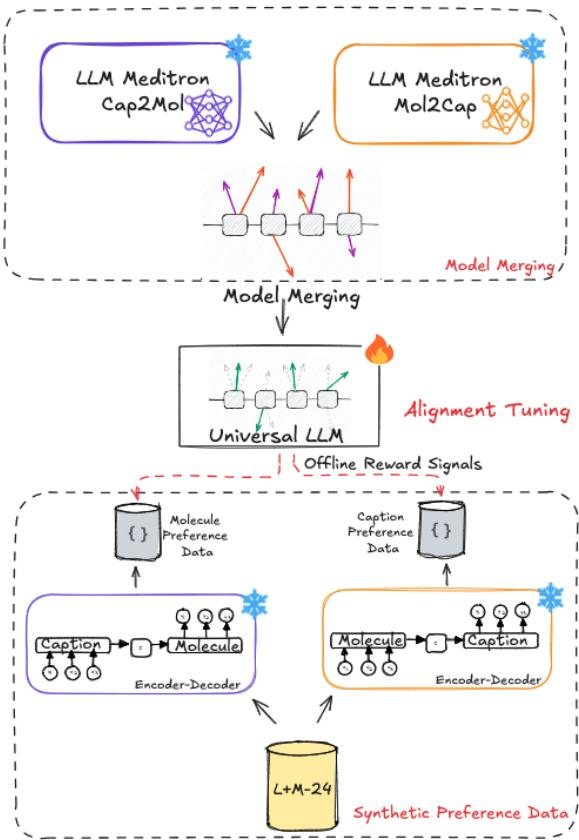  
Figure 1: Overview of our proposed post-training approach to address key limitations in chemical LLMs. Top: Merging per-task pretrained models to create a universal model (refer to 3.2.1). Bottom: Generating synthetic preference data using pretrained per-task encoder–decoders (refer to  4.1) for alignment tuning

We evaluate our models on out-of-distribution data using established statistical-based metrics (Sets, 2022; Edwards et al., 2022). Additionally, we use Natural Language Inference (NLI) models to assess generated text within the chemical domain. However, off-the-shelf NLI models are suboptimal because: a) they are trained on short texts (Williams et al., 2018), while generated outputs may mix overlapping content units (Nenkova et al., 2007); b) they struggle with unseen domains (McIntosh et al., 2024); and c) they lack subsentence inference, limiting their handling of reordered content (see Fig. 3). Thus, we propose a novel atomic-level cross-NLI approach that addresses these issues. By decomposing reference and generated texts into atomic premises and hypotheses using an LLM, we calculate probability distributions of contradiction and entailment via an NLI model and finally apply row-wise operations to obtain novel hallucination and coverage metrics ( 3.3).

Our findings and contributions are as follows:

• Extensive training doesn’t guarantee better models. Models trained on large benchmark datasets exhibit memorisation effects, with performance dropping by 50% to 100% on out-ofdistribution data ( 4.2.1).

• Alignment fine-tuning is not a panacea. Our experiments reveal that not all fine-tuning approaches applicable to heavily trained models are effective with minimal training ( 4.2.1).

• Effective alignment methods balance structured learning and generalisation. Of the alignment fine-tuning methods, only CPO managed both crossmodal agnostic and minimal training effectively ( 4.2.1).

• Model merging addresses inherent limitations in alignment fine-tuning. It improves performance with minimal training, reduces dependence on human-labelled data, and provides a scalable, cost-effective alignment method for LLMs. ( 4.2.2).

• Our novel atomic-level cross-NLI evaluation reveals intriguing insights about performance interpretability and effectively handles multiple content units in text. By contrast, widely adopted NLI methods consistently misalign with assessment criteria ( 4.2.3).

## 2 Related Work

## 2.1 LLMs for Chemistry

Existing approaches for LLMs in the chemical domain typically rely on costly pretraining with large unimodal datasets for reaction prediction and retrosynthesis (Schwaller et al., 2019; Vaucher et al., 2020), or task-specific fine-tuning for language-molecule learning (Edwards et al., 2021, 2022, 2024) and molecule editing (Liu et al., 2023a; Fang et al., 2023). Other methods focus on multitask learning, which requires resource-intensive pretraining and large multitask datasets (Lu and Zhang, 2022; Ross et al., 2022; Christofidellis et al., 2023; Zhang et al., 2024). In contrast, we investigate synergies between finetuning alignment (Gkoumas, 2024) and model merging to enhance molecule language models with minimal training.

## 2.2 Model Merging

Existing model merging techniques can be broadly categorised into weight-based, subspacebased, and routing-based approaches. Weightbased methods often use optimisation algorithms (Yang et al., 2023; Akiba et al., 2024) or geometric interpolations (Zhou et al., 2024; Goddard et al., 2024) to determine optimal task vector coefficients. Subspace-based methods involve pruning (Yadav et al., 2023; Yu et al., 2024) or masking (Wang et al., 2024) to remove insignificant parameters, reducing task interference. Routing-based methods combine models adaptively during inference based on specific input (Muqeeth et al., 2023; Tang et al., 2024). We experiment with weight- and subspace-based merging in a crossmodal context.

## 2.3 Aligning LLMs

LLM alignment methods can be divided into testtime and fine-tuning approaches. Test-time alignment techniques, such as prompt engineering and guided decoding (Khanov et al., 2024; Huang et al., 2024), adjust LLMs without changing their weights, but depend on the original model’s performance. Fine-tuning methods, like RLHF (Stiennon et al., 2020; Ouyang et al., 2022), are effective but complex, requiring model retraining and continuous sampling. DPO (Rafailov et al., 2024) simplifies RLHF by directly optimizing PPO’s objective, while CPO (Xu et al., 2024) improves efficiency by using a uniform reference model. Other methods leverage SFT for optimizing RLHF management and parameter tuning (Ethayarajh et al., 2024; Meng et al., 2024). Here, we explore alignment fine-tuning in a crossmodal setup.

## 2.4 NLI-based Evaluation

NLI models determine the relationship between a premise and a hypothesis. Existing approaches either identify a sentence in the reference text as the premise (sentence-level NLI)(Nie et al., 2019b; Laban et al., 2022), or use the entire reference as the premise (Dziri et al., 2022; Honovich et al., 2022), which can be inefficient for long texts (Schuster et al., 2022). Context-level NLI addresses this by retrieving relevant sentences to create a short context (Nie et al., 2019a; Schuster et al., 2022; Kamoi et al., 2023), but lacks sufficient granularity (Nenkova et al., 2007). We propose a novel atomic-level NLI evaluation for the chemical domain to address these limitations.

## 3 Methodology

## 3.1 Task Definition

Let $( x , y )$ represent a pair of source and target sequences mapped to the X and Y spaces, respectively. We cast molecule caption generation (MoCG) as a crossmodal alignment task that operates on offline preference data $\mathcal { D } =$ $\{ x ^ { ( i ) } , y _ { w } ^ { ( i ) } , y _ { l } ^ { ( i ) } \} _ { i = 1 } ^ { N }$ , where x is the input, and $y _ { w }$ and $y _ { l }$ are the preferred and dispreferred outputs, respectively, with N being the total number of pairs in $\mathcal { D }$ . The goal is to learn an optimal function $f : X  Y$ via a model $\pi _ { \theta }$ parameterised by θ. We coordinate the molecule and caption generation tasks via instruction modelling 1.

## 3.2 Aligned Mixed Molecule Language Models

This section elaborates on how we obtain aligned universal molecule language models.

3.2.1 Universal Models via Model Merging Let $\tau _ { 1 }$ and $\tau _ { 2 }$ represent task vectors 2 from pretrained molecule and caption generation models.

Our goal is to obtain a multitasking cross-modal model $\Theta ^ { ( m e r g e ) }$ without accessing training data by exploring weight-based and subspace-based merging techniques. Fig. 2 illustrates the process. Specifically, we experiment with model merging approaches that inherently manage conflicts and mitigate modality dominance or instability when integrating modality-specific information using off-the-shelf LLMs, ensuring that neither modality overshadows the other.

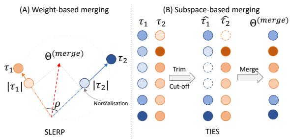  
Figure 2: Model merging techniques for obtaining universal models. (A) Weight-based merging via spherical interpolation. (B) Subspace-based merging by pruning and merging parameter magnitudes. $\tau _ { 1 }$ and $\tau _ { 2 }$ are task vectors obtained from pretrained molecule and caption generation models, respectively.

Weight-based model merging: We experiment with SLERP (Goddard et al., 2024), which applies spherical interpolation to fuse model parameters in a more nuanced approach, blending models in a way that preserves unique characteristics. The goal is to find optimal coefficients $\lambda _ { 1 }$ and $\lambda _ { 2 }$ so that the merged model Θ(merge) = $\lambda _ { 1 } \tau _ { 1 } + \lambda _ { 2 } \tau _ { 2 }$ retains the capabilities of the independent models. The coefficients are given by $\frac { \mathbf { \dot { s i n } } ( ( 1 - \lambda _ { 1 } ) { \cdot \rho } ) } { \mathbf { s i n } ( \rho ) }$ and sin(λ2·ρ) , respectively, where sin(ρ) $\begin{array} { r } { \rho = \operatorname { a r c c o s } \left( \frac { \tau _ { 1 } \cdot \tau _ { 2 } } { | \tau _ { 1 } | \cdot | \tau _ { 2 } | } \right) } \end{array}$ is the angle between the task vectors, and λ is the merging coefficient.

Subspace-based model merging: We utilise TIES (Yadav et al., 2023) to prune the task vectors $\tau _ { 1 }$ and $\tau _ { 2 }$ , retaining the top 20% parameters, resulting in refined vectors $\hat { \tau _ { 1 } }$ and τˆ2 (see Fig. 2 (B)). We then fuse the vectors via Task Arithmetic (Ilharco et al., 2022) to obtain the merged model as $\begin{array} { r } { \Theta ^ { ( m e r g e ) } = \frac { 1 } { 2 } \sum _ { i = 1 } ^ { 2 } \hat { \tau } _ { i } } \end{array}$ . During the merging process, conflicts arising from differing signs in the parameters p are resolved by aligning the pruned vectors as follows:

$$
\mathrm { A l i g n } ( \hat { \tau _ { 1 } ^ { p } } , \hat { \tau _ { 2 } ^ { p } } ) = \left\{ \begin{array} { l l } { \hat { \tau _ { 1 } ^ { p } } } & { \mathrm { i f } | \hat { \tau _ { 1 } ^ { p } } | > | \hat { \tau _ { 2 } ^ { p } } | } \\ { \hat { \tau _ { 2 } ^ { p } } } & { \mathrm { i f } | \hat { \tau _ { 2 } ^ { p } } | \ge | \hat { \tau _ { 1 } ^ { p } } | } \end{array} \right.\tag{1}
$$

## 3.2.2 Crossmodal Alignment Fine-tuning

Let $\pi _ { r e f }$ be the reference policy $( \mathrm { i . e . } ,$ the universal model from model merging), $\pi _ { \theta }$ the policy model being trained, parameterised by $\theta ,$ and $\mathcal { D } = \{ x ^ { ( i ) } , y _ { w } ^ { ( i ) } , y _ { l } ^ { ( i ) } \}$ the offline preference data. Our goal is to learn effective crossmodals for the MoCG task with minimal training via alignment fine-tuning. We experiment with different optimizations that differ substantially in how they learn a reward signal, as overviewed in Table 1.

• SFT minimises the difference between generated output z and target $y _ { w }$ by optimising model $\pi _ { \theta }$ through negative log-likelihood (Eq. 2).

• DPO (Rafailov et al., 2024) enhances crossmodal translations using an offline preference dataset . It aligns model $\pi _ { \theta }$ by maximising the likelihood of preference data, with reference model $\pi _ { \mathrm { r e f } } ,$ Sigmoid function $\sigma ,$ and hyperparameter $\beta$ (Eq. 3).

• CPO (Xu et al., 2024) reduces reliance on highquality data by avoiding suboptimal translations, but not perfect translations in ML tasks. It modifies Eq. 3 using a uniform reference model, ensuring equal likelihood for all outputs. A behaviour cloning (BC) regulariser is injected to reflect uniform output matching, with an additional SFT term in the final loss (Eq. 4).

• KTO (Ethayarajh et al., 2024) utilises nonpaired preference data $\mathcal { D } = \{ x ^ { ( i ) } , y ^ { ( i ) } , \lambda ^ { ( i ) } \}$ where λ denotes the desirability of $y .$ It directly maximizes the utility of generations instead of maximizing the log-likelihood of preferences. The loss is computed from the generated output z in relation to a reference $z _ { \mathrm { r e f } }$ and λ (Eq. 5).

## 3.3 Atomic-level Cross-NLI Evaluation

Our aim is to develop a method that operates at the right level of granularity, precisely capturing small distinctions and subtle nuances in captions, ensuring reliable evaluation. Atomic-level cross-NLI evaluation uses an LLM and an NLI model to assess relationships between generated and reference captions. The process begins with an LLM (Touvron et al., 2023) decomposing a (reference, generated) pair into atomic premises $\{ P _ { i } \} _ { i = 1 } ^ { N }$ and hypotheses $\{ H _ { j } \} _ { j = 1 } ^ { L }$ , where each atomic unit conveys a single piece of information (see Appx. E). An NLI model (He et al., 2020) then constructs probabilistic distributions of entailment and contradiction by considering all possible combinations of premises and hypotheses. Finally, pooling operators match atomic hypotheses and premises in terms of both factual correctness, i.e., hallucination, and completeness, i.e., coverage. Fig. 3 illustrates this process.

<table><tr><td>Method</td><td>Optimisation Objective</td></tr><tr><td>SFT</td><td>(2)</td></tr><tr><td>DPO</td><td> $\log \sigma \Big ( \beta \log \frac { \pi _ { \theta } ( y _ { w } | x ) } { \pi _ { \mathrm { r e f } } ( y _ { w } | x ) } - \beta \log \frac { \pi _ { \theta } ( y _ { l } | x ) } { \pi _ { \mathrm { r e f } } ( y _ { l } | x ) } \Big )$ </td></tr><tr><td>CPO</td><td></td></tr><tr><td></td><td> $\begin{array} { c } { \displaystyle \underset { \theta } { \operatorname* { m i n } } \log \sigma \Big ( \beta \log \pi _ { \theta } \big ( y _ { w } | x \big ) - \beta \log \pi _ { \theta } \big ( y _ { l } | x \big ) \Big ) - \log \pi _ { \theta } \big ( y _ { w } | x \big ) } \\ { \mathrm { s . t . } \quad \mathbb { E } _ { ( x , y _ { w } ) \sim D } \Big [ \mathbb { K L } \big ( \pi _ { w } \big ( y _ { w } | x \big ) \big | \big | \pi _ { \theta } \big ( y _ { w } | x \big ) \big ) \Big ] < \epsilon } \\ { ( 4 ) } \end{array}$ </td></tr><tr><td>KTO</td><td></td></tr><tr><td></td><td> $\begin{array} { r l r } & { } & { - \lambda _ { w } \sigma \left( \beta \log \frac { \pi _ { \theta } ( y _ { w } | x ) } { \pi _ { \mathrm { r e f } } ( y _ { w } | x ) } - z _ { r e f } \right) + \lambda _ { l } \sigma \left( z _ { r e f } - \beta \log \frac { \pi _ { \theta } ( y _ { l } | x ) } { \pi _ { \mathrm { r e f } } ( y _ { l } | x ) } \right) } \\ & { } & { \mathrm { w h e r e ~ } z _ { \mathrm { r e f } } = \mathbb { E } _ { ( x , y ) \sim \mathcal { D } } \left[ \beta \mathbb { K } \mathbb { L } ( \pi _ { \theta } ( y | x ) \| \pi _ { \mathrm { r e f } } ( y | x ) ) \right] } \\ & { } & { ( 5 ) } \end{array}$ </td></tr></table>

Table 1: Alignment fine-tuning algorithms for the MoCG task given preference data $\mathcal { D } = \{ x , y _ { w } , y _ { l } \}$

Hallucination we define here as the introduction of information not present in the reference text. Given $\{ ( P _ { i } , H _ { j } ) \}$ , the NLI model constructs a contradiction probability distribution for each atomic hypothesis against all premises, such as $p _ { j , i } = ( C _ { j , i } | P _ { i } , H _ { j } )$ . This results in an $M _ { L \times N }$ matrix of contradiction probabilities $C _ { j , i }$ (see Fig. 3). To measure hallucination, we apply min row-wise pooling and average the matching probabilities to compute the score by the formula:

$$
H a l l u c i n a t i o n = \frac { 1 } { L } \sum _ { j = 1 } ^ { L } \operatorname* { m i n } _ { i } C _ { j , i }\tag{6}
$$

Coverage we define as atomic unit recall, representing how much reference information is present in the generated text. Unlike hallucination, here generated text forms the atomic premises $( P _ { j } )$ and the reference text the hypotheses $( H _ { i } )$ . The NLI model constructs an entailment probability distribution for each $H _ { i }$ against all $P _ { j }$ , such that $p _ { i , j } = ( E _ { i , j } | P _ { j } , H _ { i } )$ , resulting in an $M _ { N \times L }$ matrix of entailment probabilities $E _ { i , j } .$ To measure coverage, we apply max row-wise pooling and average the matching probabilities to compute the score given by the formula:

$$
C o v e r a g e = \frac { 1 } { N } \sum _ { i = 1 } ^ { N } \operatorname* { m a x } _ { j } E _ { i , j }\tag{7}
$$

## 4 Experiments

## 4.1 Experimental Setup

Data: We conduct experiments training Meditron (Chen et al., 2023) on the benchmark L+M-24 (Edwards et al., 2024) dataset, using only 10% of the data for training, and evaluate on out-ofdistribution data (see Appx. D for details). For alignment fine-tuning, we create synthetic dispreferred outputs generated by MolT5 (Edwards et al., 2022). In practice, this involves feeding MolT5 with inputs from the 10% subset of L+M-24 used in our experiments, generating outputs, and then using these outputs as dispreferred samples (see Fig. 1 ). Our training, validation, and test sets contain approximately 12.7k, 3.4k, and 3k samples.

Baselines: We selected established baselines based on their relevance to our hypotheses, enabling comparison with models trained on fully (i.e., Chem-LLM (Zhang et al., 2024)) and partially (i.e., TxtChem-T5 (Christofidellis et al., 2023)) out-of-distribution data, as well as indistribution data (Meditron (Chen et al., 2023)). In this context, TxtChem-T5 and Chem-LLM are evaluated in a zero-shot setting. For more details about the baselines, please refer to Appx. G. Lastly, we fine-tune Meditron with SFT using only 10% of the training data. We leave all the implementation details in Appx. J.

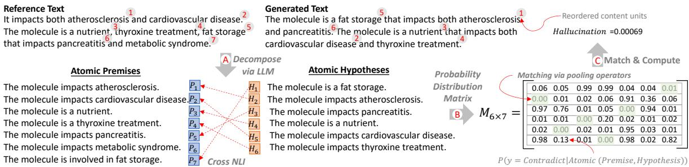  
Figure 3: The process of atomic-level cross-NLI evaluation when measuring the level of hallucination.

Evaluation: When evaluating the performance of both baselines and our models, we employ established statistical metrics (see Appendix H), in addition to our atomic-level cross-NLI evaluation method (§ 3.3). For our proposed evaluation, we assess the robustness of different NLI methods by measuring the relative entropy of textual entailment between generated outputs from high and low performance models in association with linguistic ones derived by bioinformatic databases curated by humans. Specifically, we compare our atomic-level NLI approach with leading ones, including full NLI, which treats entire premises and hypotheses as single units, and sentence-level NLI (Laban et al., 2022), i.e., which evaluates chunks in text.

## 4.2 Experimental Results

## 4.2.1 Aligning Molecule-Language Modals with Minimal Training

We first present results for molecule language models with minimal alignment fine-tuning, initialising pretrained weights from molecule generation rather than deploying model merging (see Appx. J for details). Tables 2 and 3 summarise experimental results. Generally, benchmarking models trained on extensive data with SFT exhibit memorisation effects, with performance dropping by 50% to 100% compared to reported results, when evaluated on out-of-distribution data.

Our experiments show that not all alignment optimisations are effective in the minimal training setting. Both DPO and KTO show zero performance in caption generation when models are initialised with crossmodal weights unrelated to the task (see Table 2). However, performance improves significantly when the crossmodals are known (see Table 3). In molecule generation, DPO achieves up to 42% better performance than Meditron, trained on the full dataset, while KTO still performs poorly, likely due to overfitting (see Appx. I).

By contrast, CPO effectively handles both the crossmodal agnostic and minimal training settings, outperforming Meditron by up to 20% in caption generation and 42% in molecule generation. This is likely due to its inherent ability to balance structured learning and generalisation. It aligns with preferred data through behaviour cloning and SFT, which encourage the model to mimic expert behaviour while reducing bias and suboptimal outcomes via a uniform reference model that assigns equal likelihood to all possible outputs.

## 4.2.2 Alignment with Model Merging

Tables 4 and 5 summarise the experimental results when we incorporate model merging in alignment fine-tuning while keeping the training data the same. Combining DPO with molecule and caption crossmodals via TIES improves caption generation (see $\Delta _ { D P O v s T I E S + D P O }$ in Table 4) but leads to significant performance loss in molecule generation (see $\Delta _ { D P O \mathrm { v s } T I E S + D P O }$ in Table 5). Conversely, fusing CPO with crossmodals via SLERP significantly boosts performance in cap-

provided in Appx. A.

<table><tr><td>Method</td><td>Blue-2 ↑</td><td>Blue-4↑</td><td>Rouge-1 ↑</td><td>Rouge-2 ↑</td><td>Rouge-L ↑</td><td>METEOR ↑</td></tr><tr><td>TxtChem-T5 (Christofidellis et al., 2023)</td><td>0.08</td><td>0.09</td><td>0.19</td><td>0.06</td><td>0.17</td><td>0.16</td></tr><tr><td>Chem-LLM (Zhang et al., 2024)</td><td>0.03</td><td>0.00</td><td>0.11</td><td>0.02</td><td>0.09</td><td>0.14</td></tr><tr><td>Meditron (Chen et al., 2023)</td><td>0.42</td><td>0.30</td><td>0.63</td><td>0.47</td><td>0.49</td><td>0.54</td></tr><tr><td>SFT §4.1</td><td>0.37</td><td>0.26</td><td>0.55</td><td>0.40</td><td>0.39</td><td>0.61</td></tr><tr><td>DPO (Rafailov et al., 2024)</td><td>0.00</td><td>0.00</td><td>0.00</td><td>0.00</td><td>0.00</td><td>0.00</td></tr><tr><td>CPO (Xu et al., 2024)</td><td>0.62</td><td>0.45</td><td>0.68</td><td>0.50</td><td>0.48</td><td>0.62</td></tr><tr><td>KTO (Ethayarajh et al., 2024)</td><td>0.00</td><td>0.00</td><td>0.00</td><td>0.00</td><td>0.00</td><td>0.00</td></tr><tr><td> $\Delta _ { C P O \mathrm { v s } M E D }$ </td><td>+20%</td><td>+19%</td><td>+5%</td><td>+3%</td><td>-1%</td><td>+8%</td></tr></table>

Table 2: Alignment fine-tuning results for caption generation on 3k unseen pairs. Arrows next to metrics denote value increase with performance gains. Best results are in bold. $\Delta _ { C P O \mathrm { v s } M E D }$ is the performance gain of our best model, trained on 10% of the data, compared to Meditron trained on the entire dataset.
<table><tr><td>Method</td><td>BLEU ↑</td><td>Levenshtein↓</td><td>MACCS FTS ↑</td><td>RDK FTS ↑</td><td>Morgan FTS ↑</td><td>FCD↓</td><td>Validity ↑</td></tr><tr><td>TxtChem-T5</td><td>0.18</td><td>133.29</td><td>0.21</td><td>0.10</td><td>0.03</td><td>37.67</td><td>0.58</td></tr><tr><td>Chem-LLM</td><td>0.04</td><td>732.74</td><td>0.00</td><td>0.00</td><td>0.00</td><td>59.44</td><td>0.19</td></tr><tr><td>Meditron</td><td>0.43</td><td>66.16</td><td>0.35</td><td>0.29</td><td>0.19</td><td>13.64</td><td>0.57</td></tr><tr><td>SFT</td><td>0.30</td><td>186.99</td><td>0.70</td><td>0.62</td><td>0.41</td><td>11.14</td><td>0.98</td></tr><tr><td>DPO</td><td>0.72</td><td>42.40</td><td>0.77</td><td>0.69</td><td>0.49</td><td>10.47</td><td>0.99</td></tr><tr><td>CPO</td><td>0.71</td><td>42.65</td><td>0.77</td><td>0.70</td><td>0.48</td><td>4.19</td><td>1.00</td></tr><tr><td>KTO</td><td>0.23</td><td>294.63</td><td>0.03</td><td>0.03</td><td>0.02</td><td>32.64</td><td>0.06</td></tr><tr><td> $\Delta _ { C P O \mathrm { v s } M E D }$ </td><td>+29%</td><td>-23.76%</td><td>+42%</td><td>+41%</td><td>+30%</td><td>-9.45%</td><td>+41%</td></tr></table>

Table 3: Alignment fine-tuning results for molecule generation on 3k unseen pairs. Arrows next to metrics indicate whether higher or lower values denote better performance. Best results are highlighted in bold. ∆CPOvsMED represents the performance gain of our best model compared to Meditron trained on the entire dataset.

tion generation (see $\Delta _ { C P O v s S L E R P + C P O }$ in Table 4) while having minimal impact on molecule generation (see $\Delta _ { C P O v s S L E R P + C P O }$ in Table 5), demonstrating overall gains compared to Meditron trained on the full dataset.

For our best-performing model, CPO+SLERP, we conducted ablation studies to assess the impact of weight interpolation coefficients when merging pretrained models on MoCG tasks. Specifically, we explored blending weights across all layers (0–32) to preserve Mol2Cap performance while improving Cap2Mol performance (see Appx. A for details), aiming to create a universal model with enhanced overall capability. Fig. 4 shows the performance trends across different mixing ratios of per-task model weights. Empirically, we found that a 1:18 ratio (Mol2Cap:Cap2Mol) yields the best balance, favoring Mol2Cap performance at lower ratios and Cap2Mol performance at higher ones. Further comparison with a baseline method, namely model soup (Wortsman et al., 2022), is

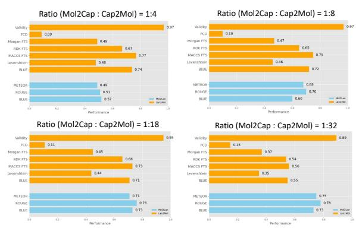  
Figure 4: Ablation of best performance model, CPO+SLERP, for Mol2Cap and Cap2Mol tasks, evaluating the effect of per-task model weight mixing ratios.

Overall, our experiments show that model merging mitigates key limitations in alignment fine-tuning. By fusing pretrained models, it boosts performance with minimal training, reduces reliance on human-labeled data, lowers costs, minimizes bias, and improves generalization. Caption and molecule generation examples are in Appx. K.

<table><tr><td>Fusion</td><td>Method</td><td>Blue-2 ↑</td><td>Blue-4↑</td><td>Rouge-1 ↑</td><td>Rouge-2 ↑</td><td>Rouge-L ↑</td><td>METEOR ↑</td></tr><tr><td rowspan="2">TIES (Yadav et al., 2023)</td><td>DPO</td><td>0.74</td><td>0.53</td><td>0.74</td><td>0.54</td><td>0.51</td><td>0.70</td></tr><tr><td>CPO</td><td>0.74</td><td>0.54</td><td>0.76</td><td>0.57</td><td>0.53</td><td>0.72</td></tr><tr><td rowspan="2">SLERP (Goddard et al., 2024)</td><td>DPO</td><td>0.00</td><td>0.00</td><td>0.02</td><td>0.01</td><td>0.00</td><td>0.00</td></tr><tr><td>CPO</td><td>0.73</td><td>0.53</td><td>0.76</td><td>0.56</td><td>0.53</td><td>0.71</td></tr><tr><td>∆DPOvsTIES+DPO</td><td></td><td>+74%</td><td>+53%</td><td>+74%</td><td>+54%</td><td>+51%</td><td>+70%</td></tr><tr><td> $\Delta _ { C P O v s S L E R P + C P O }$ </td><td></td><td>+11%</td><td>+8%</td><td>+8%</td><td>+6%</td><td>+5%</td><td>+9%</td></tr><tr><td> $\Delta _ { M E D \mathrm { v s } S L E R P + C P O }$ </td><td></td><td>+31%</td><td>+28%</td><td>+13%</td><td>+9%</td><td>+4%</td><td>+17%</td></tr></table>

Table 4: Model merging and alignment fine-tuning results for caption generation. $\begin{array} { r } { \sum _ { D P O \mathrm { v s } T I E S + D P O } , } \end{array}$ $\Delta _ { C P O v s S L E R P + C P O }$ , and $\Delta _ { M E D \mathrm { v s } S L E R P + C P O }$ measure performance gains of the best-combined approaches compared to the vanilla crossmodal setting of DPO, CPO, and the benchmark Meditron, as reported in Table 2.
<table><tr><td>Fusion</td><td>Method</td><td>BLEU↑</td><td>Levenshtein ↓</td><td>MACCS FTS ↑</td><td>RDK FTS ↑</td><td>Morgan FTS ↑</td><td>FCD↓</td><td>Validity ↑</td></tr><tr><td rowspan="3">TIES</td><td>DPO</td><td>0.32</td><td>93.18</td><td>0.31</td><td>0.22</td><td>0.19</td><td>19.80</td><td>0.42</td></tr><tr><td>CPO</td><td>0.68</td><td>46.91</td><td>0.72</td><td>0.65</td><td>0.45</td><td>24.50</td><td>0.94</td></tr><tr><td>DPO</td><td>0.72</td><td>43.85</td><td>0.77</td><td>0.70</td><td>0.51</td><td>10.35</td><td>0.98</td></tr><tr><td colspan="2">SLERP CPO</td><td>0.71</td><td>44.01</td><td>0.73</td><td>0.66</td><td>0.45</td><td>11.22</td><td>0.95</td></tr><tr><td colspan="2">∆DPOvsTIES+DPO</td><td>-40%</td><td>+51%</td><td>-46%</td><td>-47%</td><td>-30%</td><td>+7.33%</td><td>+58%</td></tr><tr><td colspan="2">∆CPOvsSLERP+CPO</td><td>0%</td><td>+1.36%</td><td>-4%</td><td>-4%</td><td>-3%</td><td>+5%</td><td>-4%</td></tr><tr><td colspan="2">∆MEDvsSLERP+CPO</td><td>+29%</td><td>-22.40%</td><td>+38%</td><td>+37%</td><td>+27%</td><td>-4.45%</td><td>+37%</td></tr></table>

Table 5: Model merging and alignment fine-tuning results for molecule generation. $\begin{array} { r } { \sum _ { D P O \mathrm { v s } T I E S + D P O } , } \end{array}$ $\Delta _ { C P O v s S L E R P + C P O }$ , and $\Delta _ { M E D \mathrm { v s } S L E R P + C P O }$ measure performance gains of the best-combined approaches from the vanilla crossmodal setting of DPO, CPO, and the benchmark Meditron, as reported in Table 2.

## 4.2.3 Atomic-level Cross-NLI Evaluation

Atomic-level NLI revealed intriguing insights regarding performance interpretation. Fig. 5 shows assessment score distributions from our proposed evaluation method, comparing our top models against Meditron trained on the entire dataset. All models exhibit low hallucination, likely due to the narrow, well-defined topics that enable factually correct captions without unrelated information. However, our models excel in coverage, generating more comprehensive captions, with performance increasing to 69% compared to Meditron’s 51% (Fig. 5 (B)). Examples of insights captured by our proposed evaluation are in Appx. L.

We also evaluated the robustness of our proposed NLI evaluation method against leading approaches by measuring the relative entropy of textual entailment between human-curated texts (i.e., gold labels) and outputs generated by our top-performing model, CPO+SLERP (preferred), versus those from a low-performing model, Meditron (dispreferred). Ideally, all NLI methods should favour preferred outputs over dispreferred ones. However, we observed that both the full and sentence-level NLI methods misclassify preferred captions as non-entailment and dispreferred captions as entailment (see Fig. 6 (B)-(D)). By contrast, atomic-level cross-NLI accurately favours preferred captions, assigning higher scores to certain cases (Fig. 6 (A)). Additionally, Kullback–Leibler divergence shows that atomic-level NLI offers better discrimination, achieving a divergence score of 0.54 compared to 0.12–0.17 for other methods, demonstrating its effectiveness in distinguishing the quality of generated captions. We leave further ablation analysis in Appx. B.

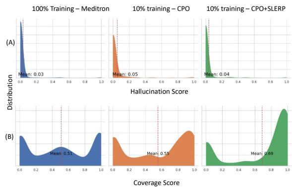  
Figure 5: Score distributions from our atomic-level cross-NLI evaluation comparing (A) hallucination and (B) coverage between our top models and Meditron.

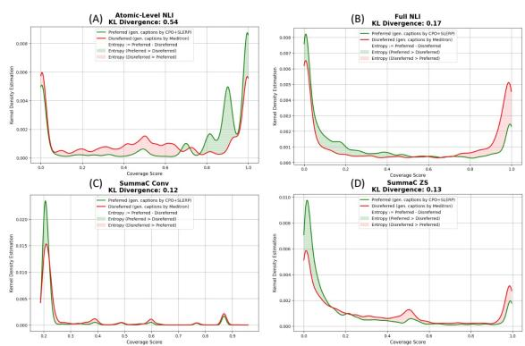  
Figure 6: Relative entropy in coverage scores for preferred vs. dispreferred generated captions across atomic-level (A), full (B), and sentence-level (C & D) NLI approaches.

We conducted ablation studies on our atomiclevel NLI evaluation method to assess its semantic robustness, particularly in handling complex, lengthy captions that may lose cohesiveness due to excessive decomposition into atomic units. To evaluate this, we analyzed the word count distribution (see Appx. B), filtered captions with at least 50 words, and recalculated relative entropy against standard NLI methods. Fig. 7 demonstrates the superior performance of our method on longer cases compared to leading alternatives. Our NLI method demonstrated a significant improvement in its ability to differentiate preferred outputs from dispreferred ones accurately, achieving a KL divergence of 2.53 (see Fig. 7), as opposed to a KL divergence of 0.54 across all cases in the test subset (see Fig. 6). In contrast, other leading NLI methods experienced a marked increase in KL divergence, favouring dispreferred outputs, which misaligned with the entailment aspect.

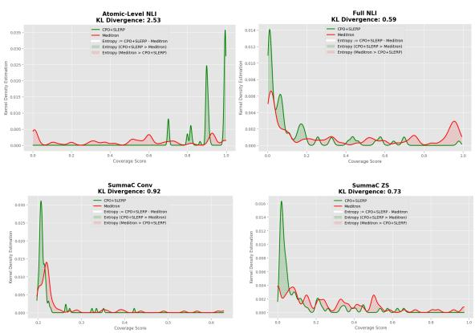  
Figure 7: Relative entropy in coverage scores for preferred vs. dispreferred generated captions across atomic-level and leading NLI approaches in long captions.

## 5 Conclusion

In this work, we address limitations of scientific language models that rely on extensive training. Focusing on molecule caption generation, we propose synergies between model merging and alignment fine-tuning with minimal post-training to enhance chemical language models. Our experiments show that while alignment fine-tuning performs poorly, incorporating model merging significantly outperforms extensively trained models on out-of-distribution data, offering a cost-effective approach that relies less on human-labelled data. Furthermore, we propose an atomic-level cross-NLI evaluation to overcome limitations of widely used NLI evaluation methods, which lack appropriate granularity. Our method provides valuable insight into performance interpretability and effectively handles multiple content units, where existing NLI methods consistently misalign with assessment criteria.

## Limitations

In this work, we employ weight-based and subspace-based merging methods to create universal models for the MoCG task, facilitating alignment fine-tuning in a training setting with minimal data. However, both are static merging methods. This means the merged model remains the same for all samples or tasks. Given that there are differences between input samples/tasks, the models’ ability may vary when processing different samples/tasks. In the future, we aim to investigate dynamically merging models (or subsets of layers) based on the samples/tasks during the inference phase (Kang et al., 2024; Yang et al., 2024).

We also propose an atomic-level NLI evaluation method that successfully handles multiple content units, offering valuable insights into performance interpretability for caption generation, where widely adopted NLI methods consistently misalign with assessment criteria. However, decomposing text into atomic units can be challenging for other tasks involving complex or lengthy text. While this method captures nuanced content, there is a risk of over-fragmentation, which may lead to a loss of context or coherence in evaluation. Additionally, the effectiveness of this approach relies heavily on the LLM for decomposition and the NLI model for entailment and contradiction assessment. The evaluation could yield inaccurate or biased results if either model struggles with domain-specific content (e.g., highly technical language). Furthermore, if generated texts introduce valid but creative or non-standard content, this approach may penalise them by classifying such deviations as contradictions or hallucinations, even when they provide accurate information. Future work will need to address these limitations across various domains.

Finally, the proposed methods in this work are tailored specifically for the chemical domain, focusing on tasks like molecule caption generation. While these techniques—such as model merging and alignment fine-tuning—show promising results within this context, their ability to generalise to other domains or scientific fields is uncertain. Different domains may have distinct data structures, tasks, and requirements, which might not align well with the crossmodal setup used here. For instance, a method optimised for chemical language and molecular structures may not work as effectively in domains like physics or biology, where the types of entities and relationships differ significantly. This potential lack of generalisation highlights the need for future research to explore the applicability of the proposed approaches in diverse scientific domains beyond chemistry, aiming to adapt and validate the methods for varying data structures and task requirements.

## Ethical Considerations

The potential for generating misleading or incorrect information poses significant ethical considerations in this work, particularly given the scientific context in which the language models are applied. If the models produce inaccurate captions or misrepresent molecular characteristics, it could lead to erroneous conclusions in research and applications that rely on these outputs. This risk is particularly critical in fields like chemistry, where precise data interpretation is vital for safety, compliance, and advancing scientific knowledge. Furthermore, the reliance on automated evaluations may not adequately catch nuanced errors that human experts would recognise, potentially allowing flawed outputs to go unchecked. Therefore, ensuring that the models maintain a high standard of accuracy and reliability is essential to prevent the dissemination of misinformation, which could undermine trust in automated systems and hinder scientific progress. Addressing these ethical concerns requires implementing robust validation mechanisms and continuously involving domain experts in the evaluation process to ensure the integrity of the generated content.

## Acknowledgements

This work was supported by a UKRI/EPSRC Turing AI Fellowship to Maria Liakata (grant ref EP/V030302/1) and the Alan Turing Institute (grant ref EP/N510129/1). This work was supported by the Engineering and Physical Sciences Research Council [grant number EP/Y009800/1], through funding from Responsible Ai UK (KP0016) as a Keystone project lead by Maria Liakata.

## References

Microsoft Research AI4Science and Microsoft Azure Quantum. 2023. The impact of large language models on scientific discovery: a preliminary study using gpt-4. arXiv preprint arXiv:2311.07361.

Takuya Akiba, Makoto Shing, Yujin Tang, Qi Sun, and David Ha. 2024. Evolutionary optimization of model merging recipes. arXiv preprint arXiv:2403.13187.

Amanda Askell, Yuntao Bai, Anna Chen, Dawn Drain, Deep Ganguli, Tom Henighan, Andy Jones, Nicholas Joseph, Ben Mann, Nova DasSarma, et al. 2021. A general language assistant as a laboratory for alignment. arXiv preprint arXiv:2112.00861.

Ralph Allan Bradley and Milton E Terry. 1952. Rank analysis of incomplete block designs: I. the method of paired comparisons. Biometrika, 39(3/4):324– 345.

Zeming Chen, Alejandro Hernández Cano, Angelika Romanou, Antoine Bonnet, Kyle Matoba, Francesco Salvi, Matteo Pagliardini, Simin Fan, Andreas Köpf, Amirkeivan Mohtashami, et al. 2023. Meditron-70b: Scaling medical pretraining for large language models. arXiv preprint arXiv:2311.16079.

Dimitrios Christofidellis, Giorgio Giannone, Jannis Born, Ole Winther, Teodoro Laino, and Matteo Manica. 2023. Unifying molecular and textual representations via multi-task language modelling. In International Conference on Machine Learning, pages 6140–6157. PMLR.

Tim Dettmers, Artidoro Pagnoni, Ari Holtzman, and Luke Zettlemoyer. 2024. Qlora: Efficient finetuning of quantized llms. Advances in Neural Information Processing Systems, 36.

Nouha Dziri, Hannah Rashkin, Tal Linzen, and David Reitter. 2022. Evaluating attribution in dialogue systems: The begin benchmark. Transactions of the Association for Computational Linguistics, 10:1066–1083.

Carl Edwards, Tuan Lai, Kevin Ros, Garrett Honke, Kyunghyun Cho, and Heng Ji. 2022. Translation between molecules and natural language. In Proceedings ofthe 2022 Conference on Empirical Methods in Natural Language Processing, pages 375–413.

Carl Edwards, Qingyun Wang, Lawrence Zhao, and Heng Ji. 2024. L+ m-24: Building a dataset for language+ molecules@ acl 2024. CoRR.

Carl Edwards, ChengXiang Zhai, and Heng Ji. 2021. Text2mol: Cross-modal molecule retrieval with natural language queries. In Proceedings of the 2021 Conference on Empirical Methods in Natural Language Processing, pages 595–607.

Kawin Ethayarajh, Winnie Xu, Niklas Muennighoff, Dan Jurafsky, and Douwe Kiela. 2024. Kto: Model alignment as prospect theoretic optimization. arXiv preprint arXiv:2402.01306.

Yin Fang, Ningyu Zhang, Zhuo Chen, Lingbing Guo, Xiaohui Fan, and Huajun Chen. 2023. Domainagnostic molecular generation with self-feedback. arXiv preprint arXiv:2301.11259.

Fleur M Ferguson and Nathanael S Gray. 2018. Kinase inhibitors: the road ahead. Nature reviews Drug discovery, 17(5):353–377.

Dimitris Gkoumas. 2024. Almol: Aligned languagemolecule translation llms through offline preference contrastive optimisation. In The 1st Workshop on Language+ Molecules, page 22.

Charles Goddard, Shamane Siriwardhana, Malikeh Ehghaghi, Luke Meyers, Vlad Karpukhin, Brian Benedict, Mark McQuade, and Jacob Solawetz. 2024. Arcee’s mergekit: A toolkit for merging large language models. arXiv preprint arXiv:2403.13257.

Pengcheng He, Xiaodong Liu, Jianfeng Gao, and Weizhu Chen. 2020. Deberta: Decoding-enhanced bert with disentangled attention. arXiv preprint arXiv:2006.03654.

Or Honovich, Roee Aharoni, Jonathan Herzig, Hagai Taitelbaum, Doron Kukliansy, Vered Cohen, Thomas Scialom, Idan Szpektor, Avinatan Hassidim, and Yossi Matias. 2022. True: Re-evaluating factual consistency evaluation. arXiv preprint arXiv:2204.04991.

James Y Huang, Sailik Sengupta, Daniele Bonadiman, Yi-an Lai, Arshit Gupta, Nikolaos Pappas, Saab Mansour, Katrin Kirchoff, and Dan Roth. 2024. Deal: Decoding-time alignment for large language models. arXiv preprint arXiv:2402.06147.

Gabriel Ilharco, Marco Tulio Ribeiro, Mitchell Wortsman, Suchin Gururangan, Ludwig Schmidt, Hannaneh Hajishirzi, and Ali Farhadi. 2022. Editing models with task arithmetic. arXiv preprint arXiv:2212.04089.

Ryo Kamoi, Tanya Goyal, Juan Diego Rodriguez, and Greg Durrett. 2023. Wice: Real-world entailment for claims in wikipedia. arXiv preprint arXiv:2303.01432.

Junmo Kang, Leonid Karlinsky, Hongyin Luo, Zhen Wang, Jacob Hansen, James Glass, David Cox, Rameswar Panda, Rogerio Feris, and Alan Ritter. 2024. Self-moe: Towards compositional large language models with self-specialized experts. arXiv preprint arXiv:2406.12034.

Maxim Khanov, Jirayu Burapacheep, and Yixuan Li. 2024. Args: Alignment as reward-guided search. arXiv preprint arXiv:2402.01694.

Bernard Kippelen and Jean-Luc Brédas. 2009. Organic photovoltaics. Energy & Environmental Science, 2(3):251–261.

Philippe Laban, Tobias Schnabel, Paul N Bennett, and Marti A Hearst. 2022. Summac: Re-visiting nlibased models for inconsistency detection in summarization. Transactions of the Association for Computational Linguistics, 10:163–177.

Shengchao Liu, Weili Nie, Chengpeng Wang, Jiarui Lu, Zhuoran Qiao, Ling Liu, Jian Tang, Chaowei Xiao, and Animashree Anandkumar. 2023a. Multimodal molecule structure–text model for text-based retrieval and editing. Nature Machine Intelligence, 5(12):1447–1457.

Zequn Liu, Wei Zhang, Yingce Xia, Lijun Wu, Shufang Xie, Tao Qin, Ming Zhang, and Tie-Yan Liu. 2023b. Molxpt: Wrapping molecules with text for generative pre-training. arXiv preprint arXiv:2305.10688.

Jieyu Lu and Yingkai Zhang. 2022. Unified deep learning model for multitask reaction predictions with explanation. Journal ofchemical information and modeling, 62(6):1376–1387.

Yizhen Luo, Kai Yang, Massimo Hong, Xingyi Liu, and Zaiqing Nie. 2023. Molfm: A multimodal molecular foundation model. arXiv preprint arXiv:2307.09484.

Timothy R McIntosh, Teo Susnjak, Tong Liu, Paul Watters, and Malka N Halgamuge. 2024. Inadequacies of large language model benchmarks in the era of generative artificial intelligence. arXiv preprint arXiv:2402.09880.

Yu Meng, Mengzhou Xia, and Danqi Chen. 2024. Simpo: Simple preference optimization with a reference-free reward. arXiv preprint arXiv:2405.14734.

Mohammed Muqeeth, Haokun Liu, and Colin Raffel. 2023. Soft merging of experts with adaptive routing. arXiv preprint arXiv:2306.03745.

Ani Nenkova, Rebecca Passonneau, and Kathleen McKeown. 2007. The pyramid method: Incorporating human content selection variation in summarization evaluation. ACM Transactions on Speech and Language Processing (TSLP), 4(2):4–es.

Yixin Nie, Haonan Chen, and Mohit Bansal. 2019a. Combining fact extraction and verification with neural semantic matching networks. In Proceedings of the AAAI conference on artificial intelligence, volume 33, pages 6859–6866.

Yixin Nie, Adina Williams, Emily Dinan, Mohit Bansal, Jason Weston, and Douwe Kiela. 2019b. Adversarial nli: A new benchmark for natural language understanding. arXiv preprint arXiv:1910.14599.

Long Ouyang, Jeffrey Wu, Xu Jiang, Diogo Almeida, Carroll Wainwright, Pamela Mishkin, Chong Zhang, Sandhini Agarwal, Katarina Slama, Alex Ray, et al. 2022. Training language models to follow instructions with human feedback. Advances in neural information processing systems, 35:27730– 27744.

Alec Radford, Jeffrey Wu, Rewon Child, David Luan, Dario Amodei, Ilya Sutskever, et al. 2019. Language models are unsupervised multitask learners.

Rafael Rafailov, Archit Sharma, Eric Mitchell, Christopher D Manning, Stefano Ermon, and Chelsea Finn. 2024. Direct preference optimization: Your language model is secretly a reward model. Advances in Neural Information Processing Systems, 36.

Jerret Ross, Brian Belgodere, Vijil Chenthamarakshan, Inkit Padhi, Youssef Mroueh, and Payel Das. 2022. Large-scale chemical language representations capture molecular structure and properties. Nature Machine Intelligence, 4(12):1256–1264.

John Schulman, Filip Wolski, Prafulla Dhariwal, Alec Radford, and Oleg Klimov. 2017. Proximal policy optimization algorithms. arXiv preprint arXiv:1707.06347.

Tal Schuster, Sihao Chen, Senaka Buthpitiya, Alex Fabrikant, and Donald Metzler. 2022. Stretching sentence-pair nli models to reason over long documents and clusters. arXiv preprint arXiv:2204.07447.

Philippe Schwaller, Teodoro Laino, Théophile Gaudin, Peter Bolgar, Christopher A Hunter, Costas Bekas, and Alpha A Lee. 2019. Molecular transformer: a model for uncertainty-calibrated chemical reaction prediction. ACS central science, 5(9):1572–1583.

Molecular Sets. 2022. A benchmarking platform for molecular generation models.

Nisan Stiennon, Long Ouyang, Jeffrey Wu, Daniel Ziegler, Ryan Lowe, Chelsea Voss, Alec Radford, Dario Amodei, and Paul F Christiano. 2020. Learning to summarize with human feedback. Advances

in Neural Information Processing Systems, 33:3008– 3021.

Anke Tang, Li Shen, Yong Luo, Nan Yin, Lefei Zhang, and Dacheng Tao. 2024. Merging multitask models via weight-ensembling mixture of experts. arXiv preprint arXiv:2402.00433.

Kushal Tirumala, Aram Markosyan, Luke Zettlemoyer, and Armen Aghajanyan. 2022. Memorization without overfitting: Analyzing the training dynamics of large language models. Advances in Neural Information Processing Systems, 35:38274– 38290.

Hugo Touvron, Louis Martin, Kevin Stone, Peter Albert, Amjad Almahairi, Yasmine Babaei, Nikolay Bashlykov, Soumya Batra, Prajjwal Bhargava, Shruti Bhosale, et al. 2023. Llama 2: Open foundation and fine-tuned chat models. arXiv preprint arXiv:2307.09288.

Amos Tversky and Daniel Kahneman. 1992. Advances in prospect theory: Cumulative representation of uncertainty. Journal ofRisk and uncertainty, 5:297–323.

Alain C Vaucher, Federico Zipoli, Joppe Geluykens, Vishnu H Nair, Philippe Schwaller, and Teodoro Laino. 2020. Automated extraction of chemical synthesis actions from experimental procedures. Nature communications, 11(1):3601.

Ke Wang, Nikolaos Dimitriadis, Guillermo Ortiz-Jimenez, François Fleuret, and Pascal Frossard. 2024. Localizing task information for improved model merging and compression. arXiv preprint arXiv:2405.07813.

Adina Williams, Nikita Nangia, and Samuel Bowman. 2018. A broad-coverage challenge corpus for sentence understanding through inference. In Proceedings of the 2018 Conference of the North American Chapter of the Association for Computational Linguistics: Human Language Technologies, Volume 1 (Long Papers), pages 1112–1122.

Mitchell Wortsman, Gabriel Ilharco, Samir Ya Gadre, Rebecca Roelofs, Raphael Gontijo-Lopes, Ari S Morcos, Hongseok Namkoong, Ali Farhadi, Yair Carmon, Simon Kornblith, et al. 2022. Model soups: averaging weights of multiple fine-tuned models improves accuracy without increasing inference time. In International conference on machine learning, pages 23965–23998. PMLR.

Haoran Xu, Young Jin Kim, Amr Sharaf, and Hany Hassan Awadalla. 2023. A paradigm shift

in machine translation: Boosting translation performance of large language models. arXiv preprint arXiv:2309.11674.

Haoran Xu, Amr Sharaf, Yunmo Chen, Weiting Tan, Lingfeng Shen, Benjamin Van Durme, Kenton Murray, and Young Jin Kim. 2024. Contrastive preference optimization: Pushing the boundaries of llm performance in machine translation. arXiv preprint arXiv:2401.08417.

Prateek Yadav, Derek Tam, Leshem Choshen, Colin Raffel, and Mohit Bansal. 2023. Resolving interference when merging models. arXiv preprint arXiv:2306.01708, 1.

Enneng Yang, Li Shen, Guibing Guo, Xingwei Wang, Xiaochun Cao, Jie Zhang, and Dacheng Tao. 2024. Model merging in llms, mllms, and beyond: Methods, theories, applications and opportunities. arXiv preprint arXiv:2408.07666.

Enneng Yang, Zhenyi Wang, Li Shen, Shiwei Liu, Guibing Guo, Xingwei Wang, and Dacheng Tao. 2023. Adamerging: Adaptive model merging for multi-task learning. arXiv preprint arXiv:2310.02575.

Le Yu, Bowen Yu, Haiyang Yu, Fei Huang, and Yongbin Li. 2024. Language models are super mario: Absorbing abilities from homologous models as a free lunch. In Forty-first International Conference on Machine Learning.

Di Zhang, Wei Liu, Qian Tan, Jingdan Chen, Hang Yan, Yuliang Yan, Jiatong Li, Weiran Huang, Xiangyu Yue, Dongzhan Zhou, et al. 2024. Chemllm: A chemical large language model. arXiv preprint arXiv:2402.06852.

X Zhang, L Wang, J Helwig, Y Luo, C Fu, Y Xie, M Liu, Y Lin, Z Xu, K Yan, et al. 2023. Artificial intelligence for science in quantum, atomistic, and continuum systems. arxiv 2023. arXiv preprint arXiv:2307.08423.

Chen Zheng, Ke Sun, Hang Wu, Chenguang Xi, and Xun Zhou. 2024. Balancing enhancement, harmlessness, and general capabilities: Enhancing conversational llms with direct rlhf. arXiv preprint arXiv:2403.02513.

Ming Zhong, Siru Ouyang, Yizhu Jiao, Priyanka Kargupta, Leo Luo, Yanzhen Shen, Bobby Zhou, Xianrui Zhong, Xuan Liu, Hongxiang Li, et al. 2023. Reaction miner: An integrated system for chemical reaction extraction from textual data. In Proceedings of the 2023 Conference on Empirical Methods in Natural Language Processing: System Demonstrations, pages 389–402.

Yuyan Zhou, Liang Song, Bingning Wang, and Weipeng Chen. 2024. Metagpt: Merging large language models using model exclusive task arithmetic. arXiv preprint arXiv:2406.11385.

## A Complementary Experiments in Model Merging

We compared SLERP and TIER model merging techniques against a weighted linear combination of parameters, referred to as model soup (Wortsman et al., 2022), when applying CPO in the MoCG task. Our results indicated that model soup caused a significant drop in performance for both Mol2Cap and Cap2Mol tasks (see Fig. 8). We hypothesise that this is because model soup assumes that performance improvement or preservation is linearly related to weight blending, which may not hold for complex models. This observation justifies our decision to explore task-specific arithmetic and geometric merging approaches, as they inherently manage conflicts and better preserve the strengths of each model in specialised tasks.

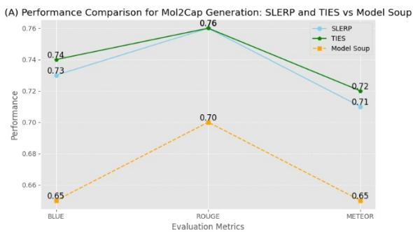

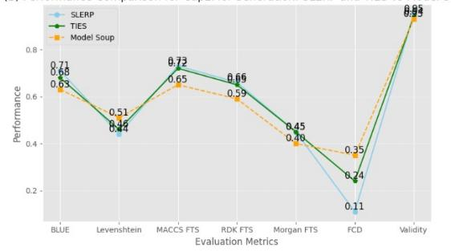  
Figure 8: Comparison of SLERP and TIES with Model Soup for (A) Mol2Cap and (B) Cap2Mol generation.

## B Complementary Experiments in Our Atomic-Level NLI Evaluation Method

First, we analysed the distribution of word counts in captions from the test subset. We observed that the captions are typically short, with an average of 31 words (STD = 50) as shown in Fig.9.

Additionally, the captions generally exhibit little dependency across sentences, as they consist of simple natural language describing chemical properties (for a more detailed view, see Table 6).

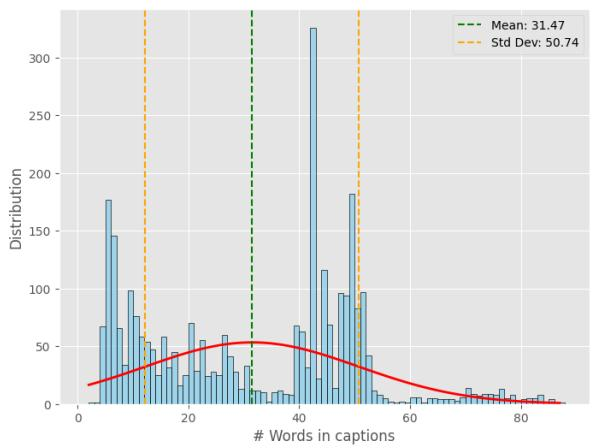  
Figure 9: Distribution of word counts in captions from the test subset.

Based on the word count distribution analysis, we filtered captions with at least 70 words and recalculated the relative entropy against standard NLI methods. As shown in Fig. 10, our method demonstrates superior performance on extremely long cases compared to leading alternatives. Notably, the performance trend is consistent with that observed for generally lengthy captions (at least 50 words, see 4.2.3).

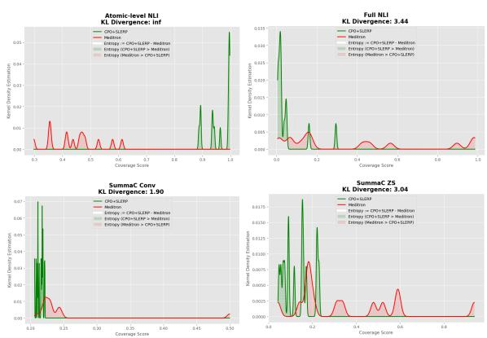  
Figure 10: Relative entropy in coverage scores for preferred vs. dispreferred generated captions across atomic-level and leading NLI approaches in extreme captions.

## C Foundations in Alignment with RLHF

Feedback-aligned LLMs traditionally undergo fine-tuning with RLHF, where human preferences serve as a reward signal in optimisation (Stiennon et al., 2020; Ouyang et al., 2022). To train a LLM with RLHF, a reinforcement learning optimisation algorithm such as PPO (Schulman et al., 2017) is typically deployed on offline preference data, commonly involving three steps:

• Model Training: Typically, a model $\pi$ is trained for auto-regressive language generation on a large generic corpus. This training operates under the premise that the probability distribution of a sequence of words can be broken down into the product of conditional distributions for the next word (Radford et al., 2019).

• Reward Model Training: A reference model $\pi _ { \mathrm { r e f } }$ is employed to optimise π for a downstream task. Typically, the $\pi _ { \mathrm { r e f } }$ model undergoes finetuning with an auto-regressive objective, using data pertinent to the downstream task. This often involves instruction tuning $\pi _ { \mathrm { r e f } }$ to regulate the generated outputs.

• Reinforcement Learning: The optimisation of $\pi$ with respect to $\pi _ { \mathrm { r e f } }$ operates on a triple dataset $\mathcal { D } = \{ x , y _ { w } , y _ { l } \}$ , where x represents the input, and $y _ { w }$ and $y _ { l }$ denote preferred and dispreferred outputs, respectively, such that $y _ { w } \succ$ $y _ { l }$ for x. In the Bradley–Terry model (Bradley and Terry, 1952), the probability of $y _ { w }$ being preferred over $y _ { l }$ in pairwise comparisons can be formulated as follows:

$$
p ^ { * } ( y _ { w } \succ y _ { l } | x ) = \sigma ( r ^ { * } ( x , y _ { w } ) - r ^ { * } ( x , y _ { l } ) )\tag{8}
$$

Here, $\sigma$ represents the logistic function, and $r ^ { * }$ denotes the “true” reward function that underlies the preferences. As obtaining the true reward directly from a human would be prohibitively expensive, a reward model $r _ { \phi }$ is trained to act as a surrogate. This is achieved by minimising the negative log-likelihood in human preference data;

$$
\begin{array} { r } { \mathcal { L } ( r _ { \phi } ) = - \mathbb { E } _ { ( x , y _ { w } , y _ { l } ) \sim \mathcal { D } } [ \log \sigma ( r _ { \phi } ( x , y _ { w } ) } \\ { - r _ { \phi } ( x , y _ { l } ) ) ] \qquad } \end{array}\tag{9}
$$

Additionally, the Kullback-Leibler (KL) divergence between the outputs generated by $\pi _ { \mathrm { r e f } }$ and the parameterised $\pi _ { \theta }$ models serves as an additional reward signal, ensuring that the generated responses closely align with the reference model. Consequently, an optimal model $\pi _ { \theta }$ is one that maximises;

$$
\begin{array} { r l } & { \mathbb { E } _ { ( x \in \mathcal { D } , y \in \pi _ { \theta } ) } [ r _ { \phi } ( x , y ) ] - \beta \mathcal { D } _ { \mathrm { K L } } ( \pi _ { \theta } ( y \mid x ) } \\ & { ~ \lvert | \pi _ { \mathrm { r e f } } ( y \mid x ) ) } \end{array}\tag{10}
$$

where $\beta$ is parameter typically $\in [ 0 . 1 , 0 . 5 ]$

## Human-aware Loss Functions (HALOs):

Definition 1 (HALOs) Let $x \in X$ and $y \in Y$ denote an input and output respectively. An f : $( x , y ) \to \mathbb { R }$ is considered a human-aware loss function if it satisfies

$$
\begin{array} { r l } & { f ( x , y ; \theta ) = t \Bigl ( v _ { f } ( r _ { \theta } ( x , y ) } \\ & { ~ - ~ \mathbb { E } _ { x ^ { \prime } \sim Q ^ { \prime } , y ^ { \prime } \sim Q ^ { \prime } } [ r _ { \theta } ( x ^ { \prime } , y ^ { \prime } ) ] ) \Bigr ) } \end{array}\tag{11}
$$

with a parameterised reward function $r _ { \theta }$ such that $\forall ( x _ { 1 } , y _ { 1 } ) , ( x _ { 2 } , y _ { 2 } ) \in X \times Y , r _ { \theta } ( x _ { 1 } , y _ { 1 } ) >$ $r _ { \theta } ( x _ { 2 } , y _ { 2 } ) \ \Leftrightarrow \ ( x _ { 1 } , y _ { 1 } ) \ \succ _ { r _ { \theta } } \ ( x _ { 2 } , y _ { 2 } ) ,$ , reference point distributions $Q _ { x } ( X ^ { \prime } )$ and $Q _ { y } ( Y ^ { \prime } | X ^ { \prime } )$ , a valuefunction $v _ { f } : \mathbb { R } \to [$ R that is monotonic nondecreasing and concave in $( 0 , \infty )$ , and a negative affine function t.

RLHF can present challenges due to inherent slowness and instability, especially in the case of highly varied outputs (Zheng et al., 2024). Recently, there has been a shift towards using closed-form losses in RLHF to align LLMs with human preferences. These losses are predominantly HALOs that model human biases, as discussed in (Tversky and Kahneman, 1992), aiming to maximise the margin between preferred and dispreferred generated outputs. This approach offers a mathematical equivalence with RLHF, while effectively addressing inherent limitations.

## D Data

Experiments are conducted on the benchmark $L + M \mathrm { - } 2 4 .$ which integrates molecular and linguistic modalities in four key categories: biomedical; light and electricity; human interaction and organoleptics; and agriculture and industry (Edwards et al., 2024). The dataset was created by extracting SMILES (Simplified Molecular-Input Line-Entry System) strings and their chemical properties from databases. The properties were transformed into natural language using GPT-4 templates. The training and validation subsets contain around 127k and 34k language-molecule pairs, with only 10% used for our experiments.

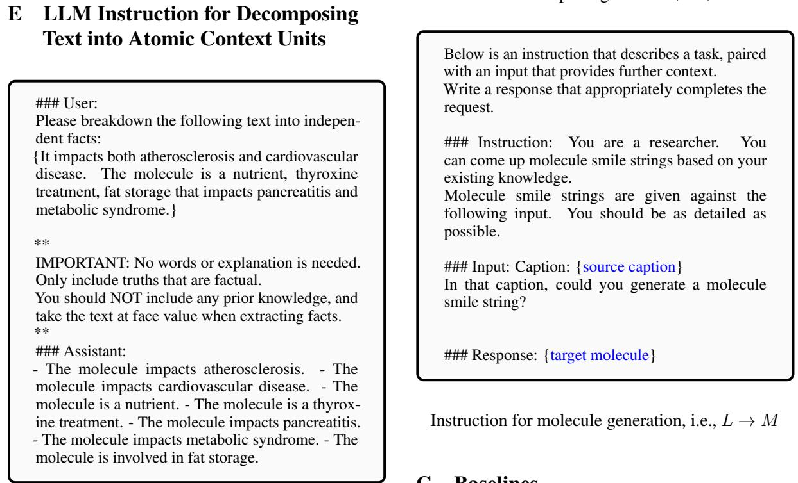  
Figure 11: Instruction for decomposing text into atomic content units conveying one piece of information.

For evaluation, we randomly selected 3k unseen pairs from a separate dataset provided by the L+M-24 research group. The samples were drawn from 635k molecule-caption pairs included in the supplementary data for the Language + Molecules @ ACL2024 workshop 3.

## F Instructions for Molecule Language Translation

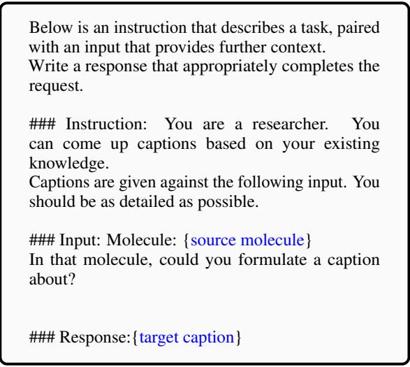

## G Baselines

• TxtChem-T5 (Christofidellis et al., 2023) is a $\mathrm { T } 5 _ { X L }$ multitask model trained on linguistic and molecule modalities across multiple datasets, including CheBI-20, akin to L+M-24.

• Chem-LLM (Zhang et al., 2024), an InternLM2- Base-7B model, is trained on large chemical knowledge databases using DPO, achieving GPT-4-level results.

• Meditron (Chen et al., 2023), a 7B model, is fine-tuned on the entire L+M-24 dataset.

## H Evaluation Metrics

For performance evaluation, we employ established metrics from the literature (Sets, 2022; Edwards et al., 2022). In translation from molecule to language, we assess using BLEU-2, BLEU-4, ROUGE-1, ROUGE-2, ROUGE-L, and ME-TEOR metrics. For translation from molecule to language, evaluation metrics include BLEU, Levenshtein distance, fingerprint metrics (MACCS, RDK, and Morgan), Fréchet ChemNet Distance (FCD), and molecule validity metrics. The annotations in the result tables indicate whether higher or lower values indicate superior performance.

## I Training Efficiency

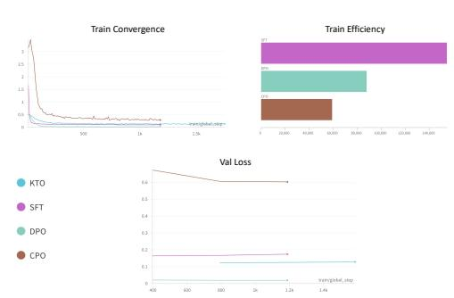  
Figure 12: Training efficiency across alignment finetuning methods

## J Implementation Details

All implementations used Meditron (Chen et al., 2023) as the backbone model, known for its performance on L+M-24. For alignment fine-tuning experiments, we initialised Meditron crossmodals, trained for molecule generation 4. For the model merging experiments, we combined Meditron weights trained on MoCG tasks in a 1:18 ratio. This ratio aimed to preserve the balance of information between the linguistic and molecule modalities. All models were fine-tuned using QLoRA (Dettmers et al., 2024).

For the atomic-level NLI evaluation method, we instruct Meta-Llama-3-8B (Touvron et al.,

2023) to break down (reference, generated) pairs into a series of atomic premises and hypotheses. We then use DeBERTa 5 to measure hallucination and coverage by performing NLI across all the atomic premises and hypotheses.

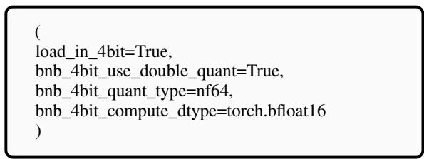  
Figure 13: Quantisation Configurations

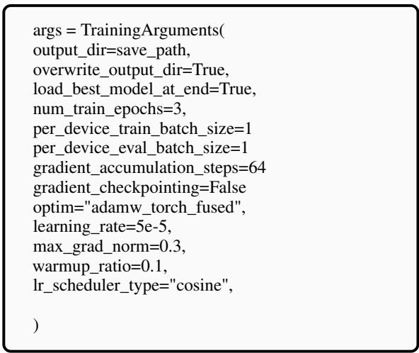  
Figure 14: Training configurations

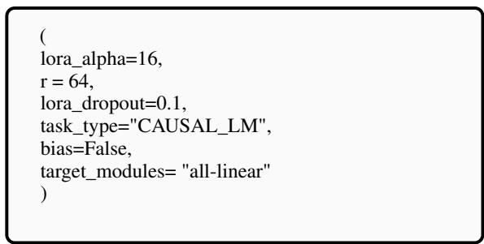  
Figure 15: LoRA Configurations

## K Examples of generated molecules and captions.

Fig. 16 and 17 illustrate examples of molecules and captions generated by our top-performing models compared to Meditron, respectively.

## L Examples of Atomic-level Cross-NLI evaluation

Table 6 presents examples of assessing hallucination and coverage in generated captions using our atomic-level cross-NLI evaluation method.

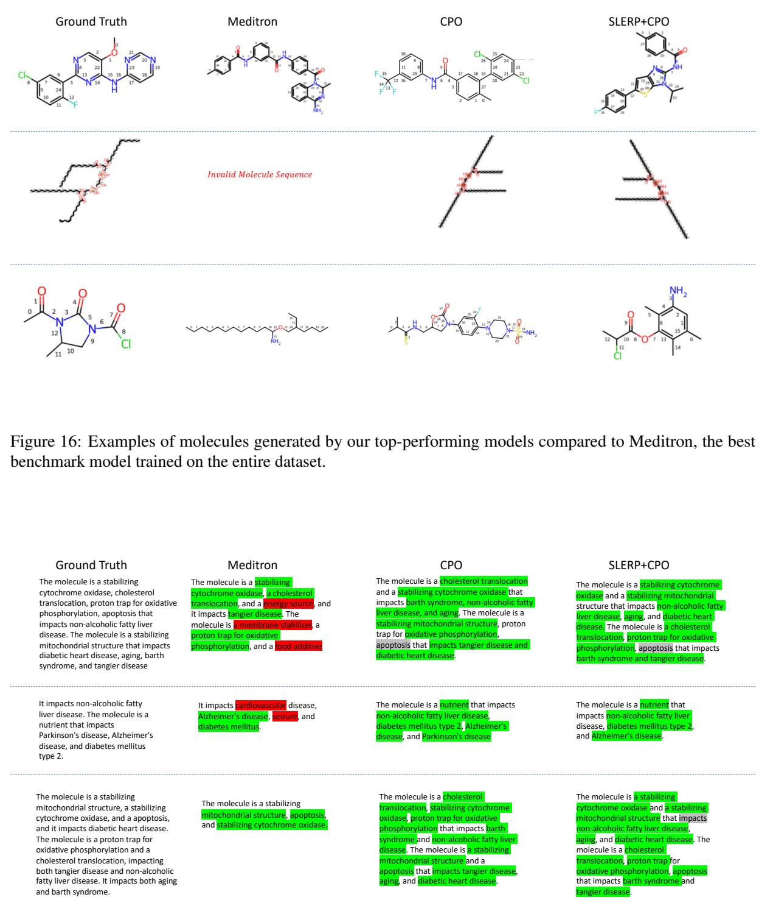  
Figure 17: Examples of captions generated by our top-performing models compared to Meditron, the best benchmark model trained on the entire dataset.

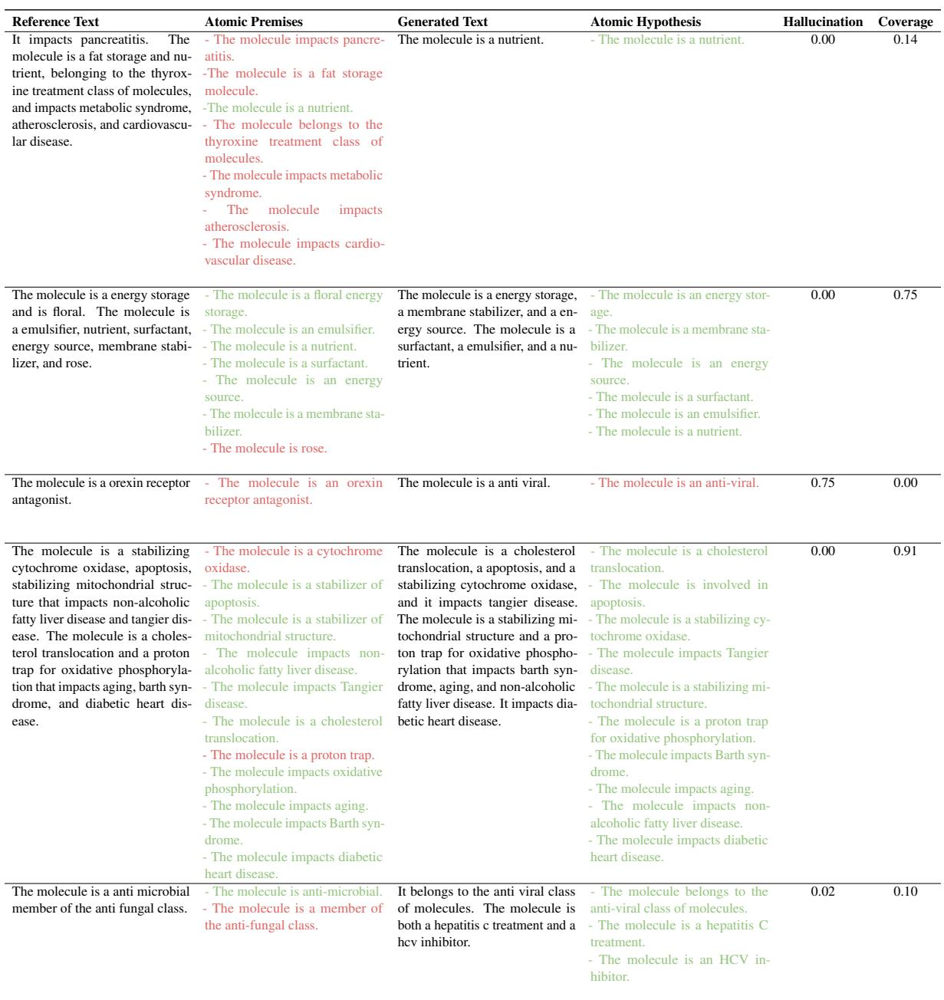  
Table 6: Cases showcasing insights captured by our atomic-level cross-NLI in assessing the level of hallucination and coverage in generated captions. Red highlights indicate missing information in atomic premises or invalid information in atomic hypotheses. Hallucination refers to the introduction of information absent from the reference, while coverage assesses the recall of atomic units (refer to 3.3).