# LongDocURL: a Comprehensive Multimodal Long Document Benchmark Integrating Understanding, Reasoning, and Locating

Chao Deng<sup>1,2,3</sup>\*<sup>†</sup>, Jiale Yuan<sup>4</sup>\*, Pi Bu<sup>4</sup>, Peijie Wang<sup>1,2</sup>, Zhong-Zhi Li<sup>1,2</sup>, Jian Xu<sup>1,2</sup>, Xiao-Hui Li<sup>1,2</sup>, Yuan Gao<sup>4</sup>, Jun Song<sup>4‡</sup>, Bo Zheng<sup>4</sup>, Cheng-Lin Liu<sup>1,2,3‡</sup> MAIS, Institute of Automation, Chinese Academy of Sciences<sup>1</sup> School of Artificial Intelligence, University of Chinese Academy of Sciences<sup>2</sup> Zhongguancun Academy, Beijing<sup>3</sup> Taobao & Tmall Group of Alibaba<sup>4</sup> dengchao2023@ia.ac.cn, liucl@nlpr.ia.ac.cn {yuanjiale.yjl, bupi.wj, jsong.sj}@alibaba-inc.com

## Abstract

Large vision language models (LVLMs) have improved the document understanding capabilities remarkably, enabling the handling of complex document elements, longer contexts, and a wider range of tasks. However, existing document understanding benchmarks have been limited to handling only a small number of pages and fail to provide a comprehensive analysis of layout elements locating. In this paper, we first define three primary task categories: Long Document Understanding, numerical Reasoning, and cross-element Locating, and then propose a comprehensive benchmark—LongDocURL—integrating above three primary tasks and comprising 20 sub-tasks categorized based on different primary tasks and answer evidences. Furthermore, we develop a semi-automated construction pipeline and collect 2,325 high-quality question-answering pairs, covering more than 33,000 pages of documents, significantly outperforming existing benchmarks. Subsequently, we conduct comprehensive evaluation experiments on both open-source and closed-source models across 26 different configurations, revealing critical performance gaps in this field. The code and data: https://github.com/ dengc2023/LongDocURL.

## 1 Introduction

The research of document understanding has been advanced remarkably in the last decade. However, past works mostly rely on smaller, specialized models, necessitating the design of independent models for each specific task (e.g., document structure parsing). This strategy not only increases the labor in model development but also limits the applicability of the models. Recently, this field has undergone transformation with the rise of large language models (LLMs) and large vision-language models (LVLMs), such as the open-source InternLM-XC2- 4KHD (Dong et al., 2024b) and TextMonkey (Liu et al., 2024). These models are showcasing their capabilities in handling complex document elements like charts and images, managing longer contexts up to 128k or more, and tackling diverse tasks in addition to OCR task, such as table question answering and layout understanding.

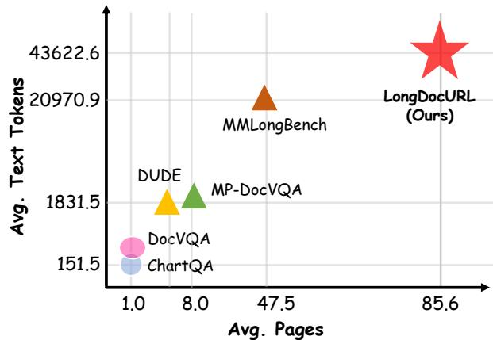  
Figure 1: Comparison with other datasets in average pages and text tokens per document.

Despite the advances in model capabilities, the evaluation of complex document tasks is somewhat lacking. Take DocVQA (Mathew et al., 2021) as an example; it is one of the standard benchmarks for document understanding, but it can only assess single-page documents, and many models can easily exceed an accuracy of 95% (e.g., Qwen2- VL (Alibaba, 2024)). The benchmarks detailed in Table 1 exhibit limitations in adequately addressing complex elements, longer contexts, and diverse tasks: 1) Complex elements: Most benchmarks fail to cover all elements such as paragraphs, titles, tables, and figures, focusing instead on only some of the contents. Additionally, discussions about the interrelations among different elements are scarce. 2) Longer contexts: Current benchmarks for multipage document question answering, such as MP-DocVQA (Tito et al., 2022) and DUDE (Landeghem et al., 2023), do not assess documents exceeding 20 pages. While MMLongBench-Doc (Ma et al., 2024) collects longer documents, it offers only approximately 1k effective samples, with only about 30% of questions involving cross-page information. 3) Diverse tasks: Existing work focuses more on OCR or easy question-answering tasks, neglecting the exploration of capabilities in other areas such as cross-element locating task (as shown in Figure 2c). The above findings indicate that existing benchmarks lag behind the advances of models, which could hinder the development of document understanding.

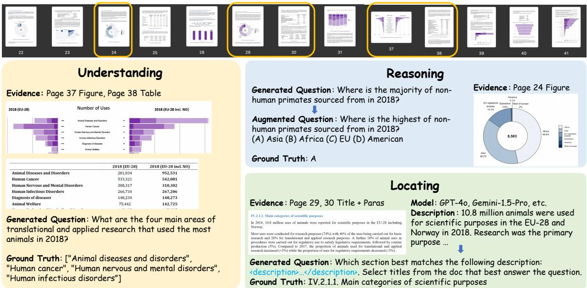  
Figure 2: LongDocURL comprises 20 sub-tasks focusing on three task categories: Understanding, numerical Reasoning, and cross-element Locating. (Top) Thumbnail of a document example. Orange boxes indicate answer evidence pages. (Bottom) Data examples generated from the document and screenshots of relevant part of answer evidence pages.

In this paper, we present a comprehensive document benchmark including three task categories: 1) Understanding: extracting information from documents by identifying keywords, parsing the structure of tables, etc. Answers are found directly in the document. 2) Numerical Reasoning: processing numerical information through counting, calculating, comparing, and summarizing, requiring both extracted information and reasoning for concluding. 3) Cross-Element Locating: As mentioned earlier, discussions about the interrelations among different types of elements are scarce. It is often necessary to establish a task that evaluates models’ ability to analyze relations among different types of elements. For instance, in Para-Title Locating task, as shown in Figure 2c, models must summarize relevant sections to identify parts that match a given abstract and then determine the relation between the paragraph and its section titles. This task requires switching element types (i.e., paragraphs to titles) during the answering process.

Our benchmark, named LongDocURL, comprises 20 sub-tasks according to different primary tasks and answer evidence. More details are presented in Section 3. To efficiently assemble the evaluation dataset for LongDocURL, we design a semi-automated pipeline comprising four modules. Specifically, a Extract & Filter module identifies documents of suitable length with rich layouts from diverse document sources. A QA Generation module utilizes a multi-step iterative querying process with advanced models (e.g., GPT-4o) to generate QA pairs with evidence sources. Finally, the Automated Verification and Human Verification modules ensure the quality of the generated content. Through this semi-automated pipeline, we ultimately produce 2,325 QA pairs, covering more than 33,000 pages of documents. Thereafter, we conduct comprehensive evaluation experiments with 26 different configurations (varying the model and input format). These evaluation results indicate that the highest-performing closed-source model, GPT-4o, scored 64.5, leading all models, while the best score for open-source models is only 30.6. This result reveals a potential gap in document understanding and shows the need for further improvement. Our contributions are as follows:

• We introduce three primary tasks of long document and propose a comprehensive benchmark comprising 20 sub-tasks categorized based on different primary tasks and answer evidences to support more fine-grained evaluation.

<table><tr><td rowspan="2">Benchmarks</td><td colspan="4">Data Size</td><td colspan="2">Answer Evidence</td><td colspan="2">Task Type</td></tr><tr><td>#Docs</td><td>#Avg. Pages</td><td>#Avg. Tokens</td><td>#QA</td><td>Multi-page(%)</td><td>Cross-element(%)</td><td>U R L</td><td></td></tr><tr><td>single-page</td><td></td><td></td><td></td><td></td><td></td><td></td><td></td><td></td><td></td></tr><tr><td>DocVQA (Mathew et al., 2021)</td><td></td><td>1.0</td><td>151.5</td><td></td><td>x</td><td>not specified</td><td></td><td>x</td><td>x</td></tr><tr><td>ChartQA (Masry et al., 2022)</td><td></td><td>1.0</td><td>236.9</td><td></td><td>X</td><td>not specified</td><td></td><td>x</td><td>x</td></tr><tr><td>multi-page(&lt;=20) MP-DocVQA (Tito et al., 2022)</td><td></td><td></td><td></td><td></td><td></td><td></td><td></td><td></td><td>X</td></tr><tr><td>DUDE (Landeghem et al., 2023)</td><td></td><td>8.3</td><td>2,026.6</td><td></td><td>x</td><td>not specified</td><td></td><td>x</td><td>x</td></tr><tr><td>multi-page(&gt;20)</td><td></td><td>5.7</td><td>1,831.5</td><td></td><td>√(2.1%)</td><td>not specified</td><td></td><td></td><td></td></tr><tr><td>MMLongBench-Doc (Ma et al., 2024)</td><td>135</td><td>47.5</td><td>21,214.1</td><td>1,082</td><td>√(33.0%)</td><td>√(22.6%)</td><td></td><td></td><td>X</td></tr><tr><td>M-Longdoc (Chia et al., 2024)</td><td>180</td><td>210.8</td><td></td><td>851</td><td></td><td></td><td></td><td></td><td>x</td></tr><tr><td></td><td></td><td></td><td></td><td></td><td></td><td></td><td></td><td></td><td></td></tr><tr><td>LongDocURL (Ours)</td><td>396</td><td>85.6</td><td>43,622.6</td><td>2,325</td><td>√(52.9%)</td><td>√(37.1%)</td><td></td><td></td><td></td></tr></table>

Table 1: Comparison between LongDocURL and previous document understanding datasets. Task types: (U)nderstanding, (R)easoning, and (L)ocating.

• We develop a cost-efficient semi-automated construction pipeline and generate 2,325 highquality QA pairs, covering more than 33,000 pages of documents, which significantly outperforms existing benchmarks.

• We conduct comprehensive evaluation experiments of both open-source and closed-source models under 26 different configurations.

## 2 Related Work

Models for Document Understanding. There are two main types of language models for document understanding: (1) OCR-dependent models, which use Optical Character Recognition (OCR) to extract text for processing, including the LayoutLM series (Xu et al., 2020, 2021; Huang et al., 2022) and text-only LLMs (Meta, 2024; QwenTeam, 2024); and (2) end-to-end models, which use a visual encoder to extract features from document images, integrating them with text for input into language model backbones. Most of document-related LVLMs fall into this category, such as GPT4o (OpenAI, 2024), Gemini-1.5 (GeminiTeam, 2024), Claude-3.5-Sonnet (Anthropic, 2024), mPLUG-DocOwl2 (Hu et al., 2024), Qwen2-VL (Alibaba, 2024).

Methods for Long Document Understanding. To address the challenges of cross-page document understanding with excessively long context lengths, early approaches employed hierarchical encoding methods (Tito et al., 2022; Kang et al., 2024; Cho et al., 2021; Dong et al., 2024a). In these approaches, an independent encoder processes the OCR text and visual modal information for each page, which is then passed to a small language model decoder for cross-page contextual learning. However, this approach is limited by the redundancy in OCR inputs, which restricts the context length and leads to the accumulation of errors (Xu et al., 2020, 2021; Appalaraju et al., 2021). Recently, with the rise of multimodal large models, methods based on multimodal Retrieval-Augmented Generation (MM-RAG) (Yu et al., 2024; Blau et al., 2024; Ding et al., 2024a; Zhang et al., 2024a,b; Cho et al., 2024) and end-toend multi-page large models (Jiang et al., 2024; Li et al., 2024; Jia et al., 2024) have emerged. These models leverage the world knowledge of large language models to enhance understanding. End-toend approaches mitigate error accumulation by dynamically reducing the number of visual tokens across multiple pages/images and build large scale instruction turning dataset (Jiang et al., 2024; Li et al., 2024; Jia et al., 2024; Hu et al., 2024), allowing for longer context lengths. Methods such as multi-page RAG facilitate dynamic interactions with OCR and other text information to remove redundant multimodal tokens.

Benchmarks for Long Document Understanding. Multi-page or long documents place higher demands on the model’s capabilities in crosspage understanding. Current multi-page document benchmarks, such as MP-DocVQA and DUDE, do not assess documents exceeding 20 pages. MMLongBench-Doc (Ma et al., 2024) and M-Longdoc (Chia et al., 2024) have been proposed to evaluate the understanding capabilities of longer documents, which have an average of 47.5 and 210.8 pages per document, respectively. Meanwhile, MMVQA (Ding et al., 2024a) and MVQA (Ding et al., 2024b) are proposed to better evaluate the retrieval-based method. WebQuest (Wang et al., 2024) focuses on evaluating models’ performance on text-rich web images.

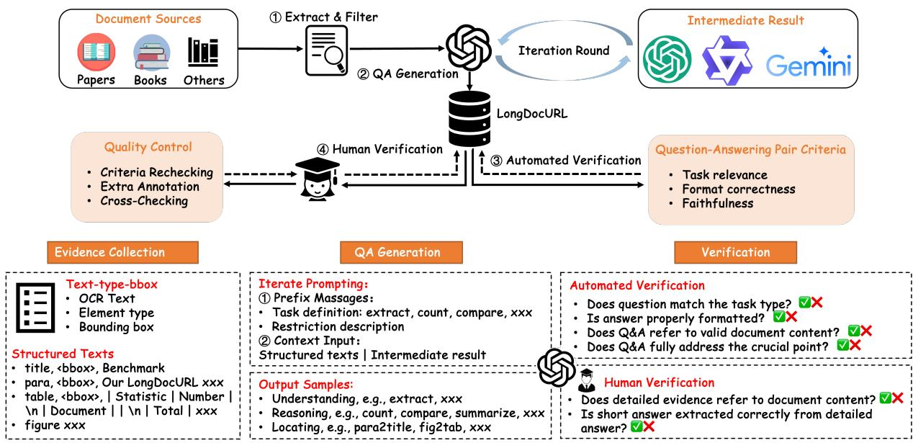  
Figure 3: Overview of our semi-automated construction pipeline. The pipeline comprises four modules: (a) Extract & Filter; (b) QA Generation; (c) Automated Verification; (d) Human Verification.

## 3 LongDocURL

## 3.1 Overview

Firstly, each question-answering pair can be categorized by three primary tasks: Understanding, Reasoning, and Locating, as discussed in Section 1. Secondly, we define four types of answer evidences based on element type: (1) Text: pure texts, such as paragraph; (2) Layout: text elements with special layout meaning (generalized text), such as title, header, footer, table name and figure name; (3) Figure: including charts and general images. (4) Table. In addition, each question-answering pair can be classified into single-page or multi-page based on the number of answer evidence pages and singleelement or cross-element based on the number of types of evidence elements. Based on different primary tasks and answer evidences, we divide our dataset into 20 sub-tasks. As shown in Figure 4, for the Understanding or Reasoning task, we divide our dataset into 8 sub-tasks according to the number of answer evidence pages. Compared to the two tasks, we pay more attention to the interrelations among different types of elements in the Locating task and we build 4 sub-tasks based on the combination of different element types. Data examples are presented in Appendix F.

## 3.2 Q&A Construction

## 3.2.1 Evidence Collection

To objectively evaluate LVLM long document question-answering comprehension ability, we first crawl 200k PDF-formatted documents from CommonCrawl<sup>1</sup> and filter them by page length(i.e., 50\~150) and language(i.e., English) to create a candidate set of approximately 3,000 documents. Then, we categorize these candidates by document type. Specifically, we randomly select 5\~10 pages from a document, and prompt GPT-4o to classify its document type based on document content and layout. We finally retain 396 documents to construct our benchmark. These documents span eight types: research reports & papers, user manuals & guides, books & e-books, theses & dissertations, work & project summaries, presentation materials, project proposals, and meeting minutes & summaries, with an average of 85.6 pages per document.

Thereafter, we utilize both PyMuPDF<sup>2</sup> and Docmind<sup>3</sup> to parse the PDF and extract texts and layout information from the documents. For instance, the tables are converted into markdown format with Docmind. We organize the extracted results in the format of text-type-bbox triples as a symbolic representation of elements: 1) text: the recognized text of the elements; 2) type: the element type. 3) bbox: the bounding box of the element. Notably, we build the element triples at the region level, such as paragraph, table, chart, footnote and title, instead of the line level.

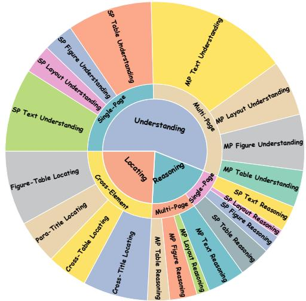  
Figure 4: Our LongDocURL comprises 20 sub-tasks. Inner: divided by the primary task categories (Understanding, Reasoning, and Locating). Middle: divided by the number of answer evidence pages (Single-Page, Multi-Page), and the number of types of evidence elements (Cross-Element). Outer: divided by the types of evidence elements (Text, Table, Figure, Layout).

## 3.2.2 Q&A Generation

Directly prompting LVLM to generate conversational question-answering pairs based on a single or multiple document images proves often ineffective, due to the inability to fully parse diverse elements present in the documents. Similar to LLaVA (Liu et al., 2023), we adopt a two-stage pipeline: Initially, we parse our PDF-formatted documents and get the “text-type-bbox” triples discussed in Section 3.2.1. Subsequently, we design prompts to query LLMs/LVLMs in a multi-step round, and finally generate question-answering pairs. Specifically, as shown in Figure 3, we present the definition of each task and description of related restriction as a part of the prompts. Details can be found in Appendix B.

## 3.3 Q&A Verification

## 3.3.1 Automated Verification

We design an automated method to verify the quality of synthesized question-answering pairs to identify and correct corresponding issues. As shown in Figure 3, a qualified question-answering pair should be verified using these criteria: (1) Task Relevance. (2) Format Correctness. (3) Faithfulness.

The verification results are utilized to classify samples: those that fail are marked as negative, and those that pass are marked as positive. We analyze the verification results and observe approximately 75.2% of the raw data in the Cross-Title Locating task are marked as negative samples, while the percentage is 19.6% in the Cross-Table Locating task. Additional statistics data is presented in Table 5. In the next stage (Section 3.3.2), we present both the final result and texts of verification chains to the human annotator as reference information to guide further verification.

<table><tr><td>Statistic</td><td>Number</td></tr><tr><td>Document</td><td></td></tr><tr><td>- Total</td><td>396</td></tr><tr><td>- Type</td><td>8</td></tr><tr><td>- Avg. pages</td><td>85.6</td></tr><tr><td>Question &amp; Answer</td><td></td></tr><tr><td>- Total</td><td>2,325</td></tr><tr><td>- Avg. question tokens</td><td>35.5</td></tr><tr><td>- Max. question tokens</td><td>277</td></tr><tr><td>Task Type</td><td></td></tr><tr><td>- Understanding</td><td>1,243 (53.5%)</td></tr><tr><td>- Reasoning</td><td>387 (16.6%)</td></tr><tr><td>- Locating</td><td>695 (29.9%)</td></tr><tr><td>Type of Evidence Element</td><td></td></tr><tr><td>- Pure-text</td><td>994 (42.8%)</td></tr><tr><td>- Layout - Table</td><td>779 (33.5%)</td></tr><tr><td>- Figure</td><td>556 (23.9%) 871 (37.5%)</td></tr><tr><td>Number of Evidence Pages</td><td></td></tr><tr><td>- Single-page question</td><td>1,093 (47.0%)</td></tr><tr><td>- Multi-page questions</td><td></td></tr><tr><td>- Unanswerable questions</td><td>1,230 (52.9%)</td></tr><tr><td></td><td>2 (0.1%)</td></tr><tr><td>Number of Evidence Element Types</td><td></td></tr><tr><td>- Single-element question</td><td>1,463(62.9%)</td></tr><tr><td>- Cross-element question</td><td>862(37.1%)</td></tr><tr><td>Answer Format</td><td></td></tr><tr><td>- String</td><td>941 (40.5%)</td></tr><tr><td>- Integer</td><td>431 (18.5%)</td></tr><tr><td>- Float</td><td>185 (8.0%)</td></tr><tr><td>- List</td><td>757 (32.6%)</td></tr><tr><td></td><td></td></tr><tr><td>- None</td><td>11 (0.5%)</td></tr></table>

Table 2: Document and Q&A statistics based on different tasks and answer evidences.

## 3.3.2 Human Verification

There are two shortcomings of automated verification in Section 3.3.1: (1) It only completes the classification of positive and negative samples, but does not recycle them, which causes waste. (2) When verifying the consistency between the question-answer pair and the document, only the text information is referenced, which may lost significant visual structure information compared to the source document. In the human verification stage, we focus on tasks that are challenging for automated verification, such as recovering negative samples and checking the consistency between the question-answering pair and the visual source information. The Human Verification module comprises the following parts:

• Criteria Rechecking. The annotator reviews the intermediate process of machine verification to determine whether it is reasonable and whether the negative samples can be recovered by simply correcting the question-answer pair.

• Extra Annotation. Human annotators should oversee the question-answer pair process using the source visual document, not the parsed one. First, they need to verify if the evidence provided by the model aligns with the document’s content, and then ensure that the final answer can be derived step by step from the intermediate process.

• Cross-Checking. After the annotators complete the first round of annotation, we require the annotators to cross-check each other’s annotation results to improve the quality of annotation.

The labor resource allocation for data annotation is detailed in Appendix H.

## 3.4 Dataset Statistics

As shown in Table 2 and Figure 8, our Long-DocURL comprises 396 documents and 2,325 question-answering samples. The average pages per document range from 50 to 150. The crosselement locating task we designed contributes 37.1% of the data, providing support for evaluating the model’s cross-element interaction capabilities in long contexts. The dataset includes five types of answers, ensuring compatibility with automated evaluation while maintaining completeness and accuracy. In addition, we compare the characteristics of question set in our LongDocURL with that in MMLongBench-Doc. The results are presented in Appendix C.

## 4 Experiments

## 4.1 Evaluation Protocols

Allowing models to think freely can enhance performance but often results in lengthy responses. Current rule-based scorers are only effective with specific short formats, making it difficult to evaluate longer responses. Therefore, we need an answer extractor (GPT4o) to convert detailed responses into concise ones. Following MATHVISTA (Lu et al., 2024) and MMLongBench-Doc (Ma et al., 2024), we implement a three-stage protocol: response generation, answer extraction, and score calculation. In the score calculation stage, we divide scores into five categories (Integer, Float, String, List, and None). Different from MMLongBench-Doc, we adopt a softer and more reasonable scoring standard. See Appendix D for more details.

## 4.2 Experimental Setup

Models We divide the experiments into two categories: text-input and image-input. For text-input configuration, document texts parsed by OCR engines are input into LLMs/LVLMs. We conduct our experiments on both open-source and closedsource models across 26 different configurations.

Input Paradigm The documents in our Long-DocURL have a max of 150 pages, and most of models are unable to fully process the context to obtain the answer due to GPU memory or interface limitations. Therefore, similar to the merge method used in previous benchmarks (Ma et al., 2024), we design the cut-off paradigm for the evaluation of current models.

For LVLMs, we cut 30 continuous pages around the answer evidences from the original PDFformatted document, and feed the converted images into the models. Details of selection rules are in Appendix D.2. As for LLMs, we input the texts parsed by OCR engines, including PyMuPDF and Docmind.

Other Configurations We assess the proprietary models using API resources, while the evaluation of the open-source models is conducted on H20 machines with 96G memory. To reduce variance, we set the temperature coefficient to 0.0 when generating free-form response and extracting short answer.

## 4.3 Main Results

As shown in Table 3 and Table 7, we calculate generalized accuracy scores to assess model capabilities. Regarding LVLMs, we draw the following conclusions: (1) Highest Scoring Model: Only GPT-4o meets the passing standard and scores highest at 64.5, indicating that our Long-DocURL presents significant challenges for current models. (2) Comparison of Open-source and Closed-source models: Proprietary models demonstrate better overall performance compared to opensource models. Among open-source models, only Qwen2-VL (score 30.6) and LLaVA-OneVision (scores 22.0 and 25.0) exceed a score of 20, while other models with fewer than 13B parameters fall below this threshold.

<table><tr><td rowspan=2 colspan=1>Model         Size</td><td rowspan=2 colspan=4>TXT LAYFIGTAB25991 94263</td><td rowspan=1 colspan=7>Understanding</td><td rowspan=1 colspan=4>multi-page</td><td rowspan=1 colspan=10>Reasoningsingle-page             multi-page</td><td rowspan=1 colspan=2>Locatingcross-element</td></tr><tr><td rowspan=1 colspan=7>all TXT LAYFIGTAB all612 443172174115 631</td><td rowspan=1 colspan=4>TXT LAY FIG TAB40 122898</td><td rowspan=1 colspan=1>all158</td><td rowspan=1 colspan=4>TXTLAY FIGTAB11540 85 69</td><td rowspan=1 colspan=1>all229</td><td rowspan=1 colspan=4>CTiCTaPTiFTa201126137231</td><td rowspan=1 colspan=1>all695</td><td rowspan=1 colspan=1>2325</td></tr><tr><td rowspan=1 colspan=1></td><td rowspan=1 colspan=4></td><td rowspan=1 colspan=7>OCR (PyMuPDF4) + La</td><td rowspan=1 colspan=16>rge Language Models (LLMs)</td></tr><tr><td rowspan=1 colspan=1>Open-source Models</td><td rowspan=1 colspan=2></td><td rowspan=1 colspan=2></td><td rowspan=1 colspan=1></td><td rowspan=1 colspan=5></td><td rowspan=1 colspan=1></td><td rowspan=1 colspan=2></td><td rowspan=1 colspan=2></td><td rowspan=1 colspan=1></td><td rowspan=1 colspan=2></td><td rowspan=1 colspan=2></td><td rowspan=1 colspan=1></td><td rowspan=1 colspan=4></td><td rowspan=1 colspan=1></td><td rowspan=1 colspan=1></td></tr><tr><td rowspan=1 colspan=1>LLaVA-OneVision-Chat 7B</td><td rowspan=1 colspan=1>28.6</td><td rowspan=1 colspan=1>22.8</td><td rowspan=1 colspan=2>25.419.4</td><td rowspan=1 colspan=1>24.6</td><td rowspan=1 colspan=1>43.0</td><td rowspan=1 colspan=1>36.3</td><td rowspan=1 colspan=2>35.4</td><td rowspan=1 colspan=1>31.0</td><td rowspan=1 colspan=1>38.6</td><td rowspan=1 colspan=1>14.4</td><td rowspan=1 colspan=1>39.6</td><td rowspan=1 colspan=2>14.310.0</td><td rowspan=1 colspan=1>12.4</td><td rowspan=1 colspan=1>31.2</td><td rowspan=1 colspan=1>20.0</td><td rowspan=1 colspan=1>28.0</td><td rowspan=1 colspan=1>22.4</td><td rowspan=1 colspan=1>26.7</td><td rowspan=1 colspan=1>16.3</td><td rowspan=1 colspan=1>2.7</td><td rowspan=1 colspan=1>16.7</td><td rowspan=1 colspan=1>16.4</td><td rowspan=1 colspan=1>14.0</td><td rowspan=1 colspan=1>24.6</td></tr><tr><td rowspan=1 colspan=1>Qwen2.5-Instruct    7B</td><td rowspan=1 colspan=1>27.1</td><td rowspan=1 colspan=1>29.4</td><td rowspan=1 colspan=2>21.421.9</td><td rowspan=1 colspan=1>24.7</td><td rowspan=1 colspan=1>36.5</td><td rowspan=1 colspan=1>32.9</td><td rowspan=1 colspan=2>33.8</td><td rowspan=1 colspan=1>28.0</td><td rowspan=1 colspan=1>34.3</td><td rowspan=1 colspan=1>12.4</td><td rowspan=1 colspan=1>24.5</td><td rowspan=1 colspan=2>28.617.3</td><td rowspan=1 colspan=1>18.3</td><td rowspan=1 colspan=1>32.0</td><td rowspan=1 colspan=1>32.5</td><td rowspan=1 colspan=1>29.2</td><td rowspan=1 colspan=1>24.2</td><td rowspan=1 colspan=1>27.4</td><td rowspan=1 colspan=1>31.3</td><td rowspan=1 colspan=1>7.7</td><td rowspan=1 colspan=1>13.5</td><td rowspan=1 colspan=1>28.2</td><td rowspan=1 colspan=1>20.5</td><td rowspan=1 colspan=1>25.9</td></tr><tr><td rowspan=1 colspan=1>Qwen2.5-Instruct   32B</td><td rowspan=1 colspan=2>28.823.9</td><td rowspan=1 colspan=2>24.824.7</td><td rowspan=1 colspan=1>26.6</td><td rowspan=1 colspan=2>34.932.6</td><td rowspan=1 colspan=2>31.3</td><td rowspan=1 colspan=1>36.0</td><td rowspan=1 colspan=1>33.4</td><td rowspan=1 colspan=1>22.5</td><td rowspan=1 colspan=1>33.3</td><td rowspan=1 colspan=2>35.715.3</td><td rowspan=1 colspan=1>20.3</td><td rowspan=1 colspan=1>31.1</td><td rowspan=1 colspan=1>40.0</td><td rowspan=1 colspan=1>32.7</td><td rowspan=1 colspan=1>25.3</td><td rowspan=1 colspan=1>29.4</td><td rowspan=1 colspan=2>33.523.1</td><td rowspan=1 colspan=2>28.531.2</td><td rowspan=1 colspan=1>29.5</td><td rowspan=1 colspan=1>29.2</td></tr><tr><td rowspan=1 colspan=1>Qwen2.5-Instruct   72B</td><td rowspan=1 colspan=1>31.9</td><td rowspan=1 colspan=1>30.3</td><td rowspan=1 colspan=2>23.325.3</td><td rowspan=1 colspan=1>28.3</td><td rowspan=1 colspan=2>42.339.7</td><td rowspan=1 colspan=2>35.1</td><td rowspan=1 colspan=1>34.6</td><td rowspan=1 colspan=1>39.4</td><td rowspan=1 colspan=2>22.525.0</td><td rowspan=1 colspan=2>35.715.3</td><td rowspan=1 colspan=1>20.2</td><td rowspan=1 colspan=2>38.039.9</td><td rowspan=1 colspan=2>32.626.7</td><td rowspan=1 colspan=1>32.0</td><td rowspan=1 colspan=2>36.221.8</td><td rowspan=1 colspan=2>38.635.3</td><td rowspan=1 colspan=1>34.2</td><td rowspan=1 colspan=1>32.9</td></tr><tr><td rowspan=1 colspan=1>Qwen-Max</td><td rowspan=1 colspan=1>31.4</td><td rowspan=1 colspan=1>31.1</td><td rowspan=1 colspan=2>24.022.5</td><td rowspan=1 colspan=1>27.1</td><td rowspan=1 colspan=1>40.0</td><td rowspan=1 colspan=1>35.3</td><td rowspan=1 colspan=2>33.5</td><td rowspan=1 colspan=1>34.8</td><td rowspan=1 colspan=1>37.0</td><td rowspan=1 colspan=1>22.5</td><td></td><td></td><td></td><td></td><td></td><td></td><td></td><td></td><td></td><td></td><td></td><td></td><td></td><td></td><td></td></tr><tr><td rowspan=1 colspan=1>Gemini-1.5-Pro</td><td rowspan=1 colspan=1>29.4</td><td rowspan=1 colspan=1>31.8</td><td rowspan=1 colspan=1>25.2</td><td rowspan=1 colspan=1>25.8</td><td rowspan=1 colspan=1>27.8</td><td rowspan=1 colspan=1>41.3</td><td rowspan=1 colspan=1>40.3</td><td rowspan=1 colspan=2>35.5</td><td rowspan=1 colspan=1>32.0</td><td rowspan=1 colspan=1>38.6</td><td rowspan=1 colspan=1>21.9</td><td rowspan=1 colspan=1>23.1</td><td rowspan=1 colspan=1>28.6</td><td rowspan=1 colspan=1>20.4</td><td rowspan=1 colspan=1>21.4</td><td rowspan=1 colspan=1>31.9</td><td rowspan=1 colspan=1>40.0</td><td rowspan=1 colspan=1>36.2</td><td rowspan=1 colspan=1>24.3</td><td rowspan=1 colspan=1>30.4</td><td rowspan=1 colspan=1>39.2</td><td rowspan=1 colspan=1>21.3</td><td rowspan=1 colspan=1>32.2</td><td rowspan=1 colspan=1>35.1</td><td rowspan=1 colspan=1>32.8</td><td rowspan=1 colspan=1>32.0</td></tr><tr><td rowspan=1 colspan=1>Qwen-VL-Max</td><td rowspan=1 colspan=1>37.2</td><td rowspan=1 colspan=1>37.0</td><td rowspan=1 colspan=1>29.1</td><td rowspan=1 colspan=1>26.3</td><td rowspan=1 colspan=1>32.0</td><td rowspan=1 colspan=1>45.4</td><td rowspan=1 colspan=1>44.1</td><td rowspan=1 colspan=2>39.9</td><td rowspan=1 colspan=1>44.5</td><td rowspan=1 colspan=1>43.3</td><td rowspan=1 colspan=1>28.7</td><td rowspan=1 colspan=1>66.2</td><td rowspan=1 colspan=1>45.8</td><td rowspan=1 colspan=1>20.4</td><td rowspan=1 colspan=1>26.8</td><td rowspan=1 colspan=1>37.1</td><td rowspan=1 colspan=1>37.5</td><td rowspan=1 colspan=1>33.8</td><td rowspan=1 colspan=1>27.1</td><td rowspan=1 colspan=1>32.1</td><td rowspan=1 colspan=1>25.5</td><td rowspan=1 colspan=1>13.9</td><td rowspan=1 colspan=1>34.4</td><td rowspan=1 colspan=1>30.4</td><td rowspan=1 colspan=1>27.3</td><td rowspan=1 colspan=1>33.3</td></tr><tr><td rowspan=1 colspan=1>GPT-40</td><td rowspan=1 colspan=1>33.5</td><td rowspan=1 colspan=1>29.6</td><td rowspan=1 colspan=1>27.4</td><td rowspan=1 colspan=1>27.0</td><td rowspan=1 colspan=1>30.4</td><td rowspan=1 colspan=1>42.6</td><td rowspan=1 colspan=1>42.7</td><td rowspan=1 colspan=2>38.0</td><td rowspan=1 colspan=1>33.5</td><td rowspan=1 colspan=1>40.2</td><td rowspan=1 colspan=1>27.5</td><td rowspan=1 colspan=1>25.0</td><td rowspan=1 colspan=1>42.9</td><td rowspan=1 colspan=1>21.4</td><td rowspan=1 colspan=1>25.9</td><td rowspan=1 colspan=1>33.7</td><td rowspan=1 colspan=1>37.5</td><td rowspan=1 colspan=1>31.5</td><td rowspan=1 colspan=1>25.6</td><td rowspan=1 colspan=1>30.0</td><td rowspan=1 colspan=1>42.5</td><td rowspan=1 colspan=1>24.1</td><td rowspan=1 colspan=1>40.8</td><td rowspan=1 colspan=1>35.6</td><td rowspan=1 colspan=1>37.2</td><td rowspan=1 colspan=1>34.7</td></tr><tr><td rowspan=1 colspan=1>01-preview</td><td rowspan=1 colspan=1>33.5</td><td rowspan=1 colspan=1>31.3</td><td rowspan=1 colspan=2>29.929.6</td><td rowspan=1 colspan=1>31.1</td><td rowspan=1 colspan=1>41.7</td><td rowspan=1 colspan=1>45.0</td><td rowspan=1 colspan=2>38.5</td><td rowspan=1 colspan=1>39.2</td><td rowspan=1 colspan=1>40.1</td><td rowspan=1 colspan=1>22.5</td><td rowspan=1 colspan=1>33.3</td><td rowspan=1 colspan=1>45.8</td><td rowspan=1 colspan=1>24.5</td><td rowspan=1 colspan=1>27.1</td><td rowspan=1 colspan=1>34.9</td><td rowspan=1 colspan=1>37.5</td><td rowspan=1 colspan=1>29.2</td><td rowspan=1 colspan=1>38.6</td><td rowspan=1 colspan=1>34.1</td><td rowspan=1 colspan=1>39.3</td><td rowspan=1 colspan=1>26.6</td><td rowspan=1 colspan=1>44.9</td><td rowspan=1 colspan=1>37.8</td><td rowspan=1 colspan=1>38.6</td><td rowspan=1 colspan=1>35.8</td></tr><tr><td rowspan=1 colspan=1></td><td rowspan=1 colspan=2></td><td rowspan=1 colspan=2></td><td rowspan=1 colspan=1></td><td rowspan=1 colspan=2></td><td rowspan=1 colspan=2></td><td rowspan=1 colspan=1>Large V</td><td rowspan=1 colspan=1>ision L</td><td rowspan=1 colspan=2>anguage Mode</td><td rowspan=1 colspan=2>ls (LVLMs)</td><td rowspan=1 colspan=1></td><td rowspan=1 colspan=2></td><td rowspan=1 colspan=2></td><td rowspan=1 colspan=1></td><td rowspan=1 colspan=4></td><td rowspan=1 colspan=1></td><td rowspan=1 colspan=1></td></tr><tr><td rowspan=1 colspan=1>Open-source Models</td><td rowspan=1 colspan=1></td><td rowspan=1 colspan=1></td><td rowspan=1 colspan=2></td><td rowspan=1 colspan=1></td><td rowspan=1 colspan=1></td><td rowspan=1 colspan=1></td><td rowspan=1 colspan=2></td><td rowspan=1 colspan=1></td><td rowspan=1 colspan=1></td><td rowspan=1 colspan=1></td><td rowspan=1 colspan=1></td><td rowspan=1 colspan=2></td><td rowspan=1 colspan=1></td><td rowspan=1 colspan=1></td><td rowspan=1 colspan=1></td><td rowspan=1 colspan=1></td><td rowspan=1 colspan=1></td><td rowspan=1 colspan=1></td><td rowspan=1 colspan=1></td><td rowspan=1 colspan=1></td><td rowspan=1 colspan=1></td><td rowspan=1 colspan=1></td><td rowspan=1 colspan=1></td><td rowspan=1 colspan=1></td></tr><tr><td rowspan=1 colspan=1>InternLM-XC2.5    7B</td><td rowspan=1 colspan=1>2.9</td><td rowspan=1 colspan=1>3.0</td><td rowspan=1 colspan=2>2.72.1</td><td rowspan=1 colspan=1>2.7</td><td rowspan=1 colspan=1>5.5</td><td rowspan=1 colspan=1>5.3</td><td rowspan=1 colspan=2>3.2</td><td rowspan=1 colspan=1>2.7</td><td rowspan=1 colspan=1>4.5</td><td rowspan=1 colspan=1>2.5</td><td rowspan=1 colspan=1>8.3</td><td rowspan=1 colspan=1>0.0</td><td rowspan=1 colspan=1>0.0</td><td rowspan=1 colspan=1>0.6</td><td rowspan=1 colspan=1>3.5</td><td rowspan=1 colspan=1>2.5</td><td rowspan=1 colspan=1>1.2</td><td rowspan=1 colspan=1>1.3</td><td rowspan=1 colspan=1>2.6</td><td rowspan=1 colspan=1>0.6</td><td rowspan=1 colspan=1>0.4</td><td rowspan=1 colspan=1>0.5</td><td rowspan=1 colspan=1>1.3</td><td rowspan=1 colspan=1>0.7</td><td rowspan=1 colspan=1>2.4</td></tr><tr><td rowspan=1 colspan=1>Pixtral          12B</td><td rowspan=1 colspan=1>10.1</td><td rowspan=1 colspan=1>8.2</td><td rowspan=1 colspan=1>6.7</td><td rowspan=1 colspan=1>4.6</td><td rowspan=1 colspan=1>7.5</td><td rowspan=1 colspan=1>10.2</td><td rowspan=1 colspan=1>8.6</td><td rowspan=1 colspan=2>5.5</td><td rowspan=1 colspan=1>7.2</td><td rowspan=1 colspan=1>8.4</td><td rowspan=1 colspan=1>2.7</td><td rowspan=1 colspan=1>8.9</td><td rowspan=1 colspan=1>0.0</td><td rowspan=1 colspan=1>0.0</td><td rowspan=1 colspan=1>0.7</td><td rowspan=1 colspan=1>10.0</td><td rowspan=1 colspan=1>5.0</td><td rowspan=1 colspan=1>4.6</td><td rowspan=1 colspan=1>2.5</td><td rowspan=1 colspan=1>5.8</td><td rowspan=1 colspan=1>3.7</td><td rowspan=1 colspan=1>1.3</td><td rowspan=1 colspan=1>1.9</td><td rowspan=1 colspan=1>2.2</td><td rowspan=1 colspan=1>2.4</td><td rowspan=1 colspan=1>5.6</td></tr><tr><td></td><td></td><td></td><td></td><td></td><td></td><td></td><td></td><td></td><td></td><td></td><td></td><td rowspan=1 colspan=1>7.5</td><td rowspan=1 colspan=1>16.7</td><td rowspan=1 colspan=1>10.1</td><td rowspan=1 colspan=1>5.1</td><td rowspan=1 colspan=1>6.9</td><td rowspan=1 colspan=1>21.4</td><td rowspan=1 colspan=1>12.5</td><td rowspan=1 colspan=1>19.9</td><td rowspan=1 colspan=1>8.5</td><td rowspan=1 colspan=1>17.2</td><td rowspan=1 colspan=1>6.6</td><td rowspan=1 colspan=1>1.1</td><td rowspan=1 colspan=1>3.7</td><td rowspan=1 colspan=1>2.4</td><td rowspan=1 colspan=1>3.8</td><td rowspan=1 colspan=1>14.1</td></tr><tr><td rowspan=1 colspan=1>LLaVA-OneVision   7B</td><td rowspan=1 colspan=1>28.6</td><td rowspan=1 colspan=1>32.4</td><td rowspan=1 colspan=1>19.2</td><td rowspan=1 colspan=1>14.6</td><td rowspan=1 colspan=1>22.3</td><td rowspan=1 colspan=1>36.7</td><td rowspan=1 colspan=1>37.1</td><td rowspan=1 colspan=2>28.1</td><td rowspan=1 colspan=1>23.5</td><td rowspan=1 colspan=1>33.7</td><td rowspan=1 colspan=1>10.7</td><td></td><td></td><td></td><td></td><td></td><td></td><td></td><td></td><td></td><td></td><td></td><td></td><td></td><td></td><td></td></tr><tr><td rowspan=1 colspan=1>LLaVA-OneVision-Chat 7B</td><td rowspan=1 colspan=1>29.5</td><td rowspan=1 colspan=1>34.1</td><td rowspan=1 colspan=1>26.0</td><td rowspan=1 colspan=1>17.9</td><td rowspan=1 colspan=1>24.8</td><td rowspan=1 colspan=1>36.9</td><td rowspan=1 colspan=1>38.4</td><td rowspan=1 colspan=2>34.5</td><td rowspan=1 colspan=1>26.9</td><td rowspan=1 colspan=1>36.0</td><td rowspan=1 colspan=1>6.9</td><td rowspan=1 colspan=1>14.5</td><td rowspan=1 colspan=1>6.5</td><td rowspan=1 colspan=1>8.2</td><td rowspan=1 colspan=1>8.0</td><td rowspan=1 colspan=1>31.8</td><td rowspan=1 colspan=1>22.5</td><td rowspan=1 colspan=1>29.3</td><td rowspan=1 colspan=1>16.5</td><td rowspan=1 colspan=1>26.6</td><td rowspan=1 colspan=1>22.5</td><td rowspan=1 colspan=1>9.9</td><td rowspan=1 colspan=1>13.6</td><td rowspan=1 colspan=1>29.7</td><td rowspan=1 colspan=1>18.7</td><td rowspan=1 colspan=1>25.0</td></tr><tr><td rowspan=1 colspan=1>Qwen2-VL        7B</td><td rowspan=1 colspan=4>37.937.230.029.8</td><td rowspan=1 colspan=1>33.4</td><td rowspan=1 colspan=1>43.8</td><td rowspan=1 colspan=1>38.0</td><td rowspan=1 colspan=2>37.8</td><td rowspan=1 colspan=1>33.5</td><td rowspan=1 colspan=1>40.2</td><td rowspan=1 colspan=1>19.0</td><td rowspan=1 colspan=1>54.9</td><td rowspan=1 colspan=2>21.417.2</td><td rowspan=1 colspan=1>19.3</td><td rowspan=1 colspan=1>33.2</td><td rowspan=1 colspan=1>22.5</td><td rowspan=1 colspan=2>34.516.5</td><td rowspan=1 colspan=1>28.6</td><td rowspan=1 colspan=1>25.7</td><td rowspan=1 colspan=2>22.117.6</td><td rowspan=1 colspan=1>27.0</td><td rowspan=1 colspan=1>22.6</td><td rowspan=1 colspan=1>30.6</td></tr><tr><td rowspan=1 colspan=1>Qwen-VL-Max</td><td rowspan=1 colspan=4>61.154.558.253.7</td><td rowspan=1 colspan=1>57.7</td><td rowspan=1 colspan=1>63.0</td><td rowspan=1 colspan=1>57.2</td><td rowspan=1 colspan=2>56.1</td><td rowspan=1 colspan=1>53.3</td><td rowspan=1 colspan=1>60.0</td><td rowspan=1 colspan=1>44.1</td><td rowspan=1 colspan=1>66.6</td><td rowspan=1 colspan=2>57.138.6</td><td rowspan=1 colspan=1>44.0</td><td rowspan=1 colspan=1>45.8</td><td rowspan=1 colspan=1>42.5</td><td rowspan=1 colspan=1>38.5</td><td rowspan=1 colspan=1>41.0</td><td rowspan=1 colspan=1>43.8</td><td rowspan=1 colspan=1>25.4</td><td rowspan=1 colspan=1>16.7</td><td rowspan=1 colspan=1>47.5</td><td rowspan=1 colspan=1>49.8</td><td rowspan=1 colspan=1>36.0</td><td rowspan=1 colspan=1>49.5</td></tr><tr><td rowspan=1 colspan=1>Gemini-1.5-Pro</td><td rowspan=1 colspan=4>54.857.260.148.8</td><td rowspan=1 colspan=1>52.8</td><td rowspan=1 colspan=1>61.4</td><td rowspan=1 colspan=1>56.9</td><td rowspan=1 colspan=2>54.2</td><td rowspan=1 colspan=1>51.8</td><td rowspan=1 colspan=1>58.4</td><td rowspan=1 colspan=1>37.7</td><td rowspan=1 colspan=1>57.9</td><td rowspan=1 colspan=1>46.4</td><td rowspan=1 colspan=1>31.3</td><td rowspan=1 colspan=1>35.9</td><td rowspan=1 colspan=1>53.4</td><td rowspan=1 colspan=1>52.5</td><td rowspan=1 colspan=1>47.8</td><td rowspan=1 colspan=1>40.4</td><td rowspan=1 colspan=1>48.6</td><td rowspan=1 colspan=1>48.4</td><td rowspan=1 colspan=1>18.9</td><td rowspan=1 colspan=1>46.7</td><td rowspan=1 colspan=1>68.1</td><td rowspan=1 colspan=1>46.4</td><td rowspan=1 colspan=1>50.9</td></tr><tr><td rowspan=1 colspan=1>GPT-40</td><td rowspan=1 colspan=4>71.167.568.566.4</td><td rowspan=1 colspan=1>68.6</td><td rowspan=1 colspan=2>70.167.4</td><td rowspan=1 colspan=2>69.1</td><td rowspan=1 colspan=1>63.8</td><td rowspan=1 colspan=1>68.6</td><td rowspan=1 colspan=1>56.7</td><td rowspan=1 colspan=1>66.6</td><td rowspan=1 colspan=1>70.8</td><td rowspan=1 colspan=1>49.5</td><td rowspan=1 colspan=1>55.7</td><td rowspan=1 colspan=1>67.3</td><td rowspan=1 colspan=1>55.0</td><td rowspan=1 colspan=2>61.761.1</td><td rowspan=1 colspan=1>62.8</td><td rowspan=1 colspan=2>50.740.1</td><td rowspan=1 colspan=1>66.8</td><td rowspan=1 colspan=1>78.5</td><td rowspan=1 colspan=1>59.6</td><td rowspan=1 colspan=1>64.5</td></tr><tr><td rowspan=1 colspan=1></td><td rowspan=1 colspan=4></td><td rowspan=1 colspan=1></td><td rowspan=1 colspan=5></td><td rowspan=1 colspan=1>Human</td><td rowspan=1 colspan=4>Baseline</td><td rowspan=1 colspan=1></td><td rowspan=1 colspan=4></td><td rowspan=1 colspan=1></td><td rowspan=1 colspan=4></td><td rowspan=1 colspan=1></td><td rowspan=1 colspan=1></td></tr><tr><td rowspan=1 colspan=1>Human Experts</td><td rowspan=1 colspan=4></td><td rowspan=1 colspan=1></td><td rowspan=1 colspan=5></td><td rowspan=1 colspan=1>87.2</td><td rowspan=1 colspan=4></td><td rowspan=1 colspan=1></td><td rowspan=1 colspan=4></td><td rowspan=1 colspan=1>81.3</td><td rowspan=1 colspan=4></td><td rowspan=1 colspan=1>81.6 |</td><td rowspan=1 colspan=1>84.8</td></tr></table>

Table 3: Generalized accuracy scores(0\~1) on LongDocURL. There are 3 types of tasks: (U)nderstanding, (R)easoning, and (L)ocating. There are 4 types of evidence elements: pure text(TXT), layout(LAY), chart & image(FIG), and table(TAB). There are 3 types of evidence pages/elements: single-page(SP), multi-page(MP), and cross-element(CE). Cross-element means at least two element types in the evidence(e.g., chart and table). CTi: Cross-Title, CTa: Cross-Table, PTi: Para-Title, FTa: Figure-Table. The highest scores among models in each section are highlighted in green . Human baselines are obtained from 102 uniformly distributed samples.

To compare the performance of models using text input versus image input, we included the O1- preview and Qwen2.5 series. The experimental results show that the overall scores of LLMs significantly lower than LVLMs, with the top LLM score trailing the top LVLM score by about 30 points. This gap is mainly because important document information is lost when parsed into plain text using PyMuPDF. Our dataset features numerous table-related and chart-related Q&A pairs, and the loss of structural information hinders LLMs ability to extract critical evidence. These results highlights our LongDocURL as a benchmark for assessing the document structure parsing capability of LVLMs.

## 4.3.1 Fine-Grained Analysis

We include more fine-grained results in Table 7 and Figure 5, based on document sources, task categories, document elements, and evidence pages.

Document Sources As shown in Figure 5, the models perform better on books, reports, manuals, and project proposals, likely due to their simpler layout, which facilitates key information extraction. Conversely, the models struggle with less common documents like meeting minutes and work summary, which have limited data.

Task Type Observations reveal: (1) Proprietary LVLMs perform comparably on reasoning and locating tasks, but image-to-text conversion impacts reasoning capabilities more severely. For instance, switching to text input, GPT-4o’s reasoning scores drop by 31.6 points versus 22.4 points for locating. (2) Strong models are balanced in reasoning and locating, whereas weaker models perform poorly on locating, suggesting a training focus on capabilities of understanding and reasoning over spatial and logical relationships in locating tasks.

Document Elements Models score highest on Text questions and lowest on Table ones, highlighting deficiencies in document structure parsing. Figure and Layout question types yield similar scores. Scores for cross-element tasks fall between singlepage and multi-page QA, closely aligning with the overall assessment.

Single-page vs Multi-page Single-page QA accuracy is lower than multi-page QA. This reveals that answers for some questions can be gathered from multiple pages, thereby reducing the difficulty. However, models like GPT-4o and Qwen-VL-Max show lower accuracy on multi-page QA, revealing a contradiction where their scores on locating tasks in multi-page QA are lower, thus skewing overall performance.

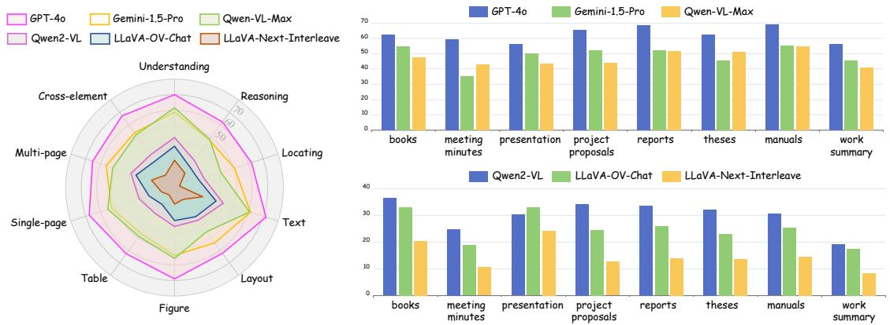  
Figure 5: Fine-grained Results. We choose 3 proprietary and 3 open-source models to conduct further analysis based on (left) task types, document elements, evidence pages, and (right) document sources.

<table><tr><td>Model</td><td>Size</td><td colspan="2">Image-input</td><td colspan="2">Text-input</td></tr><tr><td></td><td></td><td>cut-off</td><td>merge</td><td>pymupdf</td><td>docmind</td></tr><tr><td colspan="6">Open-source Models</td></tr><tr><td>Qwen2-VL</td><td>7B</td><td>30.7</td><td>7.6⁴4</td><td>24.4</td><td>45.3</td></tr><tr><td>LLaVA-Next-Interleave</td><td>7B</td><td>12.6</td><td>10.9</td><td>16.9</td><td>29.7</td></tr><tr><td>LLaVA-OneVision-Chat</td><td>7B</td><td>24.1</td><td>14.0</td><td>23.0</td><td>39.1</td></tr><tr><td colspan="6">Proprietary Models</td></tr><tr><td>Gemini-1.5-Pro</td><td></td><td>48.1</td><td>_5</td><td>34.0</td><td>64.8</td></tr><tr><td>GPT-40</td><td></td><td>64.4</td><td>44.9</td><td>36.5</td><td>66.2</td></tr><tr><td>01-preview</td><td>一</td><td></td><td></td><td>38.0</td><td>63.4</td></tr></table>

Table 4: Comparison among different input paradigms on a subset of 20% data.

## 4.4 Ablation of Input Paradigms

To explore the optimal input format in long document question-answering, we conduct ablation experiments across two image-input and two textinput paradigms. The image-input paradigms include: (1) cut-off, following the configuration detailed in Section 4.2, and (2) merge, where document images are combined from raw document lengths (50\~150) into 20\~30 new images. Further details can be found in Appendix D.1.

We note that the table structure information significantly degrades when parsed by PyMuPDF, while the markdown-format table texts parsed by Docmind retain greater structural integrity. To assess the impact of structural information loss on model performance, we conducted experiments with two input types: (1) text-input-docmind, utilizing texts parsed by Docmind, and (2) text-inputpymupdf, utilizing texts parsed by PyMuPDF. The analysis of the results presented in Table 4 led us to the following conclusions:

Text-input vs. Image-input: The scores in the cut-off paradigm are higher than that in the textinput-pymupdf paradigm, but lower than that in the text-input-docmind paradigm, indicating that this method can effectively extract table structure information, but it can be improved further.

Cut-off vs. Merge: The merge method preserves a greater number of context tokens by concatenating multiple images, while the cut-off method succeeds in acquiring prior information by shortening the context window. Experimental results suggest that the cut-off may yield better problem-solving capabilities than merging, providing insights for the future construction of multimodal Retrieval-Augmented Generation (RAG) systems.

Impact of Structural Information: For proprietary models, performance utilizing Docmind is at least 25 points higher than that with PyMuPDF, while the disparity is 15 points for open-source models. The absence of table structure information significantly hampers the performance of both open-source and proprietary models.

## 5 Error Analysis and Model Insights

Error Analysis We randomly sample 97 erroneous records and conduct a error analysis of the best-performing model, GPT-4o. We classify the errors into 7 types (See Appendix G for detailed descriptions and qualitative examples) and show their distribution in Figure 6.

Perceptual errors constitute the most prevalent category (32.7%), arising from inaccuracies in recognizing, parsing, or counting document elements such as tables, figures, and formulas. Typical manifestations include incorrect heading hierarchies and mismatched figure-text correspondences, indicating that complex document structures and OCR performance remain primary bottlenecks for LVLMs. An example of perceptual errors in LongDocURL is shown in Figure 7. Reasoning errors represent the third-largest category (16.8%), occurring during calculation, comparison, or summarization even when relevant evidence is correctly identified. A significant proportion of errors (20.6%) involves inconsistentformats, highlighting the inflexibility of rule-based evaluation. For instance, a response of "50212000" for "\$50.2 million" was incorrectly scored as entirely wrong. The remaining error categories (Hallucinated Evidence, Irrelevant Answer, Incomplete Evidence, and Extractor Error) collectively accounted for 29.9% of cases.

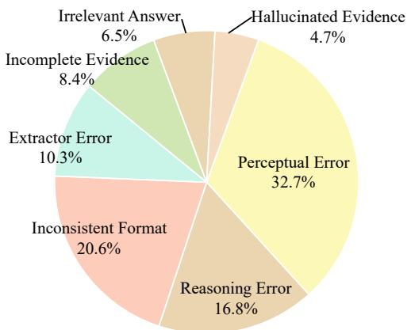  
Figure 6: Error distribution over 97 annotated GPT-4o errors.

Model Insights We analyze open-source models from two key aspects: dataset adaptation and training strategy. First, Qwen2-VL (LVLM) demonstrates superior performance over its LLM variant in Table 3, attributable to its extensive multimodal training that strengthens both comprehension and generation capabilities across modalities. Second, LLaVA-OneVision-Chat outperforms its base model (LLaVA-OneVision), as it employ Direct Preference Optimization (DPO) and human feedback to boost generalization and reasoning in long-document tasks. Additionally, we observe frequent failures caused by poor layout analysis and table/chart parsing. Incorporating layout parsing into continual pretraining or fine-tuning could mitigate these errors. Alternatively, a multi-stage response framework—where models first parse document structure before reasoning—may improve performance.

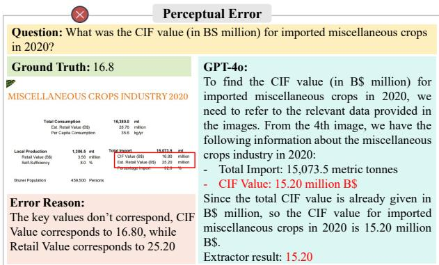  
Figure 7: A basic perception error, with the error highlighted in red.

## 6 Conclusion

In this study, we address the limitations of existing document benchmarks. We propose LongDocURL, which includes 20 capabilities across 3 tasks, 3 evidence modes, and 4 document elements. A semi-automated pipeline generated over 2,300 highquality question-answer pairs, covering more than 33,000 pages of documents. Subsequently, we conducted a comprehensive evaluation of 26 different parameter amounts of both open-source and closed-source models, revealing potential gaps in document understanding.

## Limitations

From the perspective of dataset source, the types of documents discussed in this paper are still limited. A broader range of data sources would provide richer document layouts and element information, which would be more beneficial for evaluation. Moreover, the dataset can be further expanded by the automated construction pipeline. On the other hand, designing better model structures and training processes to improve performance on Long-DocURLwill be more important. However, this may have gone beyond the scope of this paper.

## Acknowledgments

This work has been supported by the National Natural Science Foundation of China (NSFC) grant U23B2029 and Zhongguancun Academy Project No.20240102.

## References

Alibaba. 2024. Qwen2-VL: Enhancing vision-language model’s perception of the world at any resolution. Preprint, arXiv:2409.12191.

Anthropic. 2024. Claude 3.5 sonnet.

Srikar Appalaraju, Bhavan Jasani, Bhargava Urala Kota, Yusheng Xie, and R. Manmatha. 2021. Docformer: End-to-end transformer for document understanding. In 2021 IEEE/CVF International Conference on Computer Vision, ICCV 2021, Montreal, QC, Canada, October 10-17, 2021, pages 973–983. IEEE.

Tsachi Blau, Sharon Fogel, Roi Ronen, Alona Golts, Shahar Tsiper, Elad Ben-Avraham, Aviad Aberdam, Roy Ganz, and Ron Litman. 2024. GRAM: global reasoning for multi-page VQA. In IEEE/CVF Conference on Computer Vision and Pattern Recognition, CVPR 2024, Seattle, WA, USA, June 16-22, 2024, pages 15598–15607. IEEE.

Yew Ken Chia, Liying Cheng, Hou Pong Chan, Chaoqun Liu, Maojia Song, Sharifah Mahani Aljunied, Soujanya Poria, and Lidong Bing. 2024. M-longdoc: A benchmark for multimodal super-long document understanding and a retrieval-aware tuning framework. Preprint, arXiv:2411.06176.

Jaemin Cho, Jie Lei, Hao Tan, and Mohit Bansal. 2021. Unifying vision-and-language tasks via text generation. In Proceedings ofthe 38th International Conference on Machine Learning, ICML 2021, 18-24 July 2021, Virtual Event, volume 139 of Proceedings of Machine Learning Research, pages 1931–1942. PMLR.

Jaemin Cho, Debanjan Mahata, Ozan Irsoy, Yujie He, and Mohit Bansal. 2024. M3docrag: Multi-modal retrieval is what you need for multipage multi-document understanding. Preprint, arXiv:2411.04952.

Yihao Ding, Kaixuan Ren, Jiabin Huang, Siwen Luo, and Soyeon Caren Han. 2024a. MMVQA: A comprehensive dataset for investigating multipage multimodal information retrieval in pdf-based visual question answering. In Proceedings of the Thirty-Third International Joint Conference on Artificial Intelligence, IJCAI 2024, Jeju, South Korea, August 3-9, 2024, pages 6243–6251. ijcai.org.

Yihao Ding, Kaixuan Ren, Jiabin Huang, Siwen Luo, and Soyeon Caren Han. 2024b. PDF-MVQA: A dataset for multimodal information retrieval in pdf-based visual question answering. CoRR, abs/2404.12720.

Qi Dong, Lei Kang, and Dimosthenis Karatzas. 2024a. Multi-page document VQA with recurrent memory transformer. In Document Analysis Systems - 16th IAPR International Workshop, DAS 2024, Athens, Greece, August 30-31, 2024, Proceedings, volume 14994 of Lecture Notes in Computer Science, pages 57–70. Springer.

Xiaoyi Dong, Pan Zhang, Yuhang Zang, Yuhang Cao, Bin Wang, Linke Ouyang, Songyang Zhang, Haodong Duan, Wenwei Zhang, Yining Li, et al.

2024b. Internlm-Xcomposer2-4KHD: A pioneering large vision-language model handling resolutions from 336 pixels to 4k hd. ArXiv preprint, abs/2404.06512.

GeminiTeam. 2024. Gemini 1.5: Unlocking multimodal understanding across millions of tokens of context. Preprint, arXiv:2403.05530.

Anwen Hu, Haiyang Xu, Liang Zhang, Jiabo Ye, Ming Yan, Ji Zhang, Qin Jin, Fei Huang, and Jingren Zhou. 2024. mPLUG-DocOwl2: High-resolution compressing for ocr-free multi-page document understanding. CoRR, abs/2409.03420.

Yupan Huang, Tengchao Lv, Lei Cui, Yutong Lu, and Furu Wei. 2022. Layoutlmv3: Pre-training for document AI with unified text and image masking. In MM ’22: The 30th ACM International Conference on Multimedia, Lisboa, Portugal, October 10 - 14, 2022, pages 4083–4091. ACM.

Mengzhao Jia, Wenhao Yu, Kaixin Ma, Tianqing Fang, Zhihan Zhang, Siru Ouyang, Hongming Zhang, Meng Jiang, and Dong Yu. 2024. Leopard: A vision language model for text-rich multi-image tasks. CoRR, abs/2410.01744.

Dongfu Jiang, Xuan He, Huaye Zeng, Cong Wei, Max Ku, Qian Liu, and Wenhu Chen. 2024. MANTIS: interleaved multi-image instruction tuning. CoRR, abs/2405.01483.

Lei Kang, Rubèn Tito, Ernest Valveny, and Dimosthenis Karatzas. 2024. Multi-page document visual question answering using self-attention scoring mechanism. In Document Analysis and Recognition - IC-DAR 2024 - 18th International Conference, Athens, Greece, August 30 - September 4, 2024, Proceedings, Part VI, volume 14809 of Lecture Notes in Computer Science, pages 219–232. Springer.

Jordy Van Landeghem, Rafal Powalski, Rubèn Tito, Dawid Jurkiewicz, Matthew B. Blaschko, Lukasz Borchmann, Mickaël Coustaty, Sien Moens, Michal Pietruszka, Bertrand Anckaert, Tomasz Stanislawek, Pawel Józiak, and Ernest Valveny. 2023. Document understanding dataset and evaluation (DUDE). In IEEE/CVF International Conference on Computer Vision, ICCV 2023, Paris, France, October 1-6, 2023, pages 19471–19483. IEEE.

Feng Li, Renrui Zhang, Hao Zhang, Yuanhan Zhang, Bo Li, Wei Li, Zejun Ma, and Chunyuan Li. 2024. Llava-next-interleave: Tackling multi-image, video, and 3d in large multimodal models. CoRR, abs/2407.07895.

Haotian Liu, Chunyuan Li, Qingyang Wu, and Yong Jae Lee. 2023. Visual instruction tuning. In Advances in Neural Information Processing Systems 36: Annual Conference on Neural Information Processing Systems 2023, NeurIPS 2023, New Orleans, LA, USA, December 10 - 16, 2023.

Yuliang Liu, Biao Yang, Qiang Liu, Zhang Li, Zhiyin Ma, Shuo Zhang, and Xiang Bai. 2024. TextMonkey: An ocr-free large multimodal model for understanding document. Preprint, arXiv:2403.04473.

Pan Lu, Hritik Bansal, Tony Xia, Jiacheng Liu, Chunyuan Li, Hannaneh Hajishirzi, Hao Cheng, Kai-Wei Chang, Michel Galley, and Jianfeng Gao. 2024. Mathvista: Evaluating mathematical reasoning of foundation models in visual contexts. In The Twelfth International Conference on Learning Representations, ICLR 2024, Vienna, Austria, May 7-11, 2024. OpenReview.net.

Yubo Ma, Yuhang Zang, Liangyu Chen, Meiqi Chen, Yizhu Jiao, Xinze Li, Xinyuan Lu, Ziyu Liu, Yan Ma, Xiaoyi Dong, Pan Zhang, Liangming Pan, Yu-Gang Jiang, Jiaqi Wang, Yixin Cao, and Aixin Sun. 2024. Mmlongbench-doc: Benchmarking long-context document understanding with visualizations. CoRR, abs/2407.01523.

Ahmed Masry, Do Xuan Long, Jia Qing Tan, Shafiq R. Joty, and Enamul Hoque. 2022. Chartqa: A benchmark for question answering about charts with visual and logical reasoning. In Findings ofthe Association for Computational Linguistics: ACL 2022, Dublin, Ireland, May 22-27, 2022, pages 2263–2279. Association for Computational Linguistics.

Minesh Mathew, Dimosthenis Karatzas, and C. V. Jawahar. 2021. Docvqa: A dataset for VQA on document images. In IEEE Winter Conference on Applications of Computer Vision, WACV 2021, Waikoloa, HI, USA, January 3-8, 2021, pages 2199–2208. IEEE.

Meta. 2024. Introducing meta llama 3: The most capable openly available llm to date.

OpenAI. 2024. Hello gpt-4o.

QwenTeam. 2024. Qwen2.

Rubèn Tito, Dimosthenis Karatzas, and Ernest Valveny. 2022. Hierarchical multimodal transformers for multi-page docvqa. CoRR, abs/2212.05935.

Maria Wang, Srinivas Sunkara, Gilles Baechler, Jason Lin, Yun Zhu, Fedir Zubach, Lei Shu, and Jindong Chen. 2024. Webquest: A benchmark for multimodal QA on web page sequences. CoRR, abs/2409.13711.

Yang Xu, Yiheng Xu, Tengchao Lv, Lei Cui, Furu Wei, Guoxin Wang, Yijuan Lu, Dinei A. F. Florêncio, Cha Zhang, Wanxiang Che, Min Zhang, and Lidong Zhou. 2021. LayoutLMv2: Multi-modal pre-training for visually-rich document understanding. In Proceedings ofthe 59th Annual Meeting ofthe Associationfor Computational Linguistics and the 11th International Joint Conference on Natural Language Processing, ACL/IJCNLP 2021, (Volume 1: Long Papers), Virtual Event, August 1-6, 2021, pages 2579–2591. Association for Computational Linguistics.

Yiheng Xu, Minghao Li, Lei Cui, Shaohan Huang, Furu Wei, and Ming Zhou. 2020. LayoutLM: Pre-training of text and layout for document image understanding. In KDD ’20: The 26th ACM SIGKDD Conference on Knowledge Discovery and Data Mining, Virtual Event, CA, USA, August 23-27, 2020, pages 1192– 1200. ACM.

Shi Yu, Chaoyue Tang, Bokai Xu, Junbo Cui, Junhao Ran, Yukun Yan, Zhenghao Liu, Shuo Wang, Xu Han, Zhiyuan Liu, and Maosong Sun. 2024. Visrag: Vision-based retrieval-augmented generation on multi-modality documents. CoRR, abs/2410.10594.

Jinxu Zhang, Yongqi Yu, and Yu Zhang. 2024a. Cfretdvqa: Coarse-to-fine retrieval and efficient tuning for document visual question answering. CoRR, abs/2403.00816.

Jinxu Zhang, Yongqi Yu, and Yu Zhang. 2024b. CREAM: coarse-to-fine retrieval and multi-modal efficient tuning for document VQA. In Proceedings ofthe 32nd ACM International Conference on Multimedia, MM 2024, Melbourne, VIC, Australia, 28 October 2024 - 1 November 2024, pages 925–934. ACM.

## A More Statistics of LongDocURL

Figure 8 illustrate our dataset distribution characteristics across document pages, answer evidence page, evidence pages length, document sources, and evidence element types.

## B Method Details

## B.1 QA Construction

## B.1.1 Prompt Template for QA Generation

You are an expert in document question-answering dialogue synthesis. Please complete the following instructions based on the given text. The response must be true and accurate, and no additional content should be output.

[Task Description] Your task is <detailed\_task\_description>

Ensure questions and answers are suitable and correct.

Only include questions that have definite answers, that is:

• one can see the content in the image that the question asks about and can answer confidently;

• one can determine confidently from the image that it is not in the image, don’t ask any question that cannot be answered confidently.

Provide detailed evidence description first and then give final short answers. Use examples or reasoning steps to support your content. You can include multiple paragraphs if necessary.

<other\_restriction\_description>

[Response Examples]

<few\_qa\_examples>

[Context Input]

<structured\_text> | <previous\_response>

Notes: <structured\_text> refers to text-typebbox triple processed by Docmind engine, which is discussed in detail in Section 3.2.1. <previous\_response> refers to possible intermediate result(e.g., summary sentences in our Para-Title Locating task. Specifically, we prompt LVLMs to generate summary sentences of one or multiple paragraphs under certain section titles first, and then utilize these summaries and title names to construct question-answering data.)

## B.1.2 Prompt Template for QA Verification

## [System]

You are an expert in document question-answering verification. Please complete the following instructions based on the given text. The response must be true and accurate, and no additional content should be output.

[Task description & Verification criteria] Your task is to ensure the quality of question-answer pairs in the context provided. you need to follow the steps outlined below to systematically evaluate each pair’s effectiveness and accuracy. Implement this process diligently to maintain high standards across the batch of QA pairs.

## 1. Question type check

Does the question match the task description: <task\_description>

Make sure the question meets the required task context.

## 2. Formatting and Presentation

Is answer properly formatted?   
Ensure the answer uses a list format to store the title content.

## 3. Relevance Check

Does the question relate directly to document content rely on the context provided, the answer accurately reflect the information in the document?

Ensure the question is formulated based on information explicitly stated or implied in the document. The question should not introduce concepts unrelated to the document’s content.

Validate that the answer references specific data or statements from the document. Avoid including extraneous information not supported by the document.

## 4. Clarity and Precision

Is the question clear and unambiguous? And is the answer concise and precise? Ensure the language is straightforward and easily understandable, avoid complex phrasing that may confuse the reader.

The intention of the question and answer pair must be clear and direct, avoiding verbosity and unnecessary detail.

Ensure the answer fully addresses the question without omitting crucial information.

## 5. Consistency and Coherence

Check for logical flow and coherence, ensuring the question aligns seamlessly with the document’s narrative or arguments. Verify that the answer does not contradict or misrepresent other sections of the document.

By practicing this process, you can confirm whether the quality of the question-answer pairs meets the requirements. If all the above conditions are met, please output yes, otherwise output no.

Generated QA: <qa>

Input Context: <evidence\_context>

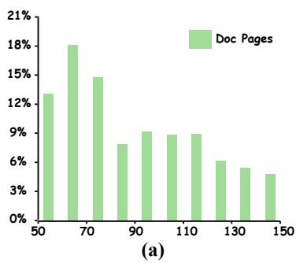

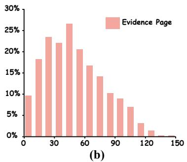

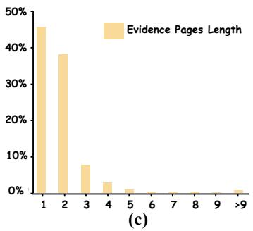

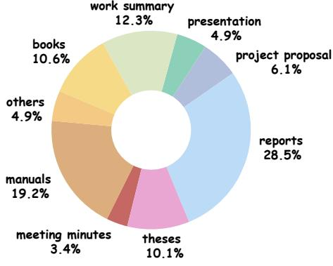  
(d)

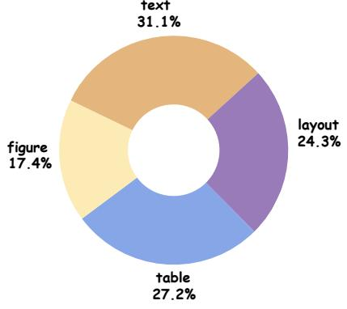  
(e)  
Figure 8: The statistical analysis of our dataset about the distribution characteristics across (a) document pages, (b) answer evidence page, (c) evidence pages length, (d) document sources, and (e) evidence element types.

## B.1.3 Statistics of QA Verification

<table><tr><td>Verify</td><td>U+R</td><td>L</td></tr><tr><td>Before</td><td>2857</td><td>1520</td></tr><tr><td>After</td><td>1630</td><td>695</td></tr><tr><td></td><td>57.1%↓</td><td>45.7%↓</td></tr></table>

Table 5: Statistics of changes in the amount of data before and after verification.

## C Comparison with MMLongBench-Doc

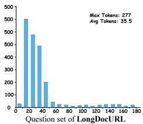

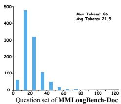

(a) Comparison of Token Length  


  
(b) Comparison of Word Cloud  
Figure 9: The dataset attributes comparison between our LongDocURL and MMLongBench-Doc.

## D Experimental Details

## D.1 Merging Rules of Images Input

As discussed in Section 4.4, we design a merge paradigm for the evaluation of current LLMs/LVLMs.

#Columns\_merged = 2 if total\_pages $/ 3 0 ~ < =$ 4 else 3
<table><tr><td>Total_pages</td><td>#Columns_merged | #Images_merged</td><td></td></tr><tr><td>50&lt;x&lt;=60</td><td>2</td><td> $\mathrm { { x } } / 2$ </td></tr><tr><td>60&lt;x&lt;=90</td><td>2</td><td> $_ { \mathrm { X } / 3 }$ </td></tr><tr><td>90&lt;x&lt;=120</td><td>2</td><td>x/4</td></tr><tr><td>120&lt;x&lt;=150</td><td>3</td><td>x/5</td></tr></table>

Table 6: Merging rules in the ablation experiment of input paradigms. #Columns\_merged: the number of columns in the sub-image array in the merged image; #Images\_merged: the number of new images after merged.

## D.2 Selection Rules of Images Input

As discussed in Section 4.2, we design a cutoff paradigm for the evaluation of current LLMs/LVLMs. We provide pseudo-code below to express the selection rules.

# All page ids mentioned are based on the order in the raw   
document.   
# context\_start\_end: page start/end id of context in qa   
generation   
# num\_of\_images\_input: the number of input images, 30   
images in cut-off paradigm   
# total\_pages: total pages in the raw document   
# img\_start, img\_end: input page start/end id   
raw\_start\_page, raw\_end\_page =   
context\_start\_end   
raw\_pages\_len = raw\_end\_page - raw\_start\_page   
img\_start = max(0, raw\_start\_page -   
(num\_of\_images\_input - raw\_pages\_len)//2   
img\_end = img\_start + num\_of\_images\_input   
if img\_end >= total\_pages:   
img\_end = total\_pages   
img\_start = max(0,   
img\_end - num\_of\_images\_input)   
return img\_start, img\_end

## D.3 Prompt for Response Generation

```xml
<document_images>
You are an expert in visual document question
answering, please answer our questions based on the
given doc images.
Following is our question:
<question_start><question></question_end>
```

## D.4 Prompt for Answer Extraction

Prompt for answer extraction is displayed in Figure 10. Based on the template given in MMLongBench-Doc (Ma et al., 2024), we make some modifications, which are marked in blue.

## D.5 Scoring Rules

Following MATHVISTA (Lu et al., 2024), we evaluate the model’s responses by scoring the extracted answers against the reference answers. Following MMLongBench-Doc (Ma et al., 2024), our scorer is rule-based and employs different strategies according to the format of the reference answer. We detail its rules as below:

String: We firstly use a series of regular expressions to determine whether the answers require exact matching (e.g., telephone numbers, email addresses, website addresses, file names, times, dates, etc.) If an exact match is needed, we perform a straightforward string comparison and score the answer either 0 or 1. Otherwise, we calculate the ANLS (Average Normalized Levenshtein Similarity) with a pre-defined threshold (τ = 0.5).

Integer: We perform an exact match comparison and score the answer either 0 or 1.

Float: We view the prediction and reference answers as equal if they fall within a 1% relative

tolerance.

List: Compared with MMLongBench-Doc, we adopt a relatively soft rule for scoring answers in list format: (1) If the prediction does not have the same number of elements as the reference, it incurs a length-dependent penalty instead of receiving a score of 0, which we think more reasonable. (2) The score of models on single element of the reference list is the highest one among the scores which are calculated and combined between the element and each one of the prediction list. Compared with MMLongBench-Doc, we assume that the sorting positions of the two lists are not always one-to-one corresponding, allowing more errors, and our rules are gentler and more tolerant. We use pseudo-code below to express the scoring rules in MMLongBench-Doc and our LongDocURL, respectively. The element-wise scoring strategies is determined by the formats of elements (i.e., string, integer or float).

```julia
# MMLongBench-Doc
pred_list, ref_list = sorted(pred_list), sorted(ref_list)
Score(pred_list, ref_list) = min([score(pred, ref) for
pred, ref in zip(pred_list, ref_list)])
# LongDocURL
pred_list, ref_list = sorted(pred_list), sorted(ref_list)
greedy_scores_list = [
max([score(pred, ref) for pred in pred_list]) for ref in
ref_list
]
Score(ref_list, pred_list) =
sum(greedy_scores_list) / len(ref_list) * min(1,
len(ref_list) / len(pred_list)) ** 0.5
```  
The part of the rule description that differs from MMLongBench-Doc is mainly in the List section.

## D.6 Fine-Grained Evaluation Results

Detailed results are presented in Table 7.   
Related analysis is in Section 4.3.1.

## E Case Study

Figure 11 and Figure 12 display the response of different models, and we give a short error analysis for each case.

## F Data Examples

Figure 13, Figure 14 and Figure 15 provide samples for three primary tasks.

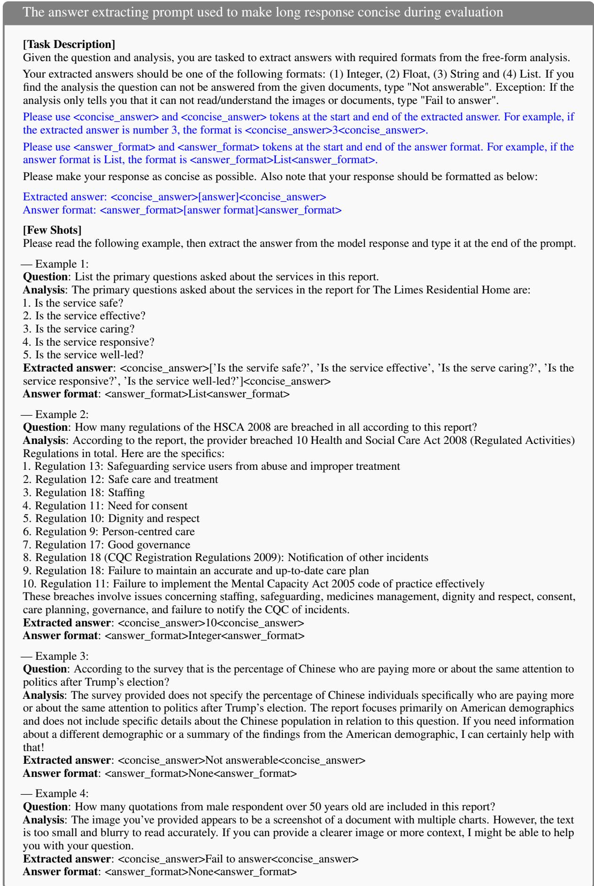  
Figure 10: Prompt for answer extraction during evaluation.

<table><tr><td rowspan="3">Model</td><td rowspan="3">Size</td><td colspan="3">Task Type</td><td colspan="4">Evidence Element</td><td colspan="4">Page/Element</td><td rowspan="3">Total</td></tr><tr><td>U</td><td>R</td><td>L</td><td>TXT</td><td>LAY</td><td>FIG</td><td></td><td>TAB</td><td>SP MP</td><td></td><td>CE</td></tr><tr><td>1243</td><td>387</td><td>695</td><td>994</td><td>779</td><td></td><td>556</td><td>871</td><td>1093 1230</td><td></td><td>862</td><td>2325</td></tr><tr><td colspan="10">OCR (PyMuPDF⁴) + Large Language Models (LLMs)</td><td rowspan="2"></td><td rowspan="2"></td><td rowspan="2"></td><td rowspan="2"></td></tr><tr><td colspan="10">Open-source Models</td></tr><tr><td>LLaVA-Next-Interleave</td><td>7B</td><td>26.4</td><td>17.2</td><td></td><td>5.8</td><td>26.0</td><td>13.8</td><td>15.4</td><td>14.0</td><td>14.4</td><td>22.6</td><td>16.0</td><td></td><td>18.7</td></tr><tr><td>LLaVA-Next-Interleave-DPO</td><td>7B</td><td>28.7</td><td>16.4</td><td>6.4</td><td>27.4</td><td></td><td>15.7</td><td>17.7</td><td>14.2</td><td>15.1</td><td>24.3</td><td>17.5</td><td></td><td>20.0</td></tr><tr><td>LLaVA-OneVision</td><td>7B</td><td>31.0</td><td>20.2</td><td>11.2</td><td></td><td>32.6</td><td>19.2</td><td>22.1</td><td>15.1</td><td>17.5</td><td>28.5</td><td></td><td>21.0</td><td>23.3</td></tr><tr><td>LLaVA-OneVision-Chat</td><td>7B</td><td>31.7</td><td>20.9</td><td>14.0</td><td></td><td>33.1</td><td>19.8</td><td>25.3</td><td>16.6</td><td></td><td>20.0</td><td>28.8</td><td>22.2</td><td>24.6</td></tr><tr><td>Qwen2-VL</td><td>7B</td><td>31.4</td><td>22.5</td><td>14.9</td><td></td><td>33.2</td><td>20.6</td><td>25.0</td><td>17.2</td><td></td><td>20.7</td><td>28.7</td><td>22.6</td><td>25.0</td></tr><tr><td>Qwen2.5-Instruct</td><td>7B</td><td>29.6</td><td>23.7</td><td>20.5</td><td></td><td>31.4</td><td>27.0</td><td>24.3</td><td>18.2</td><td></td><td>21.5</td><td>29.7</td><td>24.2</td><td>25.9</td></tr><tr><td>Qwen2.5-Instruct</td><td>14B</td><td>31.3</td><td>23.9</td><td>24.2</td><td></td><td>33.3</td><td>29.3</td><td>24.8</td><td>21.6</td><td></td><td>23.5</td><td>31.8</td><td>26.5</td><td>27.9</td></tr><tr><td>Qwen2.5-Instruct</td><td>32B</td><td>30.0</td><td>25.7</td><td>29.5</td><td></td><td>31.9</td><td>30.4</td><td>28.9</td><td>25.8</td><td></td><td>26.4</td><td>31.6</td><td>29.6</td><td>29.2</td></tr><tr><td>Qwen2.5-Instruct</td><td>72B</td><td>33.9</td><td>27.2</td><td>34.2</td><td></td><td>37.4</td><td>33.8</td><td>34.0</td><td>28.6</td><td></td><td>29.3</td><td>36.0</td><td>35.3</td><td>32.9</td></tr><tr><td>Proprietary Models Qwen-Max</td><td></td><td>32.1</td><td>24.5</td><td>34.0</td><td></td><td>34.6</td><td>32.8</td><td>32.6</td><td>27.7</td><td></td><td>28.3</td><td>34.1</td><td>33.2</td><td>31.4</td></tr><tr><td>Gemini-1.5-Pro</td><td></td><td>33.3</td><td>26.7</td><td></td><td>32.8</td><td>35.5</td><td>34.7</td><td>32.4</td><td>26.9</td><td></td><td>28.3</td><td>35.4</td><td>33.1</td><td>32.0</td></tr><tr><td>Qwen-VL-Max</td><td></td><td>37.7</td><td>30.0</td><td></td><td>27.3</td><td>39.6</td><td>31.2</td><td>35.1</td><td>27.9</td><td></td><td>31.1</td><td>35.2</td><td>34.2</td><td>33.3</td></tr><tr><td>GPT-40</td><td></td><td>35.4</td><td>28.3</td><td>37.2</td><td></td><td>37.6</td><td></td><td></td><td></td><td></td><td></td><td></td><td></td><td></td></tr><tr><td></td><td></td><td></td><td>31.2</td><td></td><td></td><td></td><td>36.3</td><td>36.3</td><td>30.2</td><td></td><td>31.9</td><td>37.2</td><td>35.8</td><td>34.7</td></tr><tr><td>01-preview</td><td></td><td>35.6</td><td></td><td></td><td>38.6</td><td>37.4</td><td>37.1</td><td>37.3</td><td>34.6</td><td></td><td>33.5</td><td>37.8</td><td>38.6</td><td>35.8</td></tr><tr><td colspan="9">Large Vision Language Models (LVLMs)</td><td colspan="7"></td></tr><tr><td colspan="10">Open-source Models InternLM-XC2.5 7B 3.6 1.8 0.7 3.9 2.2 1.9 1.2</td><td colspan="7"></td></tr><tr><td colspan="10">mPLUG-DocOwl2 7B 7.7 3.8 1.8 8.1 4.7 5.5 3.1</td><td colspan="7">1.9 2.9 2.3</td></tr><tr><td colspan="10"></td><td colspan="7">3.7 6.7</td></tr><tr><td>Pixtral</td><td colspan="10">12B</td><td colspan="4"></td><td>6.1 5.3</td></tr><tr><td>Llama-3.2</td><td>11B</td><td>7.9 12.9</td><td>3.7 9.4</td><td>2.4 2.7</td><td>8.8</td><td></td><td>4.8</td><td>4.3</td><td>3.1</td><td>4.8</td><td></td><td>6.2</td><td>5.3</td><td>5.6</td></tr><tr><td></td><td></td><td></td><td></td><td></td><td></td><td>11.8</td><td>6.9</td><td>8.7</td><td>6.3</td><td>7.9</td><td></td><td>10.3</td><td>6.8</td><td>9.2</td></tr><tr><td>LLaVA-Next-Interleave</td><td>7B</td><td>20.2</td><td>13.0</td><td>3.8</td><td></td><td>21.8</td><td>10.8</td><td>12.1</td><td>6.7</td><td>10.0</td><td></td><td>17.8</td><td>11.3</td><td>14.1</td></tr><tr><td>LLaVA-Next-Interleave-DPO</td><td>7B</td><td>21.6</td><td>13.9</td><td>7.6</td><td></td><td>22.5</td><td>13.9</td><td>15.4</td><td>8.7</td><td>12.1</td><td></td><td>19.8</td><td>13.5</td><td>16.2</td></tr><tr><td>LLaVA-OneVision</td><td>7B</td><td>28.1</td><td>16.5</td><td>14.1</td><td></td><td>30.8</td><td>23.9</td><td>17.9</td><td>11.6</td><td></td><td>16.5</td><td>26.8</td><td>20.8</td><td>22.0</td></tr><tr><td>LLaVA-OneVision-Chat</td><td>7B</td><td>30.5</td><td>19.0</td><td>18.7</td><td></td><td>32.2</td><td>26.5</td><td>24.4</td><td>15.4 23.7</td><td>27.2</td><td>19.8</td><td>29.7 33.6</td><td>24.2 29.9</td><td>25.0 30.6</td></tr><tr><td>Qwen2-VL Proprietary Models</td><td>7B</td><td>36.9</td><td>24.8</td><td>22.6</td><td></td><td>37.7</td><td>29.7</td><td>28.6</td></table>

Table 7: Generalized accuracy scores(0\~1) on LongDocURL. There are 3 types of tasks: (U)nderstanding, (R)easoning, and (L)ocalization. There are 4 types of evidence elements: pure text(TXT), layout(LAY), chart & image(FIG), and table(TAB). There are 3 types of evidence pages/elements: single-page(SP), multi-page(MP), and cross-element(CE). Cross-element means at least two element types in the evidence(e.g., chart and table). The highest scores among models in each section are highlighted in green .

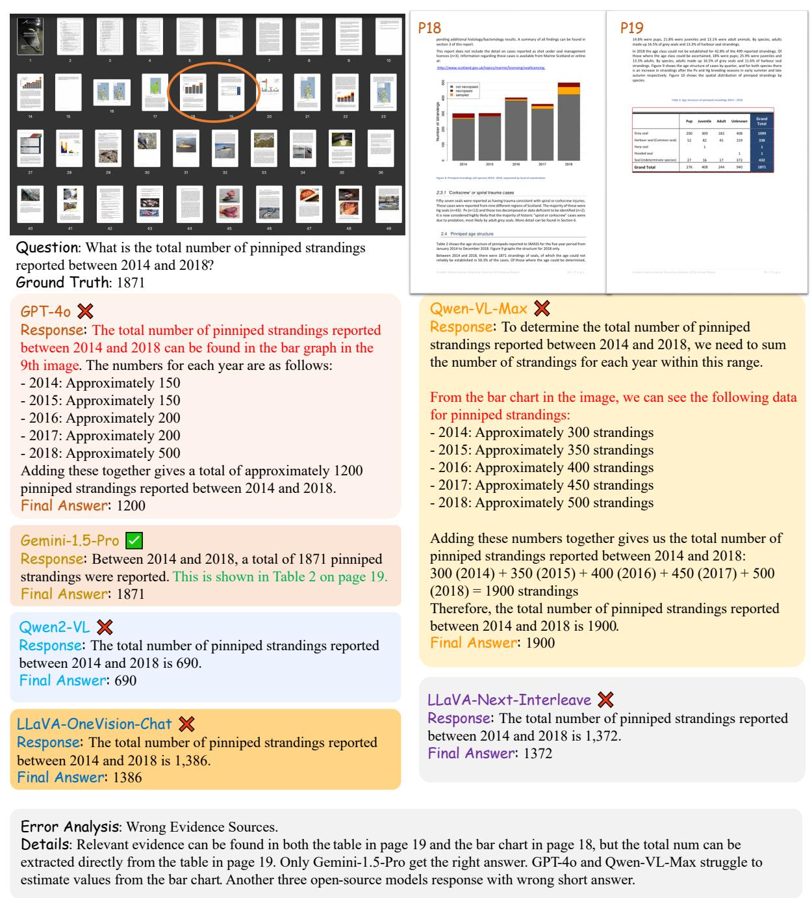  
Figure 11: Case 1. Evidence source: ["Table"]. Evidence pages: [26, 27]. The correct extracted information and reasoning are colored in green, and the wrong ones are colored in red.

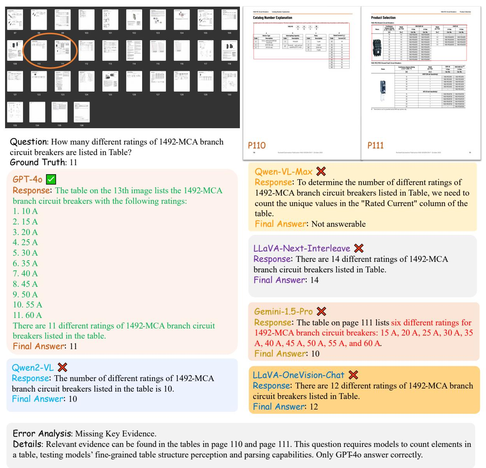  
Figure 12: Case 2. Evidence source: ["Table"]. Evidence pages: [110, 111]. The correct extracted information and reasoning are colored in green, and the wrong ones are colored in red.

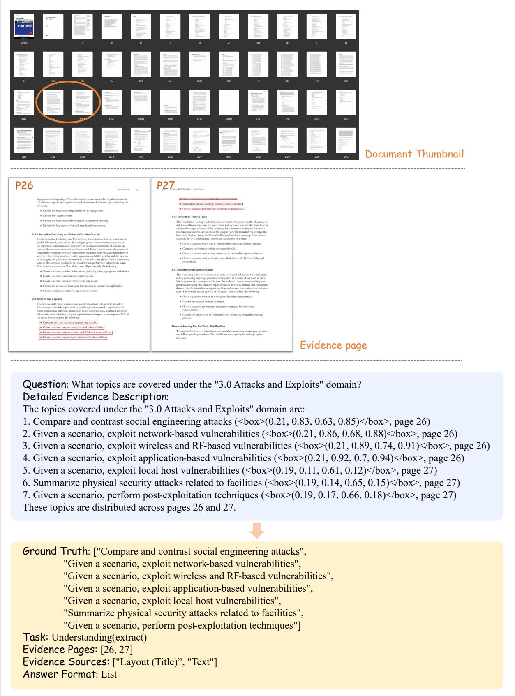  
Figure 13: Data Example of Understanding QA.

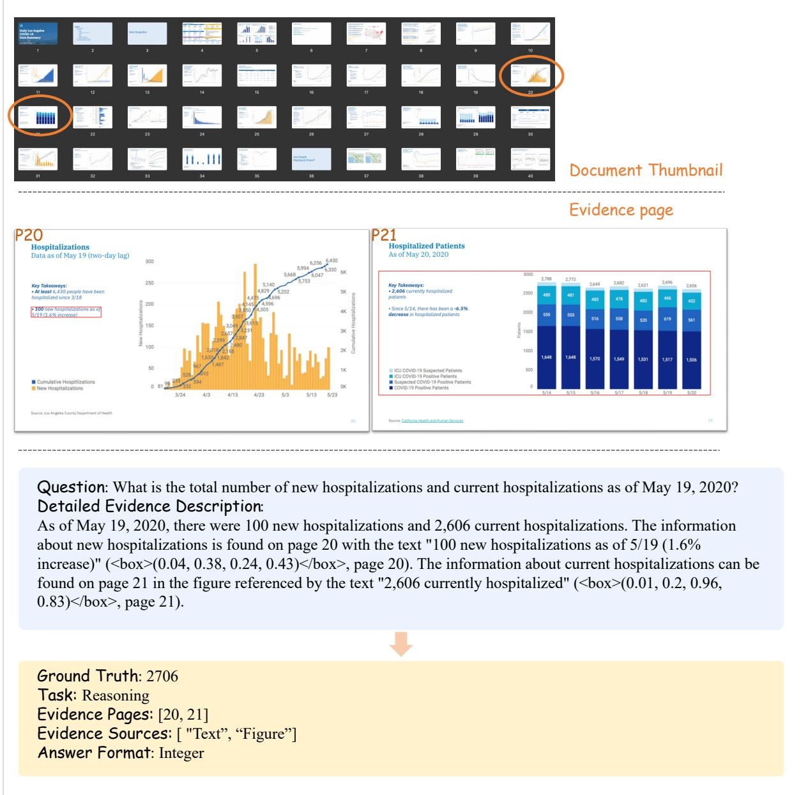  
Figure 14: Data Example of Reasoning QA.

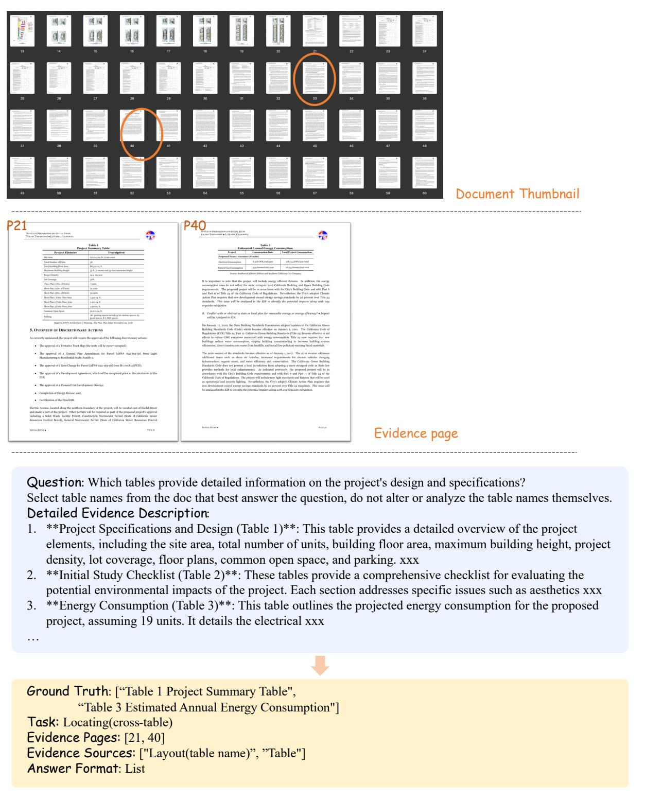  
Figure 15: Data Example of Locating QA.

## G Error Analysis

We conduct a detailed error analysis of the bestperforming model, GPT-4o. We randomly sample 97 errors and examine their distribution in detail. Based on this analysis, we classify the errors into five types, with the specific categories and their distribution shown in Figure 6. Except for the Extractor Error caused by our automatic evaluation pipeline, we present detailed definitions and descriptions of another six categories below:

Perceptual Error: This category remains prevalent in complex document understanding tasks, where models frequently fail to accurately recognize, parse, or enumerate visual elements like tables, figures, and formulas in document screenshots. See Figure 7 and Figure 16 for examples.

Reasoning Error: Ranking as the third most prevalent error type, these failures occur during critical cognitive operations—including numerical calculations, comparative analyses, and content summarization—despite correct evidence retrieval. See Figure 17 for examples.

Inconsistent Format: While our ground truth annotations strictly preserve original document content, GPT-4o sometimes generates outputs with formatting discrepancies. These variations principally involve: (1) abbreviation/full-form inconsistencies, (2) inclusion/omission of numerical units, and (3) mismatches in decimal precision. See Figure 18 for examples.

Incomplete Evidence: The LongDocURL benchmark reveals significant model limitations in processing extensive multimodal documents, where essential query-relevant information is sometimes omitted from responses. See Figure 19 for examples.

Irrelevant Answer: Fundamental misinterpretations of query intent lead to responses that fail to address the actual information needs. See Figure 20 for examples.

Hallucinated Evidence: The most severe error type involves model-generated fabrications, where non-existent document content is created to substantiate incorrect responses. See Figure 21 for examples.

## H Description of labeling labor

At the dataset verification stage, we have 21 fulltime data annotators responsible for the labeling work in the human verifying process, while 6 professional annotators with postgraduate degrees or above perform the final data quality verification and cross-checking work.

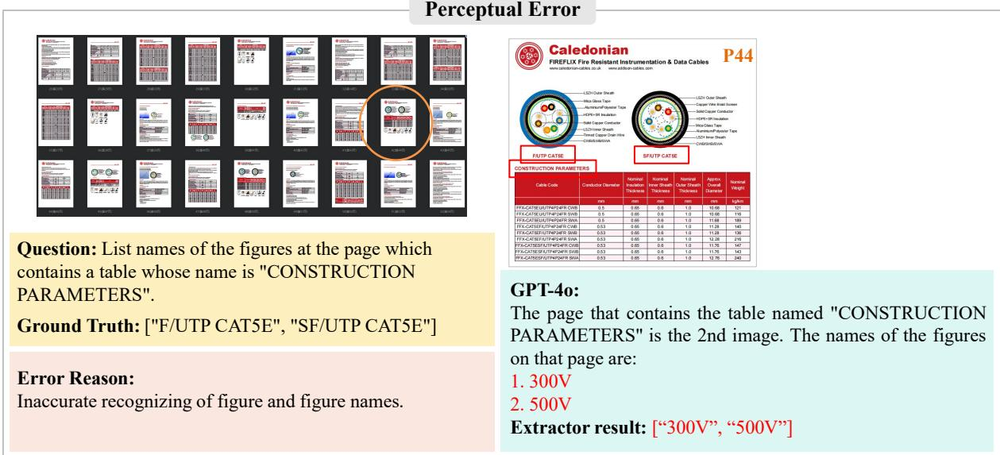  
Figure 16: An example of Perceptual Error.

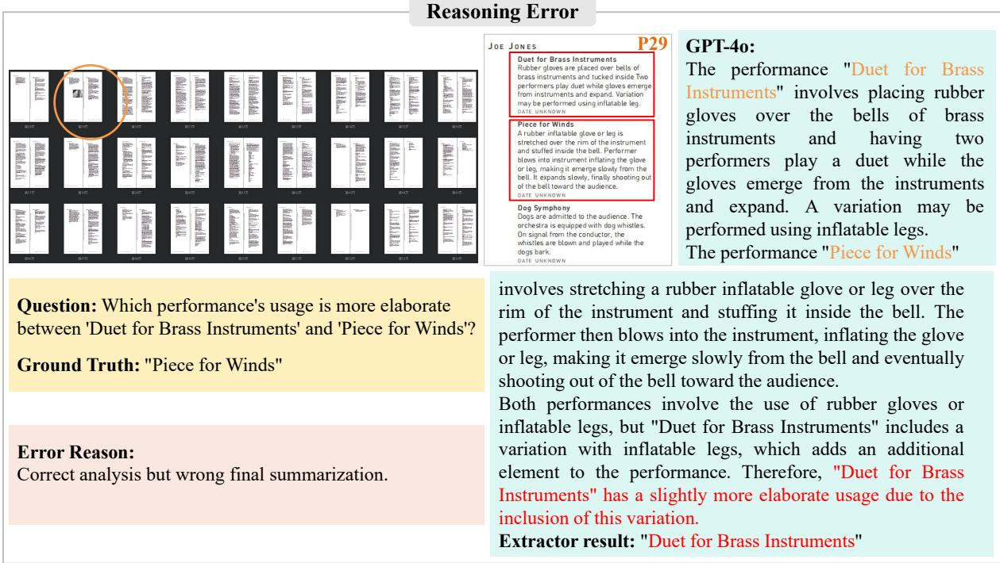  
Figure 17: An example of Reasoning Error.

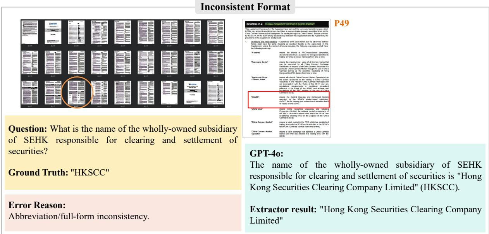  
Figure 18: An example of Inconsistent Format.

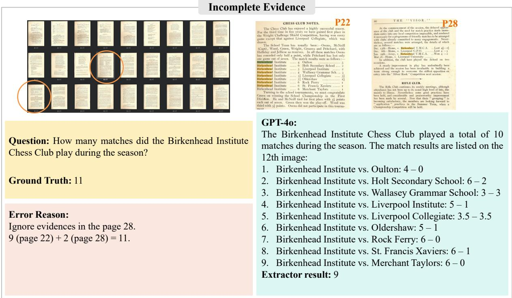  
Figure 19: An example of Incomplete Evidence.

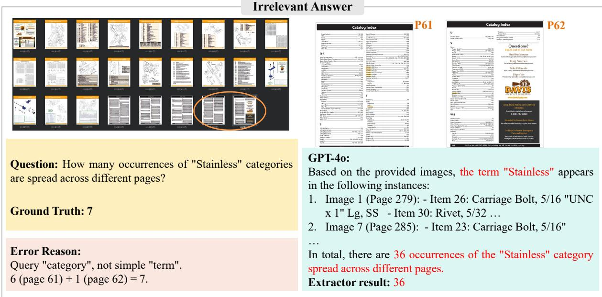  
Figure 20: An example of Irrelevant Answer.

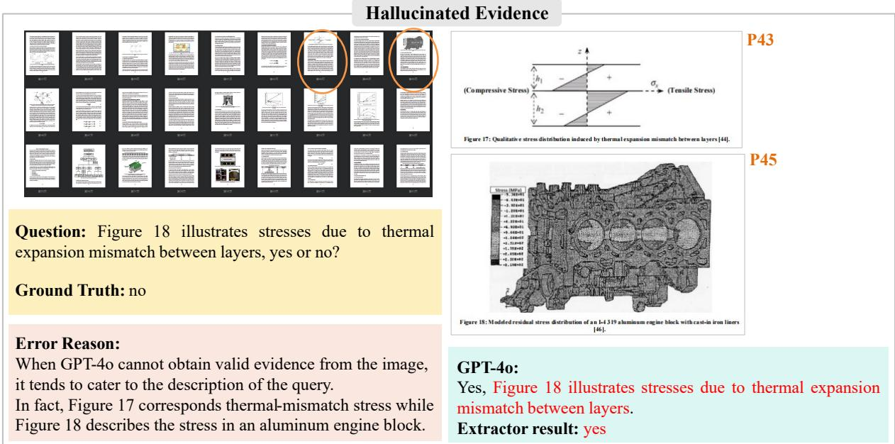  
Figure 21: An example of Hallucinated Evidence.