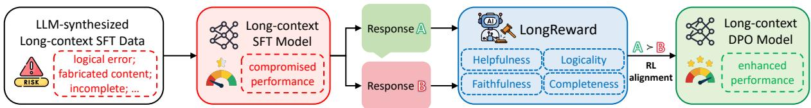
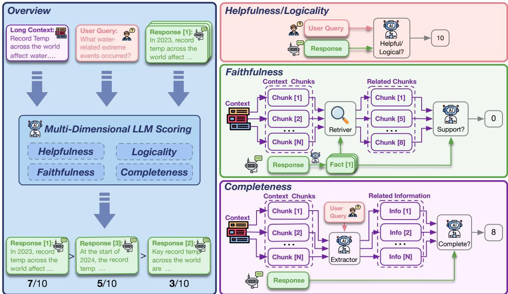
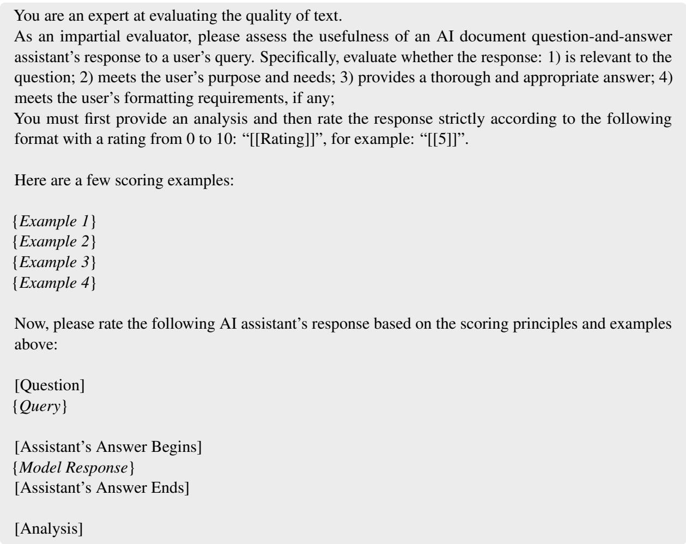
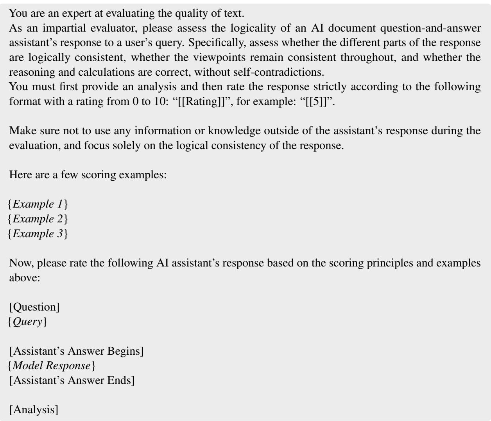
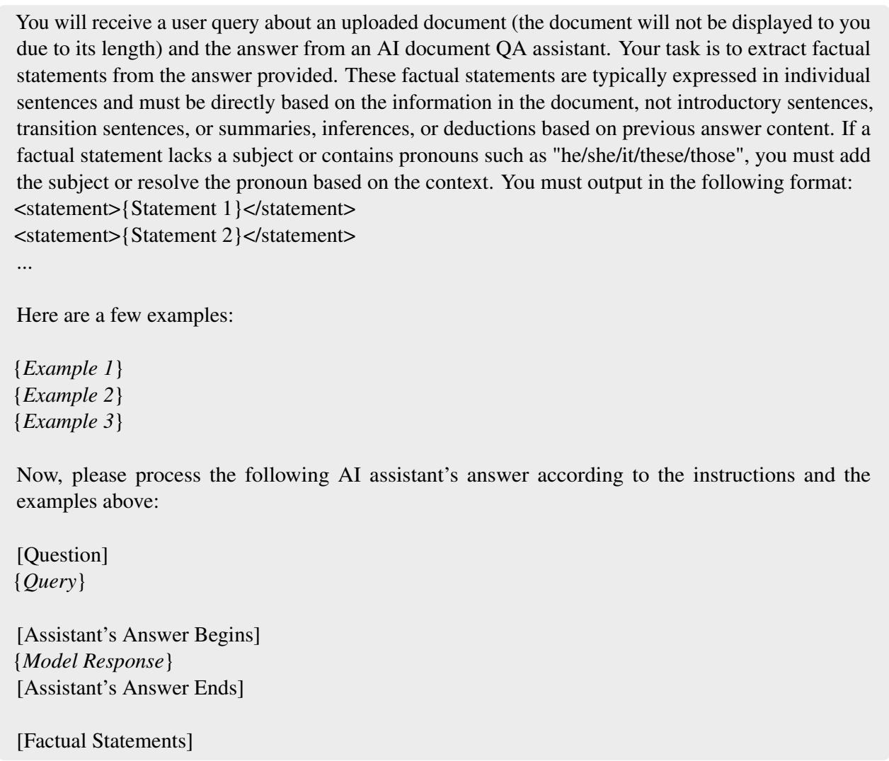
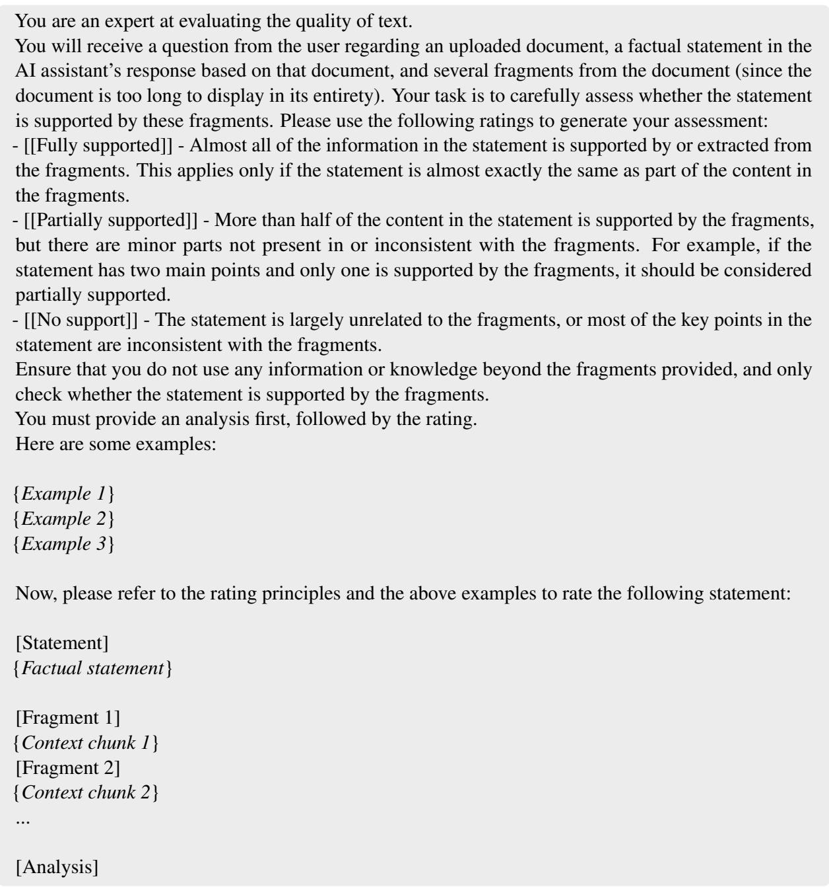
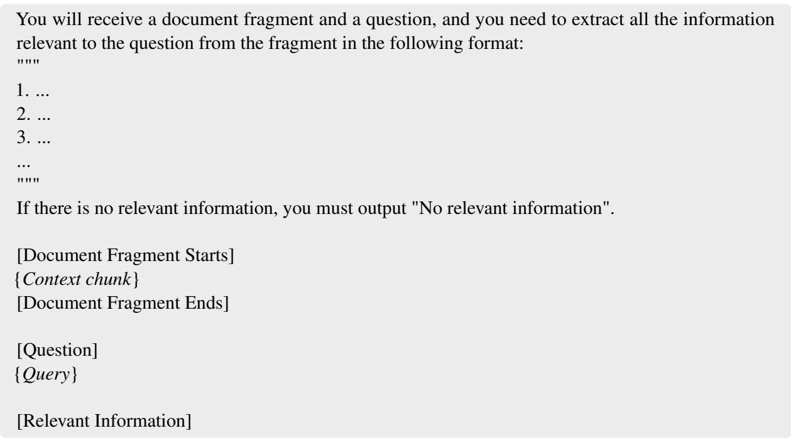
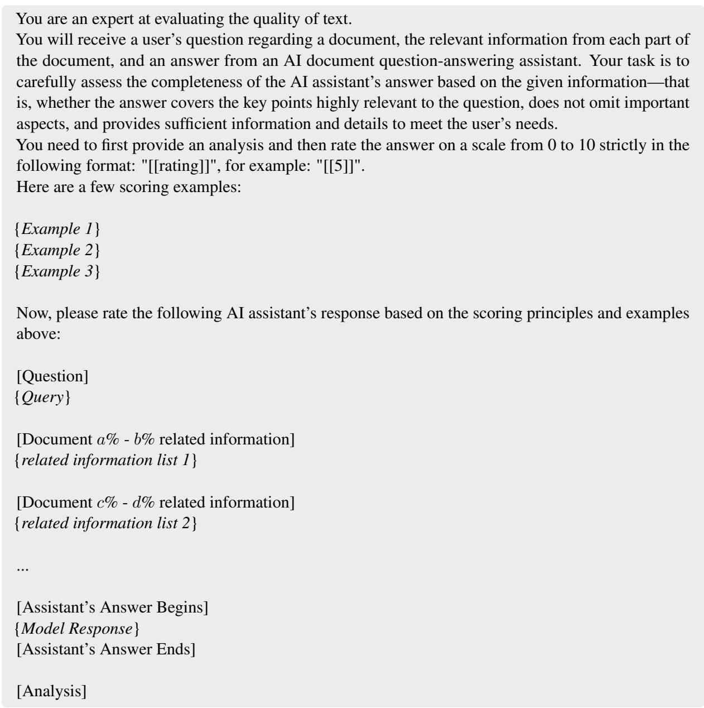
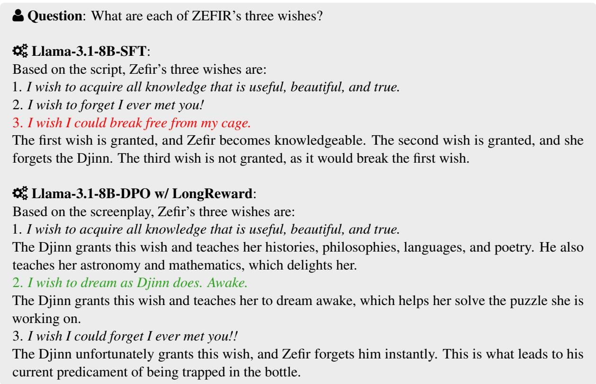

# LongReward: Improving Long-context Large Language Models with AI Feedback

Jiajie Zhang1†, Zhongni Hou2†, Xin Lv3, Shulin Cao3, Zhenyu Hou1, Yilin Niu3, Lei Hou1, Yuxiao Dong1, Ling Feng1, Juanzi Li1∗

1Tsinghua University 2University of Chinese Academy of Sciences 3Zhipu AI

## Abstract

Though significant advancements have been achieved in developing long-context large language models (LLMs), the compromised quality of LLM-synthesized data for supervised fine-tuning (SFT) often affects the long-context performance of SFT models and leads to inherent limitations. In principle, reinforcement learning (RL) with appropriate reward signals can further enhance models’ capacities. However, how to obtain reliable rewards in longcontext scenarios remains unexplored. To this end, we propose LongReward, a novel method that utilizes an off-the-shelf LLM to provide rewards for long-context model responses from four human-valued dimensions: helpfulness, logicality, faithfulness, and completeness, each with a carefully designed assessment pipeline. By combining LongReward and offline RL algorithm DPO, we are able to effectively improve long-context SFT models. Our experiments indicate that LongReward not only significantly improves models’ long-context performance but also enhances their ability to follow short instructions. We also find that longcontext DPO with LongReward and conventional short-context DPO can be used together without hurting either one’s performance.

## 1 Introduction

In recent years, significant advancements have been achieved in the development of long-context large language models (LLMs) (Anthropic, 2024; Zeng et al., 2024; Reid et al., 2024). The context windows of many contemporary LLMs have been extended to over 100,000 tokens, enabling them to process extensive context as input and perform various downstream tasks such as long document understanding and summarization (Bai et al., 2023).

Among numerous methods for extending the context window, an effective and well-established approach involves continual pre-training on longer texts, followed by supervised fine-tuning (SFT) using diverse long-context question-answering (QA) data (Xiong et al., 2023; Bai et al., 2024). However, due to the difficulty of annotation, most longcontext QA pairs are automatically synthesized by LLMs themselves (Bai et al., 2024; Vavekanand and Sam, 2024; An et al., 2024), making it challenging to guarantee the quality of data. For instance, the generated answers may not fully adhere to query requirements, contain logical errors, include fabricated content, or be incomplete. Such compromised data quality often affects the long-context capacities of SFT models, making them suffer from inherent flaws such as hallucinations (Huang et al., 2023) and inability to fully utilize the context information (Liu et al., 2024a; Zhang et al., 2024).

On the other hand, reinforcement learning (RL) with human- or AI-based rewards that penalize unpreferred behaviors has been shown as effective in reducing irrelevant, untruthful, and other undesired model outputs for short-context LLMs (Ouyang et al., 2022; Lee et al., 2024; Tian et al., 2024). Nevertheless, obtaining such rewards in long-context scenarios is still challenging due to the unscalability of human labeling and the lack of reliable long-context reward models.

In light of these challenges, we propose LongReward, a novel method that utilizes an off-the-shelf LLM as judge to provide rewards for long-contextbased model responses from four human-valued dimensions: (1) Helpfulness: whether the response is relevant and informative to the query and meets all the requirements; (2) Logicality: whether different parts of the response are logically consistent; (3) Faithfulness: whether all information in the response is consistent with the context; (4) Completeness: whether the response covers all questionrelevant key points in the context, without omitting important aspects. Given a model response, LongReward will give a score ranging from 0 to 10 for each dimension, and take their average as the final reward. Specifically, for helpfulness and logicality whose assessment primarily depends on the response content and is mostly independent of the context, we employ the LLM to directly assign scores based on the query and response through few-shot learning. For the estimation of faithfulness, we require the LLM to first break the response into a list of factual statements and then judge whether each statement is supported by the retrieved context chunks. Finally, for completeness, we first let the LLM extract question-relevant information from each segment of the context, then ask it again to evaluate the response completeness according to all the extracted information.

  
Figure 1: The compromised quality of synthesized SFT data often affects the performance of long-context SFT models, while LongReward utilizes an off-the-shelf LLM to provide reliable rewards for long-context-based model responses, enabling the employment of RL algorithms such as DPO to further enhance models’ capacities.

By combining LongReward and RL algorithms such as Direct Preference Optimization (DPO) (Rafailov et al., 2023), we can effectively mitigate the deficiencies of long-context SFT models and further enhance their capabilities. Our experiments on Llama-3.1-8B (Vavekanand and Sam, 2024) and GLM-4-9B (Zeng et al., 2024) show that the DPO models using LongReward outperform SFT models by 4.9% and 5.5% on long-context tasks, respectively, surpassing all baseline methods. Human evaluation further validates that LongReward has good alignment with human preference and helps improve long-context models from all dimensions (i.e., helpfulness, logicality, faithfulness, and completeness), bringing 46% more wins against the SFT baseline. Meanwhile, we find that LongReward also benefits models’ shortinstruction-following ability, and can be well incorporated into standard short-context DPO to jointly improve long- and short-context performance.

To summarize, our main contributions include: (1) proposing LongReward, the first method as we know to automatically provide reliable rewards for long-context-based model responses; (2) designing a long-context RL framework by combining

LongReward and DPO; (3) conducting extensive experiments to validate the efficacy of LongReward in improving long-context LLMs.

## 2 Related Work

Long-context LLMs. Long-context LLMs aim to break the context length limitations of exist ing LLMs and understand internal long-range dynamics (Bai et al., 2024; Ma et al., 2024). One research direction focuses on designing efficient attention mechanisms (Beltagy et al., 2020; Zaheer et al., 2020; Jiang et al., 2024) or structured state space models (Poli et al., 2023; Gu and Dao, 2023) to overcome the length limitations. For instance, Ding et al. (2023b) adopts sparse attention to scale the context length to billions of tokens. However, the performance of these methods usually falls short of standard Transformers (Gu and Dao, 2023; Ma et al., 2024). Another research branch focuses on extending Transformers’ context window via continual pre-training and SFT on longer texts (Xiong et al., 2023; Bai et al., 2024). Despite larger computation overhead, these methods typically demonstrate better performance on various long-context tasks. Nevertheless, their use of automatically synthesized SFT data that lacks human examination still compromises the capaci ties of current long-context LLMs to some extent. Improving LLMs with AI feedback. Reinforcement learning from human feedback is crucial in aligning LLMs with human values and intentions (Ouyang et al., 2022; Bai et al., 2022a; Sun et al., 2023). However, collecting high-quality human pairwise preference data can be expensive and time-consuming (Bai et al., 2022b; Lee et al., 2024). An alternative solution is to obtain feedback from LLMs, as modern LLMs have shown a high degree of alignment with human judgment (Ding et al., 2023a; Gilardi et al., 2023). Following this direction, Bai et al. (2022b) first integrates LLM labeled preferences data with human-labeled ones to optimize models’ harmlessness. Dubois et al.

(2023) further introduces the AlpacaFarm simulator, which leverages API LLMs to choose the preferred model responses, offering lower costs compared to human labelers. More recently, Yuan et al. (2024) develops self-rewarding language models, wherein the LLM itself acts as a judge, providing its rewards during training. However, these diverse approaches mainly focus on short-context scenarios. In contrast, our work first incorporates AI feedback with long-context scenarios and successfully improves LLMs’ long-context capability.

## 3 Methodology

In this section, we will briefly introduce reinforcement learning for LLMs as well as the DPO algorithm, and then discuss the methodology of LongReward, including multi-dimensional LLM scoring for long-context-based model responses and the combination of LongReward and DPO.

## 3.1 Preliminary

Reinforcement learning (RL) aligns LLMs with human preference by maximizing the average reward of model outputs, where a reward model $r ( x , y )$ assigns a scalar reward to each input-output pair (x, y) to represent its desirability (Ouyang et al., 2022; Bai et al., 2022a; Stiennon et al., 2020). Conventional RL algorithms such as PPO (Schulman et al., 2017) involve online response sampling and training multiple LLMs, thereby being complex to implement, while DPO (Rafailov et al., 2023) simplifies the RL process and proposes to directly learn from a dataset of preference pairs $\mathcal { D } = \{ ( x , y _ { w } , y _ { l } ) \}$ , where the winning response $y _ { w }$ is preferred over the losing response $y _ { l }$ given the same prompt x. The optimization objective of DPO is to maximize the difference between likelihood of preference pairs:

$$
\begin{array} { r l } & { \mathcal { L } _ { \mathrm { D P O } } ( \pi _ { \theta } ; \pi _ { \mathrm { r e f } } ) = - \mathbb { E } _ { ( x , y _ { w } , y _ { l } ) \sim { D } } } \\ & { [ \log \sigma ( \beta \log \frac { \pi _ { \theta } ( y _ { w } | x ) } { \pi _ { \mathrm { r e f } } ( y _ { w } | x ) } - \beta \log \frac { \pi _ { \theta } ( y _ { l } | x ) } { \pi _ { \mathrm { r e f } } ( y _ { l } | x ) } ) ] } \end{array}\tag{1}
$$

Here, $\pi _ { \theta }$ denotes the policy model, which is the LLM being trained and usually initialized from its SFT version, $\pi _ { \mathrm { r e f } }$ denotes the reference model, typically the frozen SFT model, and $\beta$ is a coefficient that controls the penalty intensity for dispreferred responses. Though DPO eliminates the need for an explicit reward model, many works still train a reward model (Liu et al., 2024b; Khaki et al.,

2024; Hou et al., 2024) or design proxy reward methods (Tian et al., 2024) to enable automated annotations of preference pairs and efficient sampling from the SFT policy, especially when human preference labeling is costly and unscalable.

## 3.2 LongReward

As mentioned in Sec. 1, the main obstacle to employing RL for long-context LLMs is the lack of approaches to obtain reliable rewards in longcontext scenarios. Inspired by LLM-as-Judge approach in open-ended question-answering evaluation (Zheng et al., 2023; Dubois et al., 2024; Liu et al., 2024c), we propose LongReward, a novel method that utilizes an off-the-shelf LLM $M _ { \mathrm { j u d g e } }$ to provide reward signals for long-context-based model responses. As illustrated in Figure 2, given a long-context prompt x (typically consisting of a lengthy context c and a query $q )$ and a response $y ,$ LongReward evaluates the response based on four dimensions that are valued by humans: helpfulness, logicality, faithfulness, and completeness. For each dimension, LongReward assigns a score ranging from 0 to 10, and the average of these scores constitutes the final reward. Below, we provide a detailed description of these four dimensions and their respective assessment methods. The detailed prompts are listed in Appendix A.

Helpfulness. We define a model response as “helpful” if it is relevant and informative to the query, fulfilling the user’s intended purpose and all the requirements. Since we treat faithfulness, i.e., the truthfulness of provided information, as a separate dimension instead of an aspect of helpfulness, the assessment of helpfulness can be directly based on the query and the response without referring to the lengthy context. Specifically, we first provide $M _ { \mathrm { j u d g e } }$ with detailed scoring principles and several examples with different helpfulness scores as references, then feed the query and the response into $M _ { \mathrm { j u d g e } }$ and ask it to rate helpfulness for the response. Similar to Zheng et al. (2023), we introduce Chain-of-Thought (CoT) (Wei et al., 2022), i.e., requiring $M _ { \mathrm { j u d g e } }$ to generate an analysis before providing the final score, to augment both the score reliability and interoperability.

Logicality. Since LLMs generate responses in an autoregressive way that lacks a rollback mechanism, it is difficult for them to fix errors once generated, even if the subsequent output and the conclusion are correct. This typically results in logical inconsistencies within their responses. Additionally, current LLMs often make mistakes in simple calculation and reasoning tasks. The focus of logicality assessment is to detect such logical errors in model responses, which is also independent of the context. Therefore, similar to the assessment of helpfulness, we utilize few-shot learning with CoT to enable $M _ { \mathrm { j u d g e } }$ to first find possible logical errors in the response and then rate its logicality.

  
Figure 2: Illustration of LongReward. LongReward evaluates a long-context-based model response from four dimensions: helpfulness, logicality, faithfulness, and completeness. It assigns a score ranging from 0 to 10 for each dimension, and takes their average as the final reward.

Faithfulness. Faithfulness measures the proportion of factual information in a model response that aligns with the context. Since it is challenging to directly find out all unfaithful information given the substantial context length, we follow the break-andcheck idea of FactScore (Min et al., 2023), requiring $M _ { \mathrm { J u d g e } }$ to first break the model response into a list of factual statements $\boldsymbol { S } = \{ s _ { 1 } , \ldots , s _ { n } \}$ , and then judge whether each statement $s _ { i }$ is supported by the most relevant context, which are top-k 128- token chunks retrieved from the context taken $s _ { i }$ as the query. Meanwhile, we make the following changes to better adapt to long-context scenarios as well as improve efficiency: (1) Current longcontext models are prone to copy sentences from the context, so we break the model response into sentence-level factual statements instead of atomic statements to improve the retrieval recall and reduce the number of fact-checking; (2) Since most responses contain several “functional sentences” such as “... has the following advantages:” and “In summary, ...” that do not provide factual information or are conclusions or reasoning based on the previous response content, we require $M _ { \mathrm { j u d g e } }$ to omit these sentences when decomposing responses to improve assessment accuracy. (3) For each factual statement $s _ { i } .$ , we consider three supporting levels: full support, partial support, and no support, and set the corresponding score $a _ { i }$ to be 1, 0.5, and 0, respectively. The final faithfulness score is calculated as $\textstyle { \bigl ( } 1 0 \cdot \sum _ { i = 1 } ^ { n } a _ { i } { \bigr ) } / n$

Completeness. The focus of completeness is to ascertain whether the response covers all questionrelevant key points in the context and provides sufficient information and details to meet the user’s needs. Considering LLMs are likely to ignore information in the middle or tail of the context when it is extremely long (Liu et al., 2024a; Zhang et al., 2024), we adopt a divide-and-conquer strategy for completeness assessment. Specifically, we first divide the context into coarse-grained chunks with a length of 4.096 tokens and ask $M _ { \mathrm { j u d g e } }$ to extract question-relevant information from each chunk. Next, we concatenate all the information and call $M _ { j u d g e }$ again to assess whether the response encompasses all important aspects without any apparent omissions, then assign a final score for completeness. The scoring process is also implemented with few-shot learning and CoT.

## 3.3 Long-context DPO with LongReward

Now that we have an automated approach to calculate rewards for long-context-based model responses, we can combine it with some RL algorithms to further enhance long-context SFT models. Here, we demonstrate how to combine LongReward with DPO, one of the most popular offline RL algorithms. The key to applying DPO for a given long-context SFT model $M _ { \mathrm { S F T } }$ is to construct a long-context preference dataset, which can be done using LongReward and a set of long-context prompts. These prompts can be either from the SFT dataset or newly collected. For each prompt, we first sample m candidate responses from MSFT using simple temperature sampling with temperature 1.0. For each response, we then apply LongReward to obtain its reward. Following (Hou et al., 2024), we ultimately choose the responses with the highest and lowest reward as the preference pair for the prompt. Finally, we can fine-tune $M _ { \mathrm { S F T } }$ with DPO to enhance its capacities. To further stabilize DPO training, we add an additional cross-entropy (CE) loss on the winning sequences as a regularization term, similar to (Pang et al., 2024):

$$
\begin{array} { r } { \mathcal { L } _ { \mathrm { C E } } ( \pi _ { \theta } ) = - \mathbb { E } _ { ( x , y _ { w } ) \sim \mathcal { D } } [ \log ( \pi _ { \theta } ( y _ { w } | x ) ) ] , } \end{array}\tag{2}
$$

$$
{ \mathcal { L } } _ { \mathrm { m e r g e } } = { \mathcal { L } } _ { \mathrm { D P O } } + \lambda \cdot { \mathcal { L } } _ { \mathrm { C E } }\tag{3}
$$

where λ denotes the scaling coefficient of CE loss.

## 4 Experiments

## 4.1 Experimental Setup

We conduct experiments on two latest open-source base models, namely Llama-3.1-8B (Vavekanand and Sam, 2024) and GLM-4-9B (Zeng et al., 2024), which have been continually pre-trained on extensive long texts and support a context window of 128k tokens. We first supervisedly fine-tune these two models, then conduct DPO experiment with LongReward, as described in Sec. 3.3. All models are trained using Megatron-LM library (Shoeybi et al., 2019) on 4 nodes with 8 H800 GPUs.

Supervised Fine-tuning. We adopt the method of Bai et al. (2024) to construct the long-context

SFT dataset. Specifically, we collect 10k documents from the pre-training corpus of GLM-4 (Zeng et al., 2024), covering 9 varied domains. These documents are mainly in English and Chinese and their lengths range from 8k to 64k tokens. For each document, we employ GLM-4 to propose a QA pair via Self-Instruct (Wang et al., 2023), where different task type descriptions such as summarization and information extraction are incorporated into the prompts to guarantee the diversity of generated queries. Following Bai et al. (2024), we mixed this dataset with 76k general SFT instances from ShareGPT (Chiang et al., 2023) and fine-tune Llama-3.1-8B and GLM-4-9B in the mixed dataset for 1,800 steps (approximately 2 epochs), with a learning rate of 1e-5 and a batch size of 8.

Direct Preference Optimization. We follow the pipeline described in Sec. 3.3 to construct the preference datasets, using prompts from the longcontext SFT dataset and taking GLM-4 as $M _ { \mathrm { j u d g e } } .$ For each prompt, we sample 10 candidate responses. We adopt Zhipu-Embedding-2† as the retriever for the assessment of faithfulness and retrieve top-5 context chunks for each factual statement. For DPO training, we set $\beta$ and λ to be 0.15 and 0.1, respectively. We use a learning rate of 1e-6 and a batch size of 16, and train from the SFT checkpoints for around 400 to 800 steps.

## 4.2 Baselines

Besides the SFT models, we consider the following long-context preference data generation policies as baselines:

Short-context reward model (SRM). This policy utilizes the short-context reward model trained by Hou et al. (2024) to construct preference datasets, where we ignore the context and only feed the query and response into the reward model due to its limited context window.

Contrast with larger models (Contrast). This policy uses responses generated by GLM-4 and the SFT model as the winning and losing responses, respectively, based on the observation that larger LLMs typically generate better responses.

In addition, we also report the performance of officially post-trained models, i.e., Llama-3.1-8B-Instruct and GLM-4-9B-Chat, as references.

<table><tr><td>Dataset</td><td>Task Type</td><td>#Data</td><td>Avg Len</td><td>Language</td><td>Metric</td><td>Judge Model</td></tr><tr><td colspan="7">Long-context Benchmark</td></tr><tr><td>LongBench-Chat</td><td>Multi-Task</td><td>50</td><td>35,571</td><td>English/Chinese</td><td>Point-wise Rate</td><td>GPT-40</td></tr><tr><td></td><td>Single-Doc QA</td><td>750</td><td>8,573</td><td>English/Chinese</td><td>Point-wise Rate</td><td>GPT-40</td></tr><tr><td>LongBench</td><td>Multi-Doc QA</td><td>800</td><td>1,0255</td><td>English/Chinese</td><td>Point-wise Rate</td><td>GPT-40</td></tr><tr><td></td><td>Summarization</td><td>800</td><td>9,210</td><td>English/Chinese</td><td>Point-wise Rate</td><td>GPT-40</td></tr><tr><td colspan="7">Short-context Benchmark</td></tr><tr><td>MT-Bench</td><td>Instruction Following</td><td>80</td><td></td><td>English</td><td>Point-wise Rate</td><td>GPT-4</td></tr><tr><td>AlpacaEval2</td><td>Instruction Following</td><td>805</td><td></td><td>English</td><td>LC Win Rate</td><td>GPT-4-turbo</td></tr></table>

Table 1: Detailed statistics of benchmarks we used for evaluation. "Avg Len" refers to the average number of words/characters in the context of English/Chinese instances. “LC Win Rate” denotes length-controlled Win Rate (Dubois et al., 2024) against GPT-4-turbo.
<table><tr><td rowspan="2">Model</td><td rowspan="2">Method</td><td rowspan="2">LongBench-Chat</td><td colspan="3">LongBench</td><td rowspan="2">Avg</td></tr><tr><td>S-Doc QA</td><td>M-Doc QA</td><td>Summ</td></tr><tr><td rowspan="5">Llama-3.1-8B</td><td>officially post-trained</td><td>60.2</td><td>59.3</td><td>42.9</td><td>35.3</td><td>49.4</td></tr><tr><td>SFT</td><td>69.8</td><td>66.1</td><td>44.5</td><td>39.6</td><td>55.0</td></tr><tr><td>DPO w/ SRM</td><td>67.4</td><td>65.0</td><td>49.6</td><td>42.7</td><td>56.2</td></tr><tr><td>DPO w/ Contrast</td><td>70.6</td><td>67.8</td><td>46.2</td><td>40.3</td><td>56.2</td></tr><tr><td>DPO w/ LongReward</td><td>72.6</td><td>67.8</td><td>55.8</td><td>43.2</td><td>59.9</td></tr><tr><td rowspan="5">GLM-4-9B</td><td>officially post-trained</td><td>68.6</td><td>67.8</td><td>56.9</td><td>47.9</td><td>60.3</td></tr><tr><td>SFT</td><td>64.8</td><td>68.4</td><td>50.9</td><td>42.1</td><td>56.6</td></tr><tr><td>DPO w/ SRM</td><td>66.6</td><td>67.5</td><td>57.4</td><td>48.2</td><td>59.9</td></tr><tr><td>DPO w/ Contrast</td><td>68.2</td><td>67.8</td><td>58.0</td><td>47.8</td><td>60.5</td></tr><tr><td>DPO w/ LongReward</td><td>69.2</td><td>71.9</td><td>58.8</td><td>48.5</td><td>62.1</td></tr></table>

Table 2: Results of automatic evaluation on long-context benchmarks rated by GPT-4o. "S-Doc QA", "M-Doc QA", and "Summ" denote Single-Doc QA, Multi-Doc QA, and Summarization, respectively.

## 4.3 Evaluation

Long-context benchmarks. We use two bilingual benchmarks LongBench-Chat (Bai et al., 2024) and LongBench (Bai et al., 2023) for the evaluation of long-context capacities, where the former is a small-scale dataset that evaluates models long-context alignment proficiency on 50 real-ward queries, and the latter is a comprehensive benchmark that tests general long-context understanding abilities. We conduct evaluations on three types of tasks within LongBench: Single-Doc QA, Multi-Doc QA, and Summarization (each task includes 4 sub-datasets), including 2,350 instances in total. Following Bai et al. (2024) and (Zhang et al., 2024), we ask GPT-4o to automatically rate the models responses based on the query and groundtruth answers via few-shot (for LongBench-Chat) or zeroshot prompting (for LongBench). In addition, we also conduct human evaluation in Sec. 4.4 and 4.7 to further validate the effectiveness of LongReward and its agreement with human preference.

Short-context benchmarks. We select two shortcontext benchmarks MT-Bench (Zheng et al., 2023) and AlpacaEval2 (Dubois et al., 2024) to investigate whether LongReward will influence models’ ability to follow short instructions. MT-Bench covers 8 categories with 80 questions and uses GPT-4 to rate model responses on a scale of 1-10, while AlpacaEval2 consists of 805 questions from 5 datasets and employs GPT-4-turbo to measure models’ length-controlled win rate against GPT-4-turbo. More detailed statistics of the evaluation datasets are listed in Table 1.

## 4.4 Results on Long-Context Benchmarks

Table 2 presents the automatic evaluation results on LongBench-Chat and LongBench rated by GPT-4o, where our proposed LongReward method demonstrates superior performance compared to other baselines. Specifically, the DPO version of Llama-3.1-8B and GLM-4-9B using LongReward significantly outperforms their SFT counterparts across all long-context tasks, with an average performance improvement of 4.9% and 5.5%, respectively. Moreover, the performance of the DPO models with LongReward also surpasses the officially post-trained models by 10.5% and 1.8%.

<table><tr><td>Method</td><td>#Facts</td><td>FactScore</td></tr><tr><td>Llama-3.1-8B</td><td></td><td></td></tr><tr><td>SFT</td><td>21.76</td><td>91.94</td></tr><tr><td>DPO w/ LongReward</td><td>32.86</td><td>92.85</td></tr><tr><td>GLM-4-9B</td><td></td><td></td></tr><tr><td>SFT</td><td>18.41</td><td>91.43</td></tr><tr><td>DPO w/ LongReward</td><td>28.05</td><td>93.62</td></tr></table>

Table 3: FactScore of the SFT and LongReward+DPO versions of models on 260 randomly sampled questions from LongBench-Chat and LongBench, taking GPT-4o-mini as the judge. "#Facts" and "FactScore" denote the average number of atomic facts and the ratio of supported facts per response, respectively.

<table><tr><td></td><td>Win</td><td>Tie Loss</td><td>∆(Win-Loss)</td></tr><tr><td>Helpfulness</td><td>0.14 0.84</td><td>0.02</td><td>0.12</td></tr><tr><td>Logicality</td><td>0.14 0.86</td><td>0.00</td><td>0.14</td></tr><tr><td>Faithfulness</td><td>0.32 0.64</td><td>0.04</td><td>0.28</td></tr><tr><td>Completeness</td><td>0.26 0.64</td><td>0.10</td><td>0.16</td></tr><tr><td>Overall</td><td>0.54 0.38</td><td>0.08</td><td>0.46</td></tr></table>

Table 4: Results of human evaluation of LongReward+DPO version of Llama-3.1-8B on LongBench-Chat against the SFT baseline. We report the proportion of wins, ties, and losses of the DPO model on each dimension.

In addition, we use FactScore (Min et al., 2023) and 260 questions randomly sampled from LongBench-Chat and LongBench (20 questions from each sub-dataset) to automatically evaluate models’ faithfulness. Specifically, we employ GPT-4o-mini to first break the model response into atomic facts and then judge whether each fact is supported by the retrieved context chunks. The results in Table 3 show that the DPO models using LongReward achieve higher FactScore (i.e., the ratio of supported facts) than the SFT baseline, demonstrating the effect of LongReward in improving faithfulness as well as reducing hallucinations for long-context LLMs. Meanwhile, the responses of DPO models typically contain more atomic facts, implying that their responses are more detailed and comprehensive.

Besides automatic evaluation, we also conduct a human evaluation on LongBench-Chat to further validate the effectiveness of LongReward in improving LLMs’ long-context capacities. Specifically, we anonymize and randomly shuffle the responses generated by the SFT and LongReward+DPO versions of Llama-3.1-8B, and ask two of the authors who are familiar with LongBench-Chat to manually judge which response is better. The annotators are required to first rate the response from four dimensions (i.e., helpfulness, logicality, faithfulness, and completeness), following the same scoring principles as LongReward, and then give the final comparison judgment. As shown in Table 4, the DPO model using Longreward maintains a distinct advantage over the SFT baseline, with an overall win-rate of 54% compared to 8%. Moreover, the DPO model obtains more wins across all four dimensions, indicating that the multi-dimensional scoring strategy of LongReward effectively helps enhance the model’s long-context capability from multiple aspects. Detailed cases can be found in Appendix B.

<table><tr><td>Method</td><td>MT-Bench</td><td>AlpacaEval2</td></tr><tr><td>Llama-3.1-8B</td><td></td><td></td></tr><tr><td>officially post-trained</td><td>8.13</td><td>22.9</td></tr><tr><td>SFT</td><td>7.12</td><td>12.4</td></tr><tr><td>DPO w/ SRM</td><td>7.58</td><td>13.7</td></tr><tr><td>DPO w/ Contrast</td><td>7.58</td><td>13.8</td></tr><tr><td>DPO w/ LongReward</td><td>7.24</td><td>14.2</td></tr><tr><td>GLM-4-9B</td><td></td><td></td></tr><tr><td>officially post-trained</td><td>8.09</td><td>22.4</td></tr><tr><td>SFT</td><td>7.37</td><td>12.5</td></tr><tr><td>DPO w/ SRM</td><td>7.50</td><td>14.2</td></tr><tr><td>DPO w/ Contrast</td><td>7.54</td><td>14.5</td></tr><tr><td>DPO w/ LongReward</td><td>7.58</td><td>15.4</td></tr></table>

Table 5: Performance of different models on shortcontext instruction-following benchmarks.

## 4.5 Results on Short-Context Benchmarks

Table 5 lists the evaluation results on MT-Bench and AlpacaEval2. Due to the simplicity of the general SFT data (i.e., ShareGPT) we used, a performance gap exists between our trained and officially post-trained models. Nevertheless, we surprisedly find that DPO on long-context preference datasets also benefits models’ ability to follow short instructions. Meanwhile, the DPO models using LongReward typically achieve better performance than other baselines, implying that the preferred values learned from LongReward can be well generalized to short-context scenarios.

<table><tr><td rowspan="2">Model</td><td rowspan="2">Preference Data</td><td colspan="2">Long Benchmark</td><td colspan="2">Short Benchmark</td></tr><tr><td>LongBench-Chat LongBench</td><td></td><td>MT-Bench AlpacaEval2</td><td></td></tr><tr><td rowspan="3">Llama-3.1-8B</td><td>Short</td><td>70.6</td><td>54.5</td><td>7.48</td><td>15.8</td></tr><tr><td>Long</td><td>72.6</td><td>55.6</td><td>7.24</td><td>14.2</td></tr><tr><td>Short + Long</td><td>73.0</td><td>57.3</td><td>7.51</td><td>14.9</td></tr><tr><td rowspan="3">GLM-4-9B</td><td>Short</td><td>67.0</td><td>56.3</td><td>7.62</td><td>14.7</td></tr><tr><td>Long</td><td>69.2</td><td>59.7</td><td>7.58</td><td>15.2</td></tr><tr><td>Short + Long</td><td>70.2</td><td>58.7</td><td>7.61</td><td>15.4</td></tr></table>

Table 6: Performance of DPO models using different preference datasets, where the short- and long-context preference data are constructed using short reward model trained by Hou et al. (2024) and LongReward, respectively.

<table><tr><td>Method</td><td>Accuracy</td></tr><tr><td>SRM</td><td>0.583</td></tr><tr><td>Paired comparison</td><td>0.571</td></tr><tr><td>LongReward</td><td>0.662</td></tr><tr><td>w/o Helpfulness</td><td>0.631</td></tr><tr><td>w/o Logicality</td><td>0.623</td></tr><tr><td>w/o Faithfulness</td><td>0.578</td></tr><tr><td>w/o Completeness</td><td>0.578</td></tr></table>

Table 7: Alignment of different reward methods with human preference on a set of 464 manually annotated long-context preference pairs, where the queries and responses are from LongBench-Chat and the SFT checkpoint of Llama-3.1-8B, respectively.

## 4.6 Combination with Short-context DPO

We also explore the compatibility of long-context DPO using LongReward and normal short-context DPO using SRM. Specifically, we utilize the SRM (Hou et al., 2024) and prompts from our general SFT dataset to construct short-context preference datasets, following a similar sample-and-rate pipeline as described in Sec. 3.3. Then we train the SFT checkpoints with DPO on the mix of long and short preference data. The evaluation results in Table 6 show that DPO on the mixed dataset well aggregates the advantages of individual short- and long-context DPO: it significantly improves models’ long-context performance as long-context DPO and also achieves comparable short-instructionfollowing performance with short-context DPO, indicating that LongReward can be well incorporated into conventional DPO pipeline to simultaneously enhance long- and short-context capacities.

## 4.7 Alignment with Human Preference

We conduct an experiment to evaluate the alignment of different reward methods with human preference in long-context scenarios. Specifically, we construct 464 preference pairs by manually rating the sampled responses from the SFT checkpoint of Llama-3.1-8B on LongBench-Chat. For each annotated pair, we employ different reward methods to predict which response is better, and then compute their accuracy by taking human preference as the golden label.

Besides the SRM trained by Hou et al. (2024) (which ignores the context when predicting rewards) and our proposed LongReward, we also consider paired comparison as a baseline, which asks an LLM to directly judge which response is better and is widely used in short-context RLAIF (Bai et al., 2022b; Lee et al., 2024). Specifically, given a preference pair, we input the two responses along with the four-dimension-based principles, query, and context into GLM-4, and require it to first give an analysis and then choose a better response.

We present the accuracy of different reward methods in Table 7. As we can observe, LongReward achieves the highest 66.2% accuracy, showing a better alignment with human than other baselines. This result is consistent with the observation of Hou et al. (2024) that a reward method can guide the training of RL with approximately 65% accuracy in mirroring human judgment. In addition, the ablation results in Table 7 also indicate that each dimension in LongReward is important for aligning with human values. On the other hand, we find that paired comparison even performs worse than SRM, indicating that current LLMs struggle to directly discern the quality difference between similar longcontext-based responses and also demonstrating the necessity of using LongReward.

## 5 Conclusion

In this work, we propose LongReward, a novel method that utilizes an off-the-shelf LLM to provide reliable rewards for model responses in longcontext scenarios, thereby enabling the employment of RL algorithms for further enhancing the capacities of long-context LLMs. Our DPO experiments indicate that LongReward not only significantly improves models’ long-context performance but also enhances their ability to follow short instructions. Meanwhile, we also find that longcontext DPO using LongReward can be well combined with the standard short-context DPO without hurting either method’s performance.

## 6 Limitations

We discuss several limitations of our work in this section: (1) LongReward relies on a well-aligned LLM such as GLM-4 to provide scores for each dimension and costs tens of API calls for each QA instance. In the future, we will try to train a smaller long-context reward model using our constructed preference datasets to enable faster and cheaper reward calculation. (2) Due to limited computational resources, we only conduct experiments on 10B level models with a maximum training length of 64k. We hope to explore long-context alignment on longer sequences and larger-scale models if there are more available resources. (3) From a data perspective, we primarily focus on user-intensive longcontext scenarios like long document QA and summarization. Generalizing LongReard to other more advanced long instruction tasks such as life-long dialogues and long-history agent tasks is also a promising direction.

## 7 Ethical Considerations

Though LongReward can effectively improve the faithfulness of long-context LLMs, it may still hallucinate, especially when the query involves common knowledge that is not presented in the context. Hence additional care and protective measures should be taken if our method is deployed in user-facing applications.

We have already desensitized the training data. All the evaluation datasets used in this work are publicly published with permissible licenses.

## 8 Acknowledgement

This work is supported by Beijing Natural Science Foundation (L243006), National Natural Science Foundation of China (62476150), Natural Science Foundation of China (NSFC) 62495063 and 62425601. This work is also supported by Zhipu AI.

## References

Shengnan An, Zexiong Ma, Zeqi Lin, Nanning Zheng, and Jian-Guang Lou. 2024. Make your LLM fully utilize the context. CoRR, abs/2404.16811.

Anthropic. 2024. Anthropic: Introducing claude 3.5 sonnet.

Yuntao Bai, Andy Jones, Kamal Ndousse, Amanda Askell, Anna Chen, Nova DasSarma, Dawn Drain, Stanislav Fort, Deep Ganguli, Tom Henighan, Nicholas Joseph, Saurav Kadavath, Jackson Kernion, Tom Conerly, Sheer El Showk, Nelson Elhage, Zac Hatfield-Dodds, Danny Hernandez, Tristan Hume, Scott Johnston, Shauna Kravec, Liane Lovitt, Neel Nanda, Catherine Olsson, Dario Amodei, Tom B. Brown, Jack Clark, Sam McCandlish, Chris Olah, Benjamin Mann, and Jared Kaplan. 2022a. Training a helpful and harmless assistant with reinforcement learning from human feedback. CoRR, abs/2204.05862.

Yuntao Bai, Saurav Kadavath, Sandipan Kundu, Amanda Askell, Jackson Kernion, Andy Jones, Anna Chen, Anna Goldie, Azalia Mirhoseini, Cameron McKinnon, Carol Chen, Catherine Olsson, Christopher Olah, Danny Hernandez, Dawn Drain, Deep Ganguli, Dustin Li, Eli Tran-Johnson, Ethan Perez, Jamie Kerr, Jared Mueller, Jeffrey Ladish, Joshua Landau, Kamal Ndousse, Kamile Lukosiute, Liane Lovitt, Michael Sellitto, Nelson Elhage, Nicholas Schiefer, Noemí Mercado, Nova DasSarma, Robert Lasenby, Robin Larson, Sam Ringer, Scott Johnston, Shauna Kravec, Sheer El Showk, Stanislav Fort, Tamera Lanham, Timothy Telleen-Lawton, Tom Conerly, Tom Henighan, Tristan Hume, Samuel R. Bowman, Zac Hatfield-Dodds, Ben Mann, Dario Amodei, Nicholas Joseph, Sam McCandlish, Tom Brown, and Jared Kaplan. 2022b. Constitutional AI: harmlessness from AI feedback. CoRR, abs/2212.08073.

Yushi Bai, Xin Lv, Jiajie Zhang, Yuze He, Ji Qi, Lei Hou, Jie Tang, Yuxiao Dong, and Juanzi Li. 2024. Longalign: A recipe for long context alignment of large language models. CoRR, abs/2401.18058.

Yushi Bai, Xin Lv, Jiajie Zhang, Hongchang Lyu, Jiankai Tang, Zhidian Huang, Zhengxiao Du, Xiao Liu, Aohan Zeng, Lei Hou, Yuxiao Dong, Jie Tang, and Juanzi Li. 2023. Longbench: A bilingual, multitask benchmark for long context understanding. CoRR, abs/2308.14508.

Iz Beltagy, Matthew E. Peters, and Arman Cohan. 2020. Longformer: The long-document transformer. CoRR, abs/2004.05150.

Wei-Lin Chiang, Zhuohan Li, Zi Lin, Ying Sheng, Zhanghao Wu, Hao Zhang, Lianmin Zheng, Siyuan Zhuang, Yonghao Zhuang, Joseph E. Gonzalez, Ion Stoica, and Eric P. Xing. 2023. Vicuna: An opensource chatbot impressing gpt-4 with 90%\* chatgpt quality.

Bosheng Ding, Chengwei Qin, Linlin Liu, Yew Ken Chia, Boyang Li, Shafiq Joty, and Lidong Bing. 2023a. Is GPT-3 a good data annotator? In Proceedings of the 61st Annual Meeting of the Association for Computational Linguistics (Volume 1: Long Papers), ACL 2023, Toronto, Canada, July 9-14, 2023, pages 11173–11195. Association for Computational Linguistics.

Jiayu Ding, Shuming Ma, Li Dong, Xingxing Zhang, Shaohan Huang, Wenhui Wang, Nanning Zheng, and Furu Wei. 2023b. Longnet: Scaling transformers to 1,000,000,000 tokens. arXiv preprint arXiv:2307.02486.

Yann Dubois, Balázs Galambosi, Percy Liang, and Tatsunori B. Hashimoto. 2024. Length-controlled alpacaeval: A simple way to debias automatic evaluators. CoRR, abs/2404.04475.

Yann Dubois, Chen Xuechen Li, Rohan Taori, Tianyi Zhang, Ishaan Gulrajani, Jimmy Ba, Carlos Guestrin, Percy Liang, and Tatsunori B. Hashimoto. 2023. Alpacafarm: A simulation framework for methods that learn from human feedback. In Advances in Neural Information Processing Systems 36: Annual Conference on Neural Information Processing Systems 2023, NeurIPS 2023, New Orleans, LA, USA, December 10 - 16, 2023.

Fabrizio Gilardi, Meysam Alizadeh, and Maël Kubli. 2023. Chatgpt outperforms crowd-workers for textannotation tasks. CoRR, abs/2303.15056.

Albert Gu and Tri Dao. 2023. Mamba: Linear-time sequence modeling with selective state spaces. CoRR, abs/2312.00752.

Zhenyu Hou, Yilin Niu, Zhengxiao Du, Xiaohan Zhang, Xiao Liu, Aohan Zeng, Qinkai Zheng, Minlie Huang, Hongning Wang, Jie Tang, and Yuxiao Dong. 2024. Chatglm-rlhf: Practices of aligning large language models with human feedback. CoRR, abs/2404.00934.

Lei Huang, Weijiang Yu, Weitao Ma, Weihong Zhong, Zhangyin Feng, Haotian Wang, Qianglong Chen, Weihua Peng, Xiaocheng Feng, Bing Qin, and Ting Liu. 2023. A survey on hallucination in large language models: Principles, taxonomy, challenges, and open questions. CoRR, abs/2311.05232.

Huiqiang Jiang, Yucheng Li, Chengruidong Zhang, Qianhui Wu, Xufang Luo, Surin Ahn, Zhenhua Han, Amir H. Abdi, Dongsheng Li, Chin-Yew Lin, Yuqing Yang, and Lili Qiu. 2024. Minference 1.0: Accelerating pre-filling for long-context llms via dynamic sparse attention. CoRR, abs/2407.02490.

Saeed Khaki, JinJin Li, Lan Ma, Liu Yang, and Prathap Ramachandra. 2024. RS-DPO: A hybrid rejection sampling and direct preference optimization method for alignment of large language models. In Findings of the Association for Computational Linguistics: NAACL 2024, Mexico City, Mexico, June 16-21, 2024, pages 1665–1680. Association for Computational Linguistics.

Harrison Lee, Samrat Phatale, Hassan Mansoor, Thomas Mesnard, Johan Ferret, Kellie Lu, Colton Bishop, Ethan Hall, Victor Carbune, Abhinav Rastogi, and Sushant Prakash. 2024. RLAIF vs. RLHF: scaling reinforcement learning from human feedback with AI feedback. In Forty-first International Conference on Machine Learning, ICML 2024, Vienna, Austria, July 21-27, 2024. OpenReview.net.

Nelson F. Liu, Kevin Lin, John Hewitt, Ashwin Paranjape, Michele Bevilacqua, Fabio Petroni, and Percy Liang. 2024a. Lost in the middle: How language models use long contexts. Trans. Assoc. Comput. Linguistics, 12:157–173.

Tianqi Liu, Yao Zhao, Rishabh Joshi, Misha Khalman, Mohammad Saleh, Peter J. Liu, and Jialu Liu. 2024b. Statistical rejection sampling improves preference optimization. In The Twelfth International Conference on Learning Representations, ICLR 2024, Vienna, Austria, May 7-11, 2024. OpenReview.net.

Xiao Liu, Xuanyu Lei, Shengyuan Wang, Yue Huang, Andrew Feng, Bosi Wen, Jiale Cheng, Pei Ke, Yifan Xu, Weng Lam Tam, Xiaohan Zhang, Lichao Sun, Xiaotao Gu, Hongning Wang, Jing Zhang, Minlie Huang, Yuxiao Dong, and Jie Tang. 2024c. Alignbench: Benchmarking chinese alignment of large language models. In Proceedings ofthe 62nd Annual Meeting of the Association for Computational Linguistics (Volume 1: Long Papers), ACL 2024, Bangkok, Thailand, August 11-16, 2024, pages 11621–11640. Association for Computational Linguistics.

Xuezhe Ma, Xiaomeng Yang, Wenhan Xiong, Beidi Chen, Lili Yu, Hao Zhang, Jonathan May, Luke Zettlemoyer, Omer Levy, and Chunting Zhou. 2024. Megalodon: Efficient LLM pretraining and inference with unlimited context length. CoRR, abs/2404.08801.

Sewon Min, Kalpesh Krishna, Xinxi Lyu, Mike Lewis, Wen-tau Yih, Pang Wei Koh, Mohit Iyyer, Luke Zettlemoyer, and Hannaneh Hajishirzi. 2023. Factscore: Fine-grained atomic evaluation of factual precision in long form text generation. In Proceedings ofthe 2023 Conference on Empirical Methods in Natural Language Processing, EMNLP 2023, Singapore, December 6-10, 2023, pages 12076–12100. Association for Computational Linguistics.

Long Ouyang, Jeffrey Wu, Xu Jiang, Diogo Almeida, Carroll L. Wainwright, Pamela Mishkin, Chong Zhang, Sandhini Agarwal, Katarina Slama, Alex Ray, John Schulman, Jacob Hilton, Fraser Kelton, Luke Miller, Maddie Simens, Amanda Askell, Peter Welinder, Paul F. Christiano, Jan Leike, and Ryan Lowe. 2022. Training language models to follow instructions with human feedback. In Advances in Neural Information Processing Systems 35: Annual Conference on Neural Information Processing Systems 2022, NeurIPS 2022, New Orleans, LA, USA, November 28 - December 9, 2022.

Richard Yuanzhe Pang, Weizhe Yuan, Kyunghyun Cho, He He, Sainbayar Sukhbaatar, and Jason Weston. 2024. Iterative reasoning preference optimization. CoRR, abs/2404.19733.

Michael Poli, Stefano Massaroli, Eric Nguyen, Daniel Y. Fu, Tri Dao, Stephen Baccus, Yoshua Bengio, Stefano Ermon, and Christopher Ré. 2023. Hyena hierarchy: Towards larger convolutional language models. In International Conference on Machine Learning, ICML 2023, 23-29 July 2023, Honolulu, Hawaii, USA, volume 202 of Proceedings ofMachine Learning Research, pages 28043–28078. PMLR.

Rafael Rafailov, Archit Sharma, Eric Mitchell, Christopher D. Manning, Stefano Ermon, and Chelsea Finn. 2023. Direct preference optimization: Your language model is secretly a reward model. In Advances in Neural Information Processing Systems 36: Annual Conference on Neural Information Processing Systems 2023, NeurIPS 2023, New Orleans, LA, USA, December 10 - 16, 2023.

Machel Reid, Nikolay Savinov, Denis Teplyashin, Dmitry Lepikhin, Timothy Lillicrap, Jean-baptiste Alayrac, Radu Soricut, Angeliki Lazaridou, Orhan Firat, Julian Schrittwieser, et al. 2024. Gemini 1.5: Unlocking multimodal understanding across millions of tokens of context. arXiv preprint arXiv:2403.05530.

John Schulman, Filip Wolski, Prafulla Dhariwal, Alec Radford, and Oleg Klimov. 2017. Proximal policy optimization algorithms. CoRR, abs/1707.06347.

Mohammad Shoeybi, Mostofa Patwary, Raul Puri, Patrick LeGresley, Jared Casper, and Bryan Catanzaro. 2019. Megatron-lm: Training multi-billion parameter language models using model parallelism. CoRR, abs/1909.08053.

Nisan Stiennon, Long Ouyang, Jeff Wu, Daniel M. Ziegler, Ryan Lowe, Chelsea Voss, Alec Radford, Dario Amodei, and Paul F. Christiano. 2020. Learning to summarize from human feedback. CoRR, abs/2009.01325.

Zhiqing Sun, Yikang Shen, Hongxin Zhang, Qinhong Zhou, Zhenfang Chen, David D. Cox, Yiming Yang, and Chuang Gan. 2023. SALMON: self-alignment with principle-following reward models. CoRR, abs/2310.05910.

Katherine Tian, Eric Mitchell, Huaxiu Yao, Christopher D. Manning, and Chelsea Finn. 2024. Finetuning language models for factuality. In The Twelfth International Conference on Learning Representations, ICLR 2024, Vienna, Austria, May 7-11, 2024. OpenReview.net.

Raja Vavekanand and Kira Sam. 2024. Llama 3.1: An in-depth analysis of the next-generation large language model. ResearchGate.

Yizhong Wang, Yeganeh Kordi, Swaroop Mishra, Alisa Liu, Noah A. Smith, Daniel Khashabi, and Hannaneh Hajishirzi. 2023. Self-instruct: Aligning language

models with self-generated instructions. In Proceedings of the 61st Annual Meeting of the Association for Computational Linguistics (Volume 1: Long Papers), ACL 2023, Toronto, Canada, July 9-14, 2023, pages 13484–13508. Association for Computational Linguistics.

Jason Wei, Xuezhi Wang, Dale Schuurmans, Maarten Bosma, Brian Ichter, Fei Xia, Ed H. Chi, Quoc V. Le, and Denny Zhou. 2022. Chain-of-thought prompting elicits reasoning in large language models. In Advances in Neural Information Processing Systems 35: Annual Conference on Neural Information Processing Systems 2022, NeurIPS 2022, New Orleans, LA, USA, November 28 - December 9, 2022.

Wenhan Xiong, Jingyu Liu, Igor Molybog, Hejia Zhang, Prajjwal Bhargava, Rui Hou, Louis Martin, Rashi Rungta, Karthik Abinav Sankararaman, Barlas Oguz, Madian Khabsa, Han Fang, Yashar Mehdad, Sharan Narang, Kshitiz Malik, Angela Fan, Shruti Bhosale, Sergey Edunov, Mike Lewis, Sinong Wang, and Hao Ma. 2023. Effective long-context scaling of foundation models. CoRR, abs/2309.16039.

Weizhe Yuan, Richard Yuanzhe Pang, Kyunghyun Cho, Xian Li, Sainbayar Sukhbaatar, Jing Xu, and Jason Weston. 2024. Self-rewarding language models. In Forty-first International Conference on Machine Learning, ICML 2024, Vienna, Austria, July 21-27, 2024. OpenReview.net.

Manzil Zaheer, Guru Guruganesh, Kumar Avinava Dubey, Joshua Ainslie, Chris Alberti, Santiago Ontañón, Philip Pham, Anirudh Ravula, Qifan Wang, Li Yang, and Amr Ahmed. 2020. Big bird: Transformers for longer sequences. In Advances in Neural Information Processing Systems 33: Annual Conference on Neural Information Processing Systems 2020, NeurIPS 2020, December 6-12, 2020, virtual.

Aohan Zeng, Bin Xu, Bowen Wang, Chenhui Zhang, Da Yin, Diego Rojas, Guanyu Feng, Hanlin Zhao, Hanyu Lai, Hao Yu, Hongning Wang, Jiadai Sun, Jiajie Zhang, Jiale Cheng, Jiayi Gui, Jie Tang, Jing Zhang, Juanzi Li, Lei Zhao, Lindong Wu, Lucen Zhong, Mingdao Liu, Minlie Huang, Peng Zhang, Qinkai Zheng, Rui Lu, Shuaiqi Duan, Shudan Zhang, Shulin Cao, Shuxun Yang, Weng Lam Tam, Wenyi Zhao, Xiao Liu, Xiao Xia, Xiaohan Zhang, Xiaotao Gu, Xin Lv, Xinghan Liu, Xinyi Liu, Xinyue Yang, Xixuan Song, Xunkai Zhang, Yifan An, Yifan Xu, Yilin Niu, Yuantao Yang, Yueyan Li, Yushi Bai, Yuxiao Dong, Zehan Qi, Zhaoyu Wang, Zhen Yang, Zhengxiao Du, Zhenyu Hou, and Zihan Wang. 2024. Chatglm: A family of large language models from GLM-130B to GLM-4 all tools. CoRR, abs/2406.12793.

Jiajie Zhang, Yushi Bai, Xin Lv, Wanjun Gu, Danqing Liu, Minhao Zou, Shulin Cao, Lei Hou, Yuxiao Dong, Ling Feng, and Juanzi Li. 2024. Longcite: Enabling llms to generate fine-grained citations in long-context qa. arXiv preprint arXiv:2409.02897.

Lianmin Zheng, Wei-Lin Chiang, Ying Sheng, Siyuan Zhuang, Zhanghao Wu, Yonghao Zhuang, Zi Lin, Zhuohan Li, Dacheng Li, Eric P. Xing, Hao Zhang, Joseph E. Gonzalez, and Ion Stoica. 2023. Judging llm-as-a-judge with mt-bench and chatbot arena. In Advances in Neural Information Processing Systems 36: Annual Conference on Neural Information Processing Systems 2023, NeurIPS 2023, New Orleans, LA, USA, December 10 - 16, 2023.

## A Prompts

We present the prompts for assessing helpfulness and logicality in Figure 3 and 4, respectively. The prompts for fact-breaking and fact-checking in faithfulness assessment are shown in Figure 5 and 6. The prompts for question-relevant information extraction and completeness assessment are shown in Figure 7 and 8. In practice, we use Chinese versions of these prompts for GLM-4 to obtain better performance.

The prompts for SFT data construction and long-context evaluation via GPT-4o can be found in Bai et al. (2024). The prompts for the evaluation of MT-Bench and AlpacaEval2 can be found in Zheng et al. (2023) and Dubois et al. (2024), respectively.

## B Case Studies

We show four cases in Figure 9, 10, 11 and 12 to illustrate the effectiveness of LongReward in improving long-context LLMs with respect to helpfulness, logicality, faithfulness, and completeness.

  
Figure 3: Prompt for helpfulness assessment.

  
Figure 4: Prompt for logicality assessment.

  
Figure 5: Prompt for fact-breaking in faithfulness assessment.

  
Figure 6: Prompt for fact-checking in faithfulness assessment.

  
Figure 7: Prompt for question-relevant information extraction in completeness assessment.

  
Figure 8: Prompt for completeness assessment based on the extracted question-relevant information.

g Question: Please summarize PaLM’s results on BigBench.

## 3 Llama-3.1-8B-SFT:

PaLM achieved impressive results on BigBench, a diverse collection of 150+ language understanding and generation tasks. Here’s a summary:

Overall Performance:

• State-of-the-Art: PaLM significantly outperformed previous state-of-the-art models like GPT-3, Gopher, and Chinchilla across a wide range of tasks.

• Close to Human Performance: PaLM 5-shot achieved a higher score than the average human performance on 44 out of 58 common tasks.

• Log-Linear Scaling: The performance of PaLM models as a function of scale followed a loglinear behavior, indicating potential for further improvements with larger models.

## Task Highlights:

• Reasoning Tasks: ...

• Discontinuous Improvements: ...

• Arithmetic and Commonsense Reasoning: ...

• Code Tasks: ...

• Translation: ...

• Multilingual Natural Language Generation: ...

• Multilingual Question Answering:...

Limitations and Future Work:

• Human Performance Gap: ...

• Discontinuous Improvements: ...

• Bias and Toxicity: ...

• Ethical Considerations: ...

## 3 Llama-3.1-8B-DPO w/ LongReward:

PaLM achieved impressive results on BigBench, a recently released benchmark of over 150 language understanding and generation tasks:

• PaLM significantly outperformed previous state-of-the-art models like GPT-3, Gopher, and Chinchilla on the majority of the tasks evaluated.

• 5-shot PaLM 540B achieved a higher score than the average score of humans asked to solve the same tasks on a large subset of the tasks.

• PaLM outperformed previous SOTA on 44 out of the 58 common tasks evaluated.

• The performance of PaLM models as a function of scale appeared to follow log-linear behavior, indicating further scaling up is likely to result in increased performance.

• PaLM showed breakthrough performance on tasks requiring logical reasoning like goal step wikihow and logical args, achieving accuracy close to the best human performance.

• PaLM also showed strong performance on tasks like english proverbs and logical sequence that require abstract reasoning, with large improvements from 62B to 540B model scale.

• However, PaLM did not show significant improvement on tasks like navigate and mathematical induction that have high example-level difficulty.

• Overall, PaLM achieved state-of-the-art few-shot results on a wide array of language understanding and generation tasks in BigBench, demonstrating the continued benefits of scaling language models.

Figure 9: Case study: The SFT model generates many contents irrelevant to BigBench (marked in red), while the DPO model using LongReward produces a more helpful response without extraneous content.

g Question: What is the beginning and end of the Russian occupation of Kherson?

## 3 Llama-3.1-8B-SFT:

According to the report, the Russian occupation of Kherson began on February 24, 2022, when Russia launched a full-scale invasion of Ukraine. Russian forces quickly captured the city of Kherson on March 2, 2022.

The report states that on November 10, 2022, Russia announced it would withdraw from the city of Kherson to more defensible lines east of the Dnipro River. So the occupation of Kherson officially ended on November 10, 2022, when Russia withdrew from the city.

## 3 Llama-3.1-8B-DPO w/ LongReward:

Based on the CRS report, the key points regarding the Russian occupation of Kherson are:

• Russia initially captured Kherson on March 2, 2022, early in the war.

• In November 2022, Russia withdrew from the city of Kherson to more defensible lines east of the Dnipro River.

• So the occupation of Kherson lasted from March 2022 to November 2022.

Figure 10: The SFT model first states that “the Russian occupation of Kherson began on February 24, 2022”, then it changes the answer to “March 2, 2022” (marked in red). So there is a logical inconsistency. In addition, “November 10, 2022”(marked in blue) is a hallucination since the original context only states “ November 2022,¨ Russia announced its withdrawal from the city of Kherson” without specifying the date. In Contrast, the DPO model using LongReward generates a correct response without hallucination or self-contradiction.

g Question: Summarize the technical route and development status of Zhipu AI based on the text above.

The technical route and development progress of Zhipu AI are as follows:

1. ...

2. ...

3. ...

4. Zhipu AI has made significant progress in the research and development of large model technology, such as multimodal large models like VisualGLM-6B, CogVLM, and AgentLM, promoting the diversification of large model technologies.

5. ...

6. ...

## 3 Llama-3.1-8B-DPO w/ LongReward:

The technical roadmap and development of Zhipu AI can be summarized as follows:

1. Zhipu AI focuses on the research and application of large-scale language models, launching the GLM series models, including ChatGLM, CodeGeeX, etc. These models perform excellently in Chinese and multilingual fields.

2. Zhipu AI continuously optimizes the performance of the GLM series models, releasing upgraded versions such as ChatGLM2 and ChatGLM2-6B with significant performance improvements. ChatGLM3 is the latest version with even stronger capabilities.

3. The GLM series models from Zhipu AI natively support multimodal capabilities, including VisualGLM, CogVLM, and more, allowing them to process various media types like images and videos.

4. Zhipu AI developed the AgentLM model, which possesses intelligent agent capabilities to accomplish complex tasks such as tool invocation, code execution, database operations, and more.

5. Zhipu AI has launched generative AI assistant products like Zhipu Qingyan, leveraging the GLM series models to provide intelligent services.

6. Zhipu AI is committed to promoting open-source large models, offering open-source code and APIs for models like ChatGLM, CodeGeeX, VisualGLM, CogVLM, and AgentLM.

7. Zhipu AI collaborates with ecosystem partners to provide infrastructure and computational power support for large models.

8. Zhipu AI introduced the “Z Plan,” providing investment, technical services, and resources to global entrepreneurs working on large models.

9. Zhipu AI continues to delve into research on large models, exploring their application across various industries.

Overall, Zhipu AI is at the forefront of the large-scale language model field, driving improvements in model performance and multimodal capabilities, and making significant contributions to the advancement and application of AI technology.

Figure 11: The response of the SFT model contains hallucinations (marked in red) since AgentLM is not a multimode large model. In contrast, the DPO model using LongReward produces a more faithful and comprehensive response.

  
Figure 12: The SFT model misses the second wish and hallucinates (marked in red), while the DPO model with LongReward succeeds in finding all three wishes.